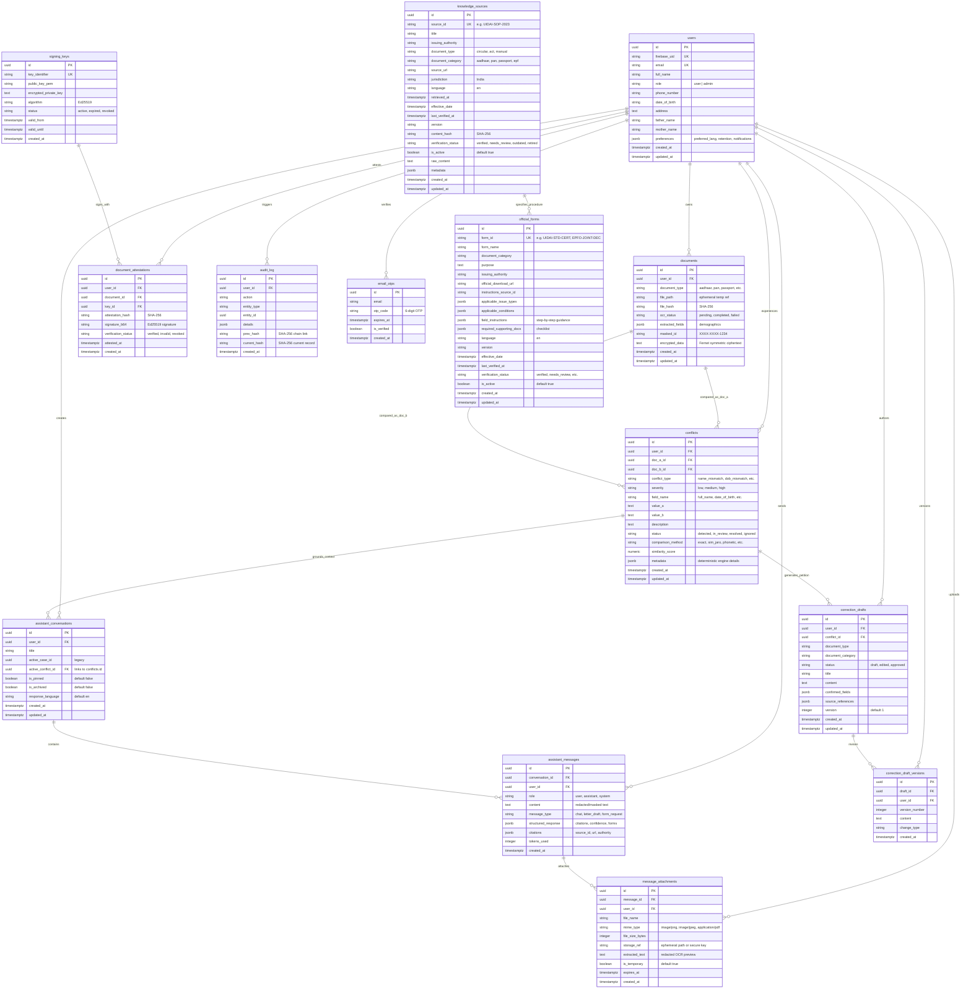

# CONVELINA — Database Architecture & Entity Relationship Specification
## PostgreSQL 16 Alpine • Kernel Forced Row-Level Security • Unprivileged Role Isolation

**Document Version:** 3.0.0  
**Status:** Approved Database Architecture  
**Database Engine:** PostgreSQL 16.4 Alpine  
**Runtime Role:** `consolith_app` (Non-Superuser, `rolsuper = false`)  
**Security Enforcement:** `FORCE ROW LEVEL SECURITY` on all user-data tables  

---

## 1. Entity Relationship Diagram (ERD)

The complete data model comprises 14 primary entities. Notice that `assistant_conversations` already directly references `conflicts.id` through `active_conflict_id`, and `correction_drafts` links to both `conflicts.id` and `users.id`. The new proposed `message_attachments` table links directly to `assistant_messages.id` and `users.id` under citizen RLS scoping.



---

## 2. Table-by-Table Schema Specifications

### 2.1 `assistant_conversations`
Stores high-level citizen dialogue threads. Directly links to `conflicts.id` when initiated from a discrepancy card.

| Column | Type | Constraints | Description |
| :--- | :--- | :--- | :--- |
| `id` | `UUID` | `PRIMARY KEY, DEFAULT gen_random_uuid()` | Unique thread identifier |
| `user_id` | `UUID` | `NOT NULL, REFERENCES users(id) ON DELETE CASCADE` | Thread owner (Citizen) |
| `title` | `VARCHAR(255)` | `NOT NULL, DEFAULT 'New Conversation'` | Human-readable title |
| `active_case_id` | `UUID` | `NULLABLE` | Legacy case pointer (deprecated) |
| `active_conflict_id` | `UUID` | `NULLABLE, REFERENCES conflicts(id) ON DELETE SET NULL` | Linked conflict for grounded resolution |
| `is_pinned` | `BOOLEAN` | `NOT NULL, DEFAULT FALSE` | Pinned to top of sidebar |
| `is_archived` | `BOOLEAN` | `NOT NULL, DEFAULT FALSE` | Archived conversation flag |
| `response_language`| `VARCHAR(10)` | `NOT NULL, DEFAULT 'en'` | Citizen's selected reply language |
| `created_at` | `TIMESTAMPTZ` | `NOT NULL, DEFAULT NOW()` | Creation timestamp |
| `updated_at` | `TIMESTAMPTZ` | `NOT NULL, DEFAULT NOW()` | Last message timestamp |

**Indexes**:
* `idx_assistant_conv_user (user_id)`
* `idx_assistant_conv_conflict (active_conflict_id)`
* `idx_assistant_conv_updated (user_id, updated_at DESC)`

---

### 2.2 `assistant_messages`
Stores individual conversation turns. Every user message is guaranteed pre-persistence redacted (raw 12-digit Aadhaar and sensitive numbers replaced with masked equivalents).

| Column | Type | Constraints | Description |
| :--- | :--- | :--- | :--- |
| `id` | `UUID` | `PRIMARY KEY, DEFAULT gen_random_uuid()` | Unique message identifier |
| `conversation_id` | `UUID` | `NOT NULL, REFERENCES assistant_conversations(id) ON DELETE CASCADE` | Parent conversation thread |
| `user_id` | `UUID` | `NOT NULL, REFERENCES users(id) ON DELETE CASCADE` | Citizen owner (matches conversation owner) |
| `role` | `VARCHAR(20)` | `NOT NULL` | `'user'`, `'assistant'`, or `'system'` |
| `content` | `TEXT` | `NOT NULL` | Redacted text content (never raw PII) |
| `message_type` | `VARCHAR(30)` | `NOT NULL, DEFAULT 'chat'` | `'chat'`, `'letter_draft'`, `'form_request'`, `'image_analysis'` |
| `structured_response` | `JSONB` | `NOT NULL, DEFAULT '{}'::jsonb` | Parsed Layer A/B/C, provider status, confidence |
| `citations` | `JSONB` | `NOT NULL, DEFAULT '[]'::jsonb` | Validated official citations (`source_id`, `url`, `title`) |
| `tokens_used` | `INT` | `NOT NULL, DEFAULT 0` | LLM token usage tracking |
| `created_at` | `TIMESTAMPTZ` | `NOT NULL, DEFAULT NOW()` | Message delivery timestamp |

**Indexes**:
* `idx_assistant_msg_conv (conversation_id)`
* `idx_assistant_msg_user (user_id)`
* `idx_assistant_msg_created (conversation_id, created_at ASC)`

---

### 2.3 Proposed New Table: `message_attachments`
Enables user uploads and screenshot pastes inside the conversation without storing raw identity cards permanently.

| Column | Type | Constraints | Description |
| :--- | :--- | :--- | :--- |
| `id` | `UUID` | `PRIMARY KEY, DEFAULT gen_random_uuid()` | Unique attachment identifier |
| `message_id` | `UUID` | `NOT NULL, REFERENCES assistant_messages(id) ON DELETE CASCADE` | Associated chat turn |
| `user_id` | `UUID` | `NOT NULL, REFERENCES users(id) ON DELETE CASCADE` | Owner for forced RLS |
| `file_name` | `VARCHAR(255)` | `NOT NULL` | Sanitized upload filename |
| `mime_type` | `VARCHAR(100)` | `NOT NULL` | `image/png`, `image/jpeg`, `application/pdf` |
| `file_size_bytes`| `INT` | `NOT NULL` | File size (bounded $\le 10$ MB) |
| `storage_ref` | `VARCHAR(512)`| `NOT NULL` | Secure encrypted ephemeral path |
| `extracted_text` | `TEXT` | `NULLABLE` | Redacted text extracted via OCR |
| `is_temporary` | `BOOLEAN` | `NOT NULL, DEFAULT TRUE` | Automatically eligible for cleanup |
| `expires_at` | `TIMESTAMPTZ` | `NOT NULL` | Purge timestamp (default $NOW() + 24\text{ hours}$) |
| `created_at` | `TIMESTAMPTZ` | `NOT NULL, DEFAULT NOW()` | Ingestion timestamp |

---

### 2.4 `official_forms`
Authoritative government correction and update forms catalog.

| Column | Type | Constraints | Description |
| :--- | :--- | :--- | :--- |
| `id` | `UUID` | `PRIMARY KEY, DEFAULT gen_random_uuid()` | Unique record identifier |
| `form_id` | `VARCHAR(100)` | `UNIQUE, NOT NULL` | Standard statutory code (`UIDAI-STD-CERT`, `EPFO-JOINT-DEC`) |
| `form_name` | `VARCHAR(255)` | `NOT NULL` | Formal statutory name |
| `document_category`| `VARCHAR(50)` | `NOT NULL` | `aadhaar`, `pan`, `passport`, `epf`, `education` |
| `purpose` | `TEXT` | `NOT NULL` | Plain-language description of what this form resolves |
| `issuing_authority`| `VARCHAR(150)`| `NOT NULL` | UIDAI, ITD, MEA, EPFO, CBSE |
| `official_download_url` | `VARCHAR(512)` | `NOT NULL` | Authentic government portal URL |
| `instructions_source_id` | `VARCHAR(100)` | `NULLABLE` | Cross-reference to `knowledge_sources.source_id` |
| `applicable_issue_types` | `JSONB` | `NOT NULL, DEFAULT '[]'::jsonb` | Array of issue types (`full_name`, `dob`, `gender`, `address`) |
| `applicable_conditions` | `JSONB` | `NOT NULL, DEFAULT '[]'::jsonb` | Conditions when this form is strictly required |
| `field_instructions` | `JSONB` | `NOT NULL, DEFAULT '{}'::jsonb` | Step-by-step section-by-section filling instructions |
| `required_supporting_docs` | `JSONB` | `NOT NULL, DEFAULT '[]'::jsonb` | Verified mandatory enclosures checklist |
| `language` | `VARCHAR(10)` | `NOT NULL, DEFAULT 'en'` | Form language |
| `version` | `VARCHAR(30)` | `NULLABLE` | Revision code / Gazette circular version |
| `verification_status` | `VARCHAR(20)` | `NOT NULL, DEFAULT 'verified'` | `verified`, `needs_review`, `outdated`, `retired` |
| `is_active` | `BOOLEAN` | `NOT NULL, DEFAULT TRUE` | Active visibility flag |
| `last_verified_at` | `TIMESTAMPTZ` | `NOT NULL, DEFAULT NOW()` | Date of last admin verification check |

---

## 3. Kernel Row-Level Security (RLS) Policy Matrix

All user tables have `ENABLE ROW LEVEL SECURITY` and `FORCE ROW LEVEL SECURITY`. Every database connection runs as non-superuser `consolith_app`.

```sql
-- Security Policy Architecture for Assistant Conversations & Messages

-- 1. Assistant Conversations: Citizens can access only their own rows
CREATE POLICY p_conv_citizen ON assistant_conversations
    FOR ALL TO consolith_app
    USING (user_id = current_app_user_id())
    WITH CHECK (user_id = current_app_user_id());

CREATE POLICY p_conv_admin ON assistant_conversations
    FOR ALL TO consolith_app
    USING (current_app_user_role() = 'admin')
    WITH CHECK (current_app_user_role() = 'admin');

-- 2. Assistant Messages: Strict ownership scoping
CREATE POLICY p_msg_citizen ON assistant_messages
    FOR ALL TO consolith_app
    USING (user_id = current_app_user_id())
    WITH CHECK (user_id = current_app_user_id());

CREATE POLICY p_msg_admin ON assistant_messages
    FOR ALL TO consolith_app
    USING (current_app_user_role() = 'admin')
    WITH CHECK (current_app_user_role() = 'admin');

-- 3. Message Attachments: Scoped to user_id
CREATE POLICY p_att_citizen ON message_attachments
    FOR ALL TO consolith_app
    USING (user_id = current_app_user_id())
    WITH CHECK (user_id = current_app_user_id());

CREATE POLICY p_att_admin ON message_attachments
    FOR ALL TO consolith_app
    USING (current_app_user_role() = 'admin')
    WITH CHECK (current_app_user_role() = 'admin');

-- 4. Knowledge Sources & Official Forms: Read-only for citizens, full access for admin
CREATE POLICY p_knowledge_read ON knowledge_sources
    FOR SELECT TO consolith_app
    USING (is_active = TRUE OR current_app_user_role() = 'admin');

CREATE POLICY p_knowledge_admin_modify ON knowledge_sources
    FOR ALL TO consolith_app
    USING (current_app_user_role() = 'admin')
    WITH CHECK (current_app_user_role() = 'admin');

CREATE POLICY p_forms_read ON official_forms
    FOR SELECT TO consolith_app
    USING (is_active = TRUE OR current_app_user_role() = 'admin');

CREATE POLICY p_forms_admin_modify ON official_forms
    FOR ALL TO consolith_app
    USING (current_app_user_role() = 'admin')
    WITH CHECK (current_app_user_role() = 'admin');
```

---

## 4. Connection Pooling Trap Defense

To guarantee that connection poolers (PgBouncer, AWS RDS Proxy, or SQLAlchemy pooling) never fail on empty session strings, the session context helper uses `NULLIF`:

```sql
CREATE OR REPLACE FUNCTION current_app_user_id()
RETURNS UUID AS $$
BEGIN
    RETURN NULLIF(current_setting('app.current_user_id', true), '')::uuid;
EXCEPTION WHEN OTHERS THEN
    RETURN NULL;
END;
$$ LANGUAGE plpgsql STABLE;

CREATE OR REPLACE FUNCTION current_app_user_role()
RETURNS VARCHAR AS $$
BEGIN
    RETURN NULLIF(current_setting('app.current_user_role', true), '');
EXCEPTION WHEN OTHERS THEN
    RETURN 'anon';
END;
$$ LANGUAGE plpgsql STABLE;
```

---

## 5. Tamper-Evident Immutability & Audit Triggers

The `audit_log` table enforces cryptographic append-only integrity via a database trigger that rejects any `UPDATE` or `DELETE` attempt:

```sql
CREATE OR REPLACE FUNCTION trg_audit_log_immutable()
RETURNS TRIGGER AS $$
BEGIN
    RAISE EXCEPTION 'TAMPER-EVIDENT ERROR: Modifications or deletions to the audit_log table are cryptographically forbidden by law.';
END;
$$ LANGUAGE plpgsql;

DROP TRIGGER IF EXISTS trg_audit_log_no_tamper ON audit_log;
CREATE TRIGGER trg_audit_log_no_tamper
BEFORE UPDATE OR DELETE ON audit_log
FOR EACH ROW EXECUTE FUNCTION trg_audit_log_immutable();
```

Each audit entry computes its SHA-256 hash chaining back to the previous entry:
$$\text{Current Hash} = \text{SHA256}(\text{prev\_hash} \,\|\, \text{action} \,\|\, \text{entity\_type} \,\|\, \text{entity\_id} \,\|\, \text{details} \,\|\, \text{created\_at})$$

