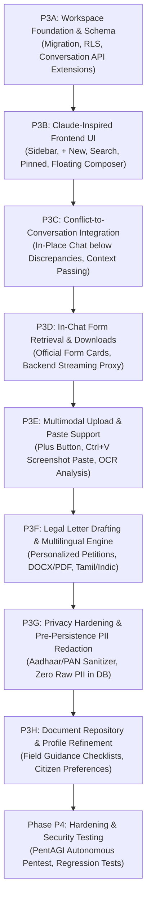

# CONVELINA — Phase P3 Master Implementation Roadmap
## Conversational AI Workspace • Contextual Conflict Integration • Privacy & Form Retrieval

**Document Version:** 3.0.0  
**Phase:** Phase P3 (Conversational AI Workspace Expansion)  
**Execution Mode:** Incremental Step-by-Step Delivery with Verified Acceptance Gates  
**Prerequisites:** Phase P0 (Matcher), P1 (Comparison), P2A (Context), P2B (Mapping), P2C (Gemini Grounding) Verified & Passing  

---

## 1. Master Phase P3 Sub-Phases & Dependency Graph

Phase P3 is decomposed into 8 tightly scoped sub-phases (P3A through P3H) to ensure zero regression of existing verified suites while delivering the complete conversational intelligence platform:

---

## 2. Detailed Sub-Phase Specifications & Acceptance Criteria

### Sub-Phase P3A: Conversational Workspace Foundation
* **Scope**:
  * Execute database migration adding `is_pinned` (BOOLEAN), `is_archived` (BOOLEAN), and `response_language` (VARCHAR) to `assistant_conversations`.
  * Create `message_attachments` table with forced RLS and foreign keys to `assistant_messages` and `users`.
  * Extend FastAPI assistant router with `PATCH /api/v1/assistant/conversations/{id}` (rename, pin/unpin) and `GET /api/v1/assistant/conversations/search?q=...`.
* **Acceptance Gate**:
  * Pytest validates conversation pinning, archiving, and search under cross-user RLS isolation.
  * 0 migration errors against PostgreSQL 16 Alpine container.

---

### Sub-Phase P3B: Claude-Inspired Frontend Assistant UI
* **Scope**:
  * Refactor `AssistantWorkspace.tsx` to match the 3 reference screenshots:
    * Left collapsible sidebar with Brand, `+ New Inquiry` (`Ctrl+N`), Search input, Pinned list, chronological chats, and profile card.
    * Warm editorial welcome canvas (`Afternoon, [User]`) with brand mark and sample prompts.
    * Centered floating message composer pill with auto-expand, plus button, language picker, dictation icon, and live model badge.
* **Acceptance Gate**:
  * Desktop and mobile layouts render without horizontal overflow or UI clipping.
  * `Ctrl+N` triggers clean new conversation reset.
  * Next.js production build passes with 0 TypeScript errors.

---

### Sub-Phase P3C: Conflict-to-Conversation Integration
* **Scope**:
  * In `frontend/src/app/app/inconsistencies/page.tsx`, embed an interactive follow-up chat box directly below each detected discrepancy card.
  * Clicking "Ask Follow-Up" on a discrepancy auto-initiates a conversation bound to `conflict_id` without navigating the user away.
  * Backend reconstructs authorized resolution context server-side, passing field name, compared values, and deterministic classification into prompt.
* **Acceptance Gate**:
  * Follow-up chat answers discrepancy questions accurately in-place.
  * Returning to `/app/assistant` displays the linked conversation with badge showing the originating conflict.

---

### Sub-Phase P3D: In-Chat Official Form Retrieval & Downloads
* **Scope**:
  * When assistant responses recommend an official form, render an interactive `OfficialFormCard` inside the message thread.
  * Display form code, formal name, issuing authority, purpose, and verification badge.
  * Implement `GET /api/v1/knowledge/forms/{id}/download` in FastAPI streaming authorized binary PDF/DOCX files directly from repository storage.
* **Acceptance Gate**:
  * In-chat download button successfully triggers browser download of verified PDF without exposing raw file bucket paths.

---

### Sub-Phase P3E: Multimodal Uploads & Clipboard Screenshot Paste
* **Scope**:
  * Implement `+` attachment button supporting PDF and image picker.
  * Add `window.addEventListener("paste")` handling clipboard images (`Ctrl+V`).
  * Backend processes temporary attachments through OCR, extracts textual errors/receipts, and includes findings in conversational context.
* **Acceptance Gate**:
  * Pasting a screenshot into composer stages a thumbnail chip.
  * Submitting prompt analyzes screenshot contents and answers user inquiry.

---

### Sub-Phase P3F: Personalized Legal Letter Drafting & Multilingual Engine
* **Scope**:
  * Implement `POST /api/v1/assistant/letter-draft` producing formal representations addressed to specific authorities (RPO, EPFO, ITD, UIDAI) using citizen facts and statutory rules.
  * Provide in-chat Letter Preview Card with Copy to Clipboard and DOCX/PDF export triggers via `DocumentExporter`.
  * Wire composer language dropdown (`🌐 Language: English, Tamil, Hindi, etc.`) passing target language to Gemini, ensuring form IDs and statutory citations remain intact.
* **Acceptance Gate**:
  * Letter generator produces formal non-generic letters.
  * Exporter downloads valid DOCX/PDF representations.
  * Responses in Tamil, Hindi, and other languages preserve exact form codes.

---

### Sub-Phase P3G: Privacy Hardening & Pre-Persistence PII Redaction
* **Scope**:
  * Implement `PIISanitizer` interceptor in `RAGOrchestrator`.
  * Detect 12-digit Aadhaar numbers, PANs, and phone numbers in user input and replace with masked equivalents (`XXXX-XXXX-1234`) before database insertion.
  * Add log scrubbing filter preventing confidential strings from writing to stdout.
* **Acceptance Gate**:
  * Typing `My Aadhaar is 2345 6789 0123` persists as `XXXX-XXXX-0123` in `assistant_messages.content`.
  * Zero raw 12-digit Aadhaar numbers in database or logs.

---

### Sub-Phase P3H: Document Repository & Citizen Profile Polish
* **Scope**:
  * Enhance `/app/forms` catalog with step-by-step field filling instructions and supporting proofs checklists.
  * Polish `/app/profile` to support citizen preferences (preferred language, notifications, data retention policy, export personal data, account deletion).
* **Acceptance Gate**:
  * Forms repository displays clear, actionable field instructions for all 8 official forms.
  * Citizen preferences update and persist cleanly under RLS.

---

## 3. Phase P4: Security Testing & PentAGI Autonomous Pentest Gate

Following completion of Phase P3, the system transitions to **Phase P4 (Security Hardening & Penetration Testing)**:
1. **Automated Unit & Integration Test Suite**: Pytest suite elevated across all new routers and models.
2. **Playwright E2E Automation**: Real browser journeys testing Upload $\rightarrow$ OCR $\rightarrow$ Conflicts $\rightarrow$ Follow-up Chat $\rightarrow$ Form Download $\rightarrow$ Letter Export $\rightarrow$ Profile Management.
3. **PentAGI Autonomous Penetration Testing**:
   * Deploy PentAGI (`vxcontrol/pentagi`) in an isolated test environment.
   * Run automated security audits against `api.convelina.com` targeting OWASP Top 10 API vulnerabilities (BOLA/IDOR, broken authentication, mass assignment, injection, SSRF, PII data leakage).
   * Remediate all high and critical findings prior to staging gate.

---

## 4. Prioritized Execution Next Step

> [!IMPORTANT]
> Per your instructions, **no application code or migrations have been modified yet.**
> Upon your review and approval of these architecture blueprints:
> * We will immediately proceed with **Sub-Phase P3A (Conversational Workspace Foundation: Database Migrations, RLS Scoping & API Extensions)**.

