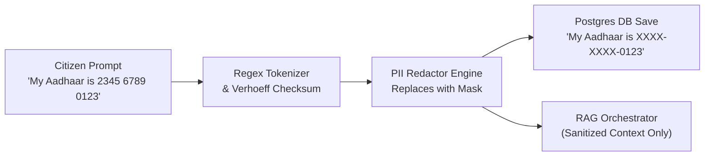

# CONVELINA — Privacy Architecture & Data Protection Specification
## Aadhaar Act (Section 29) Compliance • Pre-Persistence Redaction • Zero-Retention Ephemeral Storage

**Document Version:** 3.0.0  
**Status:** Approved Security Architecture  
**Statutory Foundation:** The Aadhaar (Targeted Delivery of Financial and Other Subsidies, Benefits and Services) Act, 2016 (Section 29) • Information Technology Act, 2000 (Section 43A) • Digital Personal Data Protection Act (DPDPA), 2023  

---

## 1. Threat Modeling & Data Leakage Vectors

A comprehensive audit of the CONVELINA system identified 8 sensitive data leakage vectors that could compromise citizen identity confidentiality if unmanaged:

```
┌────────────────────────────────────────────────────────────────────────────────────────┐
│                        DATA LEAKAGE VECTOR AUDIT MATRIX                                │
├────┬─────────────────────────────┬──────────────────────────┬─────────────────────────┤
│ #  │ Leakage Vector              │ Risk Description         │ Mitigation Mechanism    │
├────┼─────────────────────────────┼──────────────────────────┼─────────────────────────┤
│ 1  │ Chat Message History        │ Citizen types 12-digit   │ Pre-Persistence Redact- │
│    │ (`assistant_messages`)      │ Aadhaar/PAN into prompt  │ ion Interceptor         │
├────┼─────────────────────────────┼──────────────────────────┼─────────────────────────┤
│ 2  │ Ephemeral OCR Temporary Disk│ PDF/Image uploads leave  │ In-memory processing &  │
│    │ Storage (`/tmp`)            │ residual unlinked blocks │ immediate unlink in     │
│    │                             │ on host storage          │ finally: block          │
├────┼─────────────────────────────┼──────────────────────────┼─────────────────────────┤
│ 3  │ External LLM API Egress     │ Sending raw identity     │ Minimal Case Context;   │
│    │ (Google Gemini Egress)      │ cards or unmasked IDs to │ zero biometric/raw data │
│    │                             │ third-party cloud API    │ egress                  │
├────┼─────────────────────────────┼──────────────────────────┼─────────────────────────┤
│ 4  │ Application & Access Logs   │ Loggers printing raw     │ Log Scrubbing Filter    │
│    │ (stdout / stderr)           │ query bodies or payloads │ masking 12-digit sequences│
├────┼─────────────────────────────┼──────────────────────────┼─────────────────────────┤
│ 5  │ Vector Search Database      │ Indexing private citizen │ Qdrant stores ONLY pub- │
│    │ (Qdrant Collections)        │ documents into search    │ lic government circulars│
│    │                             │ embeddings               │ and statutory forms     │
├────┼─────────────────────────────┼──────────────────────────┼─────────────────────────┤
│ 6  │ Generated Artifacts (DOCX)  │ Temporary generated      │ In-memory streaming via │
│    │ File Exporters              │ letters stored on disk   │ io.BytesIO buffers      │
├────┼─────────────────────────────┼──────────────────────────┼─────────────────────────┤
│ 7  │ PostgreSQL Database Backups │ Backups containing      │ Fernet encryption at    │
│    │ and Replication Streams     │ plain-text demographic   │ rest for OCR text;      │
│    │                             │ fields                   │ restricted chmod 600    │
├────┼─────────────────────────────┼──────────────────────────┼─────────────────────────┤
│ 8  │ Sentry / Error Diagnostics  │ Exception tracebacks     │ PII scrubber sanitizing │
│    │                             │ capturing local vars     │ stack trace frames      │
└────┴─────────────────────────────┴──────────────────────────┴─────────────────────────┘
```

---

## 2. Pre-Persistence PII Redaction & Masking Interceptor

### 2.1 The Redaction Interceptor Workflow
When a citizen enters a query in the assistant composer, the raw string passes through the `PIISanitizer` before reaching the database persistence layer or prompt formatting:



### 2.2 Redaction Rules Matrix

| Identifier Type | Detection Method | Masking Format | Example Input | Example Output |
| :--- | :--- | :--- | :--- | :--- |
| **Aadhaar Number** | 12 consecutive digits (with or without spaces/hyphens) validated via Verhoeff algorithm | `XXXX-XXXX-NNNN` (Mask first 8, retain last 4) | `2345 6789 0123` | `XXXX-XXXX-0123` |
| **PAN Number** | 10 alphanumeric `[A-Z]{5}[0-9]{4}[A-Z]{1}` | `XXXXXNNNNX` (Mask first 5, retain last 5) | `ABCDE1234F` | `XXXXX1234F` |
| **Passport Number** | 8 alphanumeric `[A-Z]{1}[0-9]{7}` | `XNNNNNNX` (Mask first/last, retain middle) | `Z1234567` | `X123456X` |
| **Mobile Number** | 10 digits starting with 6, 7, 8, or 9 (with or without `+91`) | `XXXXXXNNNN` (Mask first 6, retain last 4) | `+91 9876543210` | `XXXXXX3210` |
| **Email Address** | Standard RFC-5322 regex | `u***r@domain.com` | `ajay.kumar@gmail.com`| `a***r@gmail.com` |

> [!IMPORTANT]
> **Database Invariant**: The database column `assistant_messages.content` NEVER stores raw 12-digit Aadhaar numbers. Masking is enforced server-side before calling `db.add(user_msg)`.

---

## 3. Ephemeral Upload & OCR Lifecycle

In strict compliance with the **Aadhaar Act (2016) Section 29**:
* *“No core biometric or identity information collected or created under this Act shall be published, displayed, or posted publicly or stored permanently without explicit statutory mandate.”*

### 3.1 The 4-Stage Ephemeral Pipeline
1. **Bounded Ingress**: Incoming file uploads are streamed in 1 MB chunks up to a hard cap of 10 MB. Magic byte validation verifies headers (`%PDF-`, `\x89PNG`, `\xFF\xD8\xFF`).
2. **Ephemeral Disk Ingestion**: File bytes are saved to a temporary RAM-backed directory (`/tmp/convelina_uploads/` with permissions `0700`).
3. **In-Memory OCR & Parsing**: Tesseract extracts plain text into memory. Structured demographic attributes (`full_name`, `date_of_birth`, `gender`, `father_name`) are parsed, and the identifier is masked.
4. **Immediate Deletion in `finally:` Block**:
   ```python
   try:
       raw_text = default_ocr_engine.extract_text(temp_file_path)
       extracted_fields = parser.parse(raw_text)
   finally:
       if settings.STORAGE_RETENTION_POLICY == "delete_after_ocr":
           if os.path.exists(temp_file_path):
               os.unlink(temp_file_path)  # File unlinked immediately!
   ```

### 3.2 Qdrant Vector Isolation
* The vector database (Qdrant) is strictly dedicated to **public, authoritative government circulars, Gazette guidelines, and official forms**.
* **Zero Citizen Data in Vector Store**: Uploaded citizen documents, OCR transcripts, and user conversation messages are **never vectorized or indexed into Qdrant**. Vector embeddings are strictly domain-statutory.

---

## 4. Third-Party AI (Google Gemini) Egress Controls & Transparency

Because Google Gemini is a cloud-hosted LLM service, CONVELINA implements explicit egress boundaries:

1. **What is Sent to Google Gemini**:
   * Masked citizen discrepancy attributes: `{"field": "full_name", "doc_a": "Ajay M", "doc_b": "Ajay Kumar"}`.
   * Deterministic matching classification: `INITIAL_AMBIGUITY`.
   * Verified retrieved statutory circular text chunks from Qdrant.
   * Citizen follow-up question text with PII masked.
2. **What is NEVER Sent to Google Gemini**:
   * Raw document images or scanned PDFs.
   * Unmasked 12-digit Aadhaar numbers or full biometric data.
   * Passwords, session tokens, or internal database keys.
   * Other citizens' case records.
3. **Citizen Transparency Notice**:
   * The user interface clearly notifies citizens:
     > *"CONVELINA uses Google Gemini API to explain verified statutory procedures. All queries are pre-sanitized and confidential identity numbers are masked prior to transmission."*

---

## 5. Citizen Privacy Rights & Data Erasure Protocols

In compliance with the Digital Personal Data Protection Act (DPDPA), 2023:

* **Right to View Activity (`GET /api/v1/auth/activity`)**: Citizens can inspect an immutable chronological audit trail of all access, logins, uploads, and profile changes.
* **Right to Delete Conversations (`DELETE /api/v1/assistant/conversations/{id}`)**: Deletes conversation threads, all associated messages, and temporary chat attachments under forced RLS.
* **Right to Full Account Erasure (`DELETE /api/v1/auth/account`)**:
  * Deletes user record in `users` table.
  * Triggers database cascading deletions across `documents`, `conflicts`, `assistant_conversations`, `assistant_messages`, and `correction_drafts`.
  * Logs a final, irreversible audit tombstone in `audit_log` with user ID set to `NULL` (`ON DELETE SET NULL`) while recording that the citizen requested full erasure.

