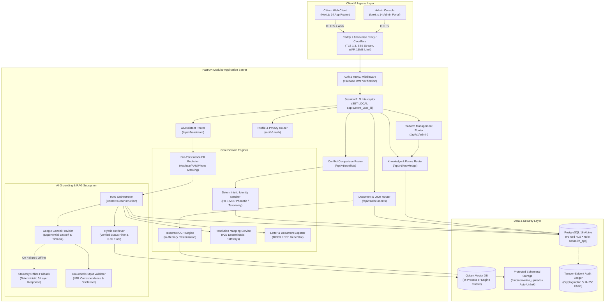
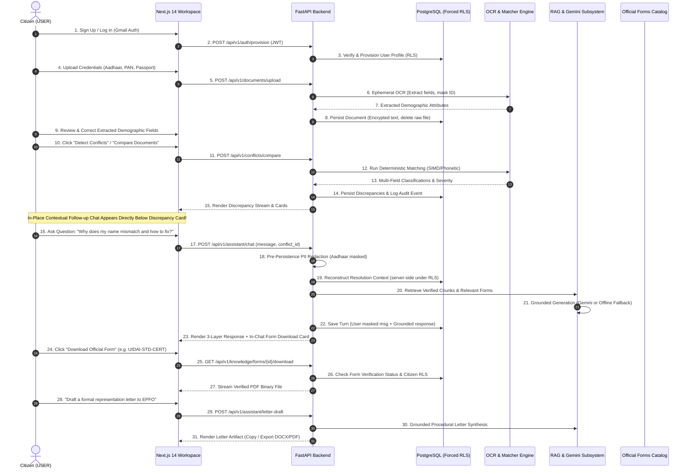

# CONVELINA — Master Product Architecture Specification
## Identity Document Intelligence, Conflict Resolution & Conversational Assistance Platform

**Document Version:** 3.0.0  
**Status:** Approved Architecture Specification  
**Classification:** Internal System Architecture  
**Active Roles:** USER (Citizen) and ADMIN (System Administrator) Only  

---

## 1. Executive Summary & Product Vision

**CONVELINA** (*Connect. Manage. Evolve.*) is an enterprise-grade, privacy-first identity document intelligence and discrepancy resolution platform. Designed to eliminate administrative bottlenecks, bureaucratic deadlocks, and identity mismatch rejections across Indian statutory bodies (UIDAI, Income Tax Department, Ministry of External Affairs, EPFO, and State Education Boards), CONVELINA bridges deterministic verification algorithms with evidence-grounded Large Language Model (LLM) reasoning and Retrieval-Augmented Generation (RAG).

The platform transforms raw citizen documents into actionable legal and administrative pathways:
1. **Document Ingestion & Ephemeral OCR**: In-memory parsing of Aadhaar, PAN, Passport, Class 10/12 marksheets, and EPFO records with immediate image unlinking per Section 29 of the Aadhaar Act (2016).
2. **Deterministic Conflict Detection**: Non-LLM, mathematical, phonetic, and taxonomy-driven identity matching (RapidFuzz, Jellyfish, Verhoeff, Indic-script transliteration, gender-pairing defense, and abbreviation expansion) that serves as the absolute ground truth.
3. **Conversational Resolution Workspace**: A modern, minimal, Claude-inspired conversational assistant where citizens interact with their verified discrepancy findings, ask follow-up questions, retrieve authentic official government forms directly within the chat stream, draft personalized formal legal representations, and receive multilingual explanations.
4. **Permanent Statutory Repository**: An authoritative catalog of official government forms, circulars, Gazette formats, and step-by-step submission checklists.
5. **Zero-Trust Privacy & Kernel RLS**: Forced Row-Level Security on PostgreSQL 16 Alpine, unprivileged application roles, pre-persistence PII masking, cryptographic append-only audit chaining, and Ed25519 PKI attestation.

---

## 2. Strict Architectural Invariants

The following invariants are absolute and govern every subsystem within CONVELINA:

```
┌───────────────────────────────────────────────────────────────────────────────────────┐
│                                NON-NEGOTIABLE INVARIANTS                              │
├───────────────────────────────────────────────────────────────────────────────────────┤
│ 1. TWO ROLES ONLY: Exactly two system roles exist: USER and ADMIN. No officer role.   │
│ 2. MODULAR MONOLITH: Single unified FastAPI backend + Next.js 14 App Router frontend.  │
│    Zero premature microservices, zero Kafka, zero Redis, zero Kubernetes.             │
│ 3. DETERMINISTIC SUPREMACY: The LLM NEVER decides if identity documents match or      │
│    which document is legally superior. Deterministic matching is the sole truth.      │
│ 4. STATUTORY DISCLAIMER: Every AI output must carry:                                  │
│    "AUTOMATED COMPARISON RESULT • NOT OFFICIAL GOVERNMENT VERIFICATION"               │
│ 5. FORCED RLS: PostgreSQL forced Row-Level Security on all user tables via unprivi-  │
│    leged role 'consolith_app'. Session setting NULLIF(..., '')::uuid avoids pooling trap│
│ 6. ZERO RAW PII RETENTION: No long-term storage of raw identity images. User chats     │
│    must have 12-digit Aadhaar and sensitive numbers masked before database insertion. │
│ 7. APPEND-ONLY AUDIT: Audit log rows are cryptographically hashed (SHA-256) and cannot│
│    be updated or deleted by database triggers.                                        │
└───────────────────────────────────────────────────────────────────────────────────────┘
```

---

## 3. High-Level Master Architecture Diagram



---

## 4. Complete End-to-End Citizen Journey



---

## 5. Subsystem Component Responsibilities

### 5.1 Presentation Tier (Next.js 14 App Router)
* **Design Philosophy**: Minimal, distraction-free, light-mode editorial design inspired by Claude's interface patterns (warm neutral `#FAF9F6`, clean hairline borders `#E7E5E0`, crisp high-contrast typography `#111111`, zero neon gradients or noisy cards).
* **Workspace Navigation (`/app`)**:
  * Collapsible left sidebar containing Brand, `+ New` button with `Ctrl+N`, Search conversation input, quick links to Forms Repository (`/app/forms`) and Discrepancies (`/app/inconsistencies`), Pinned conversations, scrollable chronological chat history, and bottom user profile card.
* **Floating Message Composer**:
  * Rounded pill-shaped composer with auto-expanding textarea.
  * Attachment action (`+`) supporting PDF, PNG, JPG, and JPEG.
  * Native clipboard listener for `Ctrl+V` screenshot pasting.
  * Language selector (`🌐 Language`) supporting English, Tamil, Hindi, Telugu, Kannada, Malayalam, Bengali, and Marathi.
  * Real-time engine badge indicating operational mode (`AI Grounded (Gemini) • Verified RAG` vs `Offline Statutory Mode`).
* **In-Chat Interactive Artifacts**:
  * Downloadable Official Form Cards with verified download trigger and field instructions preview.
  * Statutory Citation Accordion displaying official government portal links.
  * Legal Letter Draft Cards with inline editing, clipboard copy, and DOCX/PDF export triggers.
* **In-Place Follow-up Chat**:
  * Embedded below discrepancy items in `/app/inconsistencies`, eliminating context-switching friction.

### 5.2 Application & Business Logic Tier (FastAPI)
* **Modular Structure**: Organized into dedicated domain routers (`assistant`, `conflicts`, `documents`, `knowledge`, `auth`, `admin`).
* **Authentication & Authorization**:
  * Two-role RBAC (`user` and `admin`).
  * Server-side token verification (RS256, signature, expiry, audience).
  * Role resolved strictly from the database to prevent client claim spoofing.
* **Deterministic Matching Engine (P0 & P1)**:
  * Strict separation: Runs purely on SIMD string metrics, Verhoeff checksums, phonetic algorithms, and taxonomy mappings.
  * Operates completely independent of the LLM.
* **Resolution Mapping Service (P2B)**:
  * Maps discrepancy fields and document pairings directly into verified statutory procedures, prescribed forms, document checklists, and authorities.
* **Pre-Persistence PII Redactor**:
  * Sanitizes messages prior to database insertion. Masks 12-digit Aadhaar numbers, PANs, passports, and contact numbers.
* **Letter & Representation Generator**:
  * Synthesizes formal legal petitions using authenticated case facts and statutory provisions without hallucination.

### 5.3 Knowledge Retrieval & AI Tier (RAG & Gemini)
* **In-Process Qdrant Vector Store**:
  * Lightweight, persistent or in-memory vector database containing chunked official guidelines and forms.
  * Zero remote dormancy pause risks; instant cold start (< 200ms).
* **Hybrid Retriever**:
  * Enforces strict `verification_status == "verified"` and `is_active is True`.
  * Enforces relevance score floor ($\ge 0.55$). Below this floor, the assistant abstains (`confidence="insufficient_evidence"`).
* **Google Gemini Provider (P2C)**:
  * Integration with exponential backoff, configurable timeout (15s), retry limits (2 retries), and instant fallback on auth failure.
* **Statutory Offline Fallback**:
  * Returns a structured 3-layer deterministic guidance response when Gemini is disabled, rate-limited, or unconfigured.
* **Grounded Output Validator**:
  * Validates every citation against legitimate retrieved chunks, restores authentic government URLs, strips hallucinated references, and appends the mandatory statutory disclaimer.

### 5.4 Data, Security & Persistence Tier (PostgreSQL 16 Alpine)
* **Row-Level Security (RLS)**:
  * Forced on all application tables holding user data.
  * Runtime execution under unprivileged role `consolith_app`.
  * Safe session variable casting: `NULLIF(current_setting('app.current_user_id', true), '')::uuid`.
* **Cryptographic Tamper-Evident Audit Ledger**:
  * PostgreSQL triggers prevent any `UPDATE` or `DELETE` on `audit_log`.
  * SHA-256 cryptographic linkage from previous record hash to current hash.
* **Fernet Encryption at Rest**:
  * Sensitive raw OCR extracted strings encrypted using symmetric keys.
* **Ed25519 PKI Attestation**:
  * Digital signature of verification outcomes with key rotation logs.

---

## 6. Tier 1 Document Category Scope

CONVELINA strictly bounds its operational scope to six Tier 1 identity credentials:

| Document Type | Issuing Authority | Primary Attributes Compared | Official Formats Handled |
| :--- | :--- | :--- | :--- |
| **Aadhaar Card** | Unique Identification Authority of India (UIDAI) | Full Name, DOB, Gender, Care-Of / Father's Name, Address, Masked UID (last 4) | e-Aadhaar PDF, Physical Card Scan, mAadhaar |
| **PAN Card** | Income Tax Department / NSDL / UTIITSL | Full Name, Father's Name, DOB, PAN (10-char alphanum) | Form 49A, e-PAN, Physical Card Scan |
| **Passport** | Ministry of External Affairs (CPV / RPO) | Given Name, Surname, DOB, Place of Birth, Father's Name, Spouse Name | Normal Booklet, Tatkaal, Annexures |
| **Class 10 Certificate** | CBSE, ICSE, State Examination Boards | Candidate Name, Father's Name, Mother's Name, Exact DOB | Matriculation Certificate / Marksheet |
| **Class 12 Certificate** | CBSE, CISCE, State Examination Boards | Candidate Name, Father's Name, Mother's Name, DOB / Stream | Higher Secondary Certificate / Marksheet |
| **EPF / UAN Record** | Employees' Provident Fund Organisation (EPFO) | Member Name, Father's Name, DOB, Date of Joining, UAN | UAN Member Card, Joint Declaration Form |

> [!NOTE]
> Future categories (such as Voter ID / EPIC, Driving Licence, and Birth Certificate) are designed into the database enum/schema but remain inactive until verified official guidance collections are ingested.

