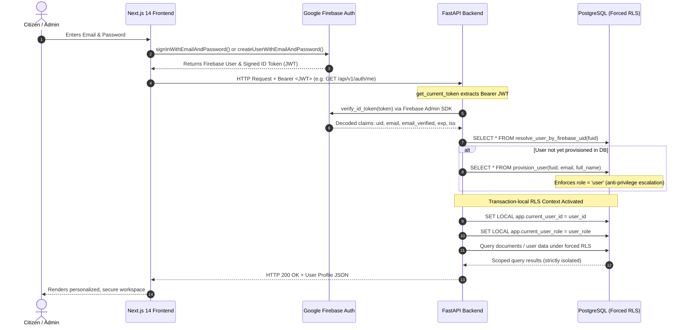

# CONVELINA — Firebase Authentication Architecture & Security Specification

This document details the authentication and authorization architecture implemented in CONVELINA, integrating client-side Firebase Authentication (Next.js 14), backend identity verification (FastAPI + Firebase Admin SDK), and PostgreSQL forced Row-Level Security (RLS).

---

## 1. End-to-End Authentication Flow

The following sequence details how a citizen signs up or logs in, obtains a cryptographically signed JWT, establishes a backend session, and interacts with isolated database resources:



---

## 2. JWT Token Lifecycle & Automatic Refresh

Firebase ID tokens are compact, URL-safe JSON Web Tokens (JWT) signed with Google's RS256 private keys:
1. **Token Lifetime**:
   - Firebase ID tokens expire strictly after **1 hour** (`exp - iat = 3600s`).
   - The token contains claims including `auth_time`, `iss` (`https://securetoken.google.com/<project_id>`), `aud` (`<project_id>`), `sub`/`uid`, and `email`.
2. **Client-Side Refresh**:
   - The Firebase Web Client SDK automatically tracks token expiration and dispatches background refresh requests using a long-lived OAuth refresh token.
   - When calling protected endpoints, `user.getIdToken()` returns a cached token if valid or silently fetches a fresh token if expired.
3. **Session Persistence**:
   - Firebase maintains authenticated sessions across browser refreshes using `INDEXEDDB` or `LOCAL` browser storage.
   - On page reload, `onAuthStateChanged()` seamlessly reconstructs the active `FirebaseUser`, retrieves the current JWT, and synchronizes the user's profile with the backend.

---

## 3. Backend Verification Dependency

Backend authentication is anchored on FastAPI dependency injection in `backend/app/dependencies/auth.py` and cryptographic verification in `backend/app/core/security.py`:

```python
def verify_firebase_id_token(token: str) -> Dict[str, Any]:
    # Validates RS256 signature against Google's public x509 certs
    # Checks audience matching FIREBASE_PROJECT_ID
    # Enforces expiration (exp), issue time (iat), and issuer (iss)
    decoded_token = firebase_auth.verify_id_token(token, check_revoked=False)
    return decoded_token
```

### Error Handling & HTTP Status Codes:
- **Missing Token**: `HTTP 401 Unauthorized` ("Authorization header is missing.")
- **Malformed Header**: `HTTP 401 Unauthorized` ("Invalid Authorization header format. Expected 'Bearer <token>'.")
- **Expired Token**: `HTTP 401 Unauthorized` ("Firebase ID token has expired.")
- **Invalid Signature/Issuer**: `HTTP 401 Unauthorized` ("Invalid Firebase ID token.")
- **Revoked Token**: `HTTP 401 Unauthorized` ("Firebase ID token has been revoked.")

---

## 4. User Provisioning & Forced Row-Level Security

CONVELINA guarantees zero unauthenticated database writes and complete cryptographic tenant isolation:

### Automatic Identity Provisioning:
When a verified user accesses a protected route for the first time:
1. The backend extracts `uid`, `email`, and `display_name` from verified token claims.
2. It executes the stored procedure `provision_user(p_firebase_uid, p_email, p_full_name)`:
   - Uses `ON CONFLICT (firebase_uid) DO UPDATE` to ensure idempotent execution.
   - Defaults the account role strictly to `'user'`.
   - Client-provided roles in request bodies are completely ignored.

### Transaction-Local RLS Context:
Every database interaction executes inside a scoped transaction:
```sql
SELECT set_config('app.current_user_id', :user_id::text, true);
SELECT set_config('app.current_user_role', :user_role::text, true);
```
- The third parameter `true` scopes the settings to the current transaction (`LOCAL`). When the database connection returns to the connection pool, the context is automatically cleared, preventing connection pool context leakage.
- All RLS policies defensively handle connection pooling using `NULLIF(current_setting('app.current_user_id', true), '')::uuid`.

---

## 5. Role-Based Access Control (RBAC)

CONVELINA enforces a strict **Two-Role Model**:

| Role | Scope | Permitted Endpoints | Database Access |
|---|---|---|---|
| **`USER`** | Citizen / General User | `/api/v1/documents/*`, `/api/v1/auth/me`, `/api/v1/conflicts/*`, `/api/v1/assistant/*` | Strictly own rows (`user_id = current_app_user_id()`) |
| **`ADMIN`** | Platform Administrator | `/api/v1/admin/*`, `/api/v1/knowledge/reindex`, platform audit consoles | Cross-user inspection, knowledge catalog management |

### Anti-Privilege Escalation Rules:
1. **Self-Promotion Block**: Neither the `/provision` nor the `/profile` endpoint accepts or modifies the `role` field.
2. **Database Trigger Guard**: A PostgreSQL trigger blocks any `UPDATE` on `users.role` unless the executing session's `current_app_user_role()` equals `'admin'`.
3. **Bootstrap Admin Assignment**: Only accounts matching the pre-configured `ADMIN_GMAIL` setting receive the `'admin'` role upon initial provisioning.

---

## 6. Security Considerations & Privacy Defense

1. **Aadhaar Act Compliance**:
   - Zero storage of raw Aadhaar numbers or plaintext identity cards.
   - Sensitive metadata encrypted at rest via Fernet 32-byte url-safe keys.
2. **Replay & Timing Protection**:
   - JWT tokens include unique `jti` and strict `exp` timestamps verified on every API invocation.
3. **Audit Trail Immutability**:
   - Every registration, authentication failure, and document upload records an entry in `audit_log`.
   - Each audit entry cryptographically chains its SHA-256 hash to the preceding record (`prev_hash`).
   - Database triggers prohibit any `UPDATE` or `DELETE` on the `audit_log` table.
4. **Zero Credential Leakage**:
   - All private keys, service account JSON files, and environment files (`.env`, `.env.local`) are excluded by `.gitignore`.
