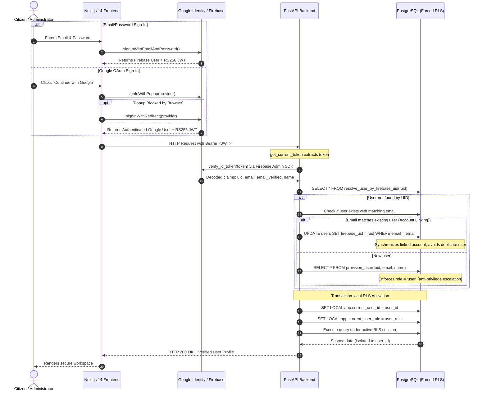

# CONVELINA — Firebase Authentication Architecture (Email + Google)

This document details the multi-provider authentication architecture in CONVELINA, covering Next.js 14 client flows (Email/Password & Google Sign-In), FastAPI token verification using the Firebase Admin SDK, PostgreSQL forced Row-Level Security (RLS), and account synchronization.

---

## 1. Unified Authentication Sequence (Email + Google)



---

## 2. Multi-Provider Account Linking & Single User Record Guarantee

### Challenge:
When an individual signs up first with Email/Password and later clicks "Sign in with Google" using the same verified email (e.g. `ajay@convelina.in`), naive implementations create two separate database user accounts with duplicate or fragmented data.

### CONVELINA Solution:
1. **Firebase Console Level**:
   - `User account linking` set to *"Link accounts that use the same email"*.
2. **Backend Synchronization Level**:
   - `get_current_user` in `backend/app/dependencies/auth.py` first checks `resolve_user_by_firebase_uid(fuid)`.
   - If no user matches the incoming UID, it queries for an existing record with `LOWER(email) = LOWER(:email)`.
   - If found, it safely synchronizes `firebase_uid = :fuid` on the existing user row.
   - All uploaded documents, conflict records, drafts, and cases remain intact under the original primary key UUID.
   - Zero duplicate user records created.

---

## 3. JWT Token Lifecycle & Automatic Refresh

- **Expiry**: Firebase ID tokens expire after 1 hour (3600 seconds).
- **Client Auto-Refresh**:
  - `onIdTokenChanged(auth, callback)` in `AuthContext.tsx` detects automatic hourly token refreshes and updates React state.
  - Active API requests always carry an unexpired token.
- **Backend Cryptographic Verification**:
  - Validates Google RS256 public keys against the JWKS endpoint.
  - Checks expiration (`exp > now`).
  - Enforces `iss == "https://securetoken.google.com/" + FIREBASE_PROJECT_ID`.
  - Enforces `aud == FIREBASE_PROJECT_ID`.

---

## 4. Two-Role Model & Anti-Privilege Escalation

CONVELINA strictly enforces two roles:
1. **`USER`**: All regular citizens and users. Granted access only to their own documents and workspaces.
2. **`ADMIN`**: Platform administrators. Configured via `ADMIN_GMAIL` setting or secure direct database assignment.

### Guarantees:
- **No Self-Assignment**: Stored procedure `provision_user` hardcodes `role = 'user'`.
- **Database Trigger Guard**: A PostgreSQL trigger blocks any `UPDATE` on `users.role` unless `current_app_user_role() = 'admin'`.
- **Caller Identity Derived Exclusively from Token**: Backend ignores any client-supplied `firebase_uid`, `email`, or `role` in the request body.

---

## 5. PostgreSQL Forced Row-Level Security

- Every citizen-facing table has `FORCE ROW LEVEL SECURITY` enabled.
- Runtime connections connect via the unprivileged role `consolith_app`.
- Session context is set transaction-locally:
  ```sql
  SET LOCAL app.current_user_id = :user_id;
  SET LOCAL app.current_user_role = :user_role;
  ```
- All policies employ `NULLIF(current_setting('app.current_user_id', true), '')::uuid` to prevent connection-pooling type casting traps.
