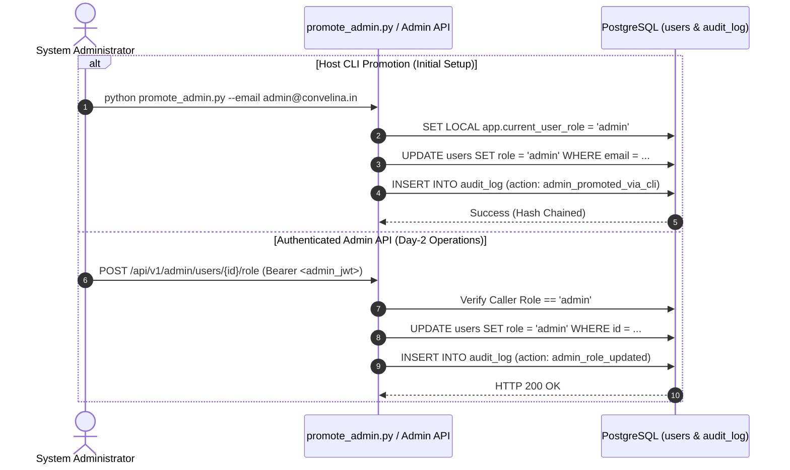

# CONVELINA — Firebase Authentication & Security Architecture

> [!IMPORTANT]
> **DEVELOPMENT MODE STATUS**:
> `LIVE FIREBASE INTEGRATION: PENDING CREDENTIAL CONFIGURATION`  
> Live Firebase credentials are not yet configured in the local workspace. All backend token-verification logic, two-role RBAC, anti-takeover invariants, and account-linking security guarantees are fully implemented and verified via unit tests and mocks. Live cloud authentication remains pending until credentials are provided.

This document specifies the technical architecture of CONVELINA's multi-provider authentication subsystem, secure account-linking guarantees, Two-Role RBAC model, and explicit administrator provisioning controls.

---

## 1. System Architecture Overview

```mermaid
flowchart TD
    subgraph Client ["Frontend (Next.js 14)"]
        UI["Login / Signup Form"]
        GoogleBtn["Google Sign-In Button"]
        AuthCtx["AuthContext (onIdTokenChanged)"]
        LinkHandler["Account Link Handler (linkWithCredential)"]
    end

    subgraph Firebase ["Google Firebase Platform"]
        FAuth["Firebase Auth Service"]
        GoogleIdP["Google OAuth Identity Provider"]
        EmailIdP["Email/Password Identity Provider"]
    end

    subgraph Backend ["Backend API (FastAPI)"]
        AuthDep["get_current_user Dependency"]
        TokenVerif["verify_firebase_id_token (RS256)"]
        LinkEndpoint["/api/v1/auth/link-provider"]
        AdminEndpoint["/api/v1/admin/users/{id}/role"]
        RoleGuard["RoleChecker (require_user, require_admin)"]
    end

    subgraph DB ["PostgreSQL 16 (Forced RLS)"]
        UserTable["users (role CHECK user, admin)"]
        AuditTable["audit_log (append-only SHA-256 chain)"]
        RLSContext["set_rls_context (app.current_user_id)"]
    end

    UI -->|Email & Password| FAuth
    GoogleBtn -->|OAuth 2.0 Popup/Redirect| GoogleIdP
    GoogleIdP --> FAuth
    FAuth -->|ID Token (JWT)| AuthCtx

    AuthCtx -->|Bearer Token| AuthDep
    AuthDep --> TokenVerif
    TokenVerif -->|Verified Claims| AuthDep
    AuthDep -->|UID Lookup| UserTable
    AuthDep -->|Session Scoping| RLSContext

    AuthCtx -->|Handle Account Conflict| LinkHandler
    LinkHandler -->|linkWithCredential| FAuth
    AuthCtx -->|Authenticated Link Request| LinkEndpoint
    LinkEndpoint -->|Update UID & Audit| UserTable
    LinkEndpoint --> AuditTable

    AdminEndpoint -->|Explicit Promotion| UserTable
    AdminEndpoint --> AuditTable
```

---

## 2. Secure Account-Linking Architecture

### The Account Takeover (ATO) Threat Vector
When supporting both Email/Password and Google OAuth, naive implementations often associate incoming tokens with existing user rows solely by checking `LOWER(email) = LOWER(:email)` and updating `firebase_uid = :new_uid`.

> [!CAUTION]
> **Vulnerability**: If an attacker registers an unverified Email/Password account with a victim's email address, a naive backend would overwrite the victim's `firebase_uid`. The victim is locked out, and the attacker inherits the victim's identity, RLS permissions, documents, and drafts.

### CONVELINA's Three-Tier Defense:

1. **Rejection of Silent UID Overwrites**:
   - In `backend/app/dependencies/auth.py`, if a user exists with the requested email but holds a different `firebase_uid`, the backend **strictly rejects** the request with `409 Conflict`.
   - The database record's `firebase_uid` is **never mutated** during standard token resolution.

2. **Mandatory Email Verification**:
   - Only tokens where `claims["email_verified"] == True` can ever participate in identity association or account linking.
   - Unverified tokens attempting to bind to existing records are rejected with `403 Forbidden`.

3. **Explicit, Authenticated Provider Linking (`POST /api/v1/auth/link-provider`)**:
   - To link a secondary identity to an existing account, the user must provide two proofs of ownership:
     1. Primary authentication via standard `Authorization: Bearer <primary_token>`.
     2. Secondary token presented in request body (`linking_token`).
   - The backend validates:
     - `secondary_claims.email_verified == True`.
     - `LOWER(secondary_claims.email) == LOWER(current_user.email)`.
     - `secondary_uid != current_user.firebase_uid`.
     - `secondary_uid` is not already bound to another citizen row in PostgreSQL.
   - Upon successful verification:
     - The user's PostgreSQL UUID (`user.id`) is **strictly preserved**.
     - All associated documents, conflicts, correction drafts, and RLS permissions remain intact.
     - An immutable `AuditLog` entry is appended (`action="account_provider_linked"`).

---

## 3. Administrator Provisioning Architecture

### Elimination of Automatic `ADMIN_GMAIL` Escalation
Previously, incoming requests matching `ADMIN_GMAIL` were automatically upgraded to `admin`. This created privilege escalation risks if an identity was spoofed or created prior to verification.

CONVELINA enforces an **explicit administrator provisioning model**:
- Every newly registered account strictly receives the `user` role.
- Client-supplied role claims (in JWT claims or HTTP request bodies) are strictly ignored.
- Promotion to `admin` requires one of two explicit, authenticated methods:



---

## 4. Forced PostgreSQL Row-Level Security Scoping

1. **Non-Superuser Runtime Role**:
   - FastAPI connects via `consolith_app`.
   - `consolith_app` does not possess `BYPASSRLS` or superuser privileges.
2. **Transaction-Local Scoping**:
   - Every request executes `set_rls_context(db, user_id=user.id, role=user.role)`:
     ```sql
     SET LOCAL app.current_user_id = '...';
     SET LOCAL app.current_user_role = 'user';
     ```
   - Connection pooling safety is enforced via `NULLIF(current_setting('app.current_user_id', true), '')::uuid`.
