# CONVELINA — Personal Application Exploration & Walkthrough Guide

## Welcome to CONVELINA

**CONVELINA** means: **Connect. Manage. Evolve.**  
*An AI-Powered Identity Document Conflict Detection and Government Correction Assistance System using LLMs and RAG.*

This comprehensive guide is designed for you to personally open, explore, test, and experience the entire running application in your own browser.

---

## 1. Quick Start & Service Status

Both the FastAPI backend and Next.js frontend are currently running in your local workspace:

| Service | Local Address | Health Check Endpoint | Status |
| :--- | :--- | :--- | :---: |
| **FastAPI Backend** | `http://127.0.0.1:8000` | `http://127.0.0.1:8000/health` | **RUNNING** |
| **Next.js Frontend** | `http://localhost:3000` | `http://localhost:3000/` | **RUNNING** |
| **Qdrant Vector Engine** | Embedded In-Process | Initialized (73 knowledge chunks + 52 forms) | **ACTIVE** |

### How to Restart Services If Ever Stopped
If you ever restart your machine or terminal sessions, execute these commands from the repository root (`C:\Users\ajaya\Desktop\consolin`):

**Terminal 1 — Backend**:
```powershell
$env:PYTHONPATH="backend"
backend\.venv\Scripts\python.exe -m uvicorn app.main:app --port 8000 --reload
```

**Terminal 2 — Frontend**:
```powershell
cd frontend
npm run start
# Or for live hot-reload development mode:
# npm run dev
```

### Checking Service Health
Open your browser or run:
```powershell
curl http://127.0.0.1:8000/health
```
You will receive:
```json
{
  "status": "degraded",
  "services": {
    "backend": { "status": "up" },
    "postgres": { "status": "down" },
    "qdrant": { "status": "up", "mode": "in_process", "collections": ["consolith_knowledge", "consolith_forms"] },
    "firebase_auth": { "status": "configured" }
  }
}
```
*(Note: `postgres` status is down because the local Docker container is offline. The application gracefully operates with session fixtures in development mode).*

---

## 2. Authentication & Account Modes

### Public Routes (No Authentication Needed)
- `http://localhost:3000/` (Landing Page)
- `http://localhost:3000/login` (Citizen Login)
- `http://localhost:3000/signup` (Citizen Signup)
- `http://localhost:3000/admin/login` (Admin Gateway)

### How to Explore Authenticated Citizen Screens
Because live Firebase cloud credentials are not yet linked, the application includes a **Development Session Simulator**. 
To immediately enter as a citizen:
1. Open your browser to `http://localhost:3000/login`.
2. Open Developer Tools (`F12`), go to the **Console** tab, and paste:
   ```javascript
   localStorage.setItem("convelina_test_token", "test_token_:usr_cit_001:citizen@example.com:Aarav Sharma");
   window.location.href = "/app";
   ```
3. You will instantly be logged in as **Aarav Sharma** (Role: `user`) and redirected to your Citizen Action Hub (`/app`).

### How to Explore Authenticated Administrator Screens
To explore the Administrator Console (`/admin`):
1. In Developer Tools Console (`F12`), paste:
   ```javascript
   localStorage.setItem("convelina_test_token", "test_token_:usr_admin_001:admin@convelina.gov.in:Super Administrator");
   window.location.href = "/admin";
   ```
2. You will instantly be authenticated with platform administrative privileges (`role: "admin"`).

---

## 3. Interactive Walkthrough: 20 Core Screens & Workflows

Follow this 20-step sequence to explore every facet of CONVELINA:

```mermaid
flowchart LR
    S1["1. Landing Page"] --> S2["2. Login / Signup"]
    S2 --> S3["3. Citizen Dashboard"]
    S3 --> S4["4. Document Ingestion"]
    S4 --> S5["5. OCR Field Confirmation"]
    S5 --> S6["6. Conflict Matcher"]
    S6 --> S7["7. Conflict Details"]
    S7 --> S8["8. AI Assistant"]
    S8 --> S9["9. Chat Threads"]
    S9 --> S10["10. Statutory Repository"]
    S10 --> S11["11. Document Details"]
    S11 --> S12["12. Procedural Guidance"]
    S12 --> S13["13. Interactive Checklists"]
    S13 --> S14["14. Draft Generation"]
    S14 --> S15["15. Citizen Profile & PKI"]
    S15 --> S16["16. Admin Login Gate"]
    S16 --> S17["17. Admin Dashboard"]
    S17 --> S18["18. Statutory Form Manager"]
    S18 --> S19["19. Circular Ingestion"]
    S19 --> S20["20. Audit & Diagnostics"]
```



---

### Screen 01: Landing Page (`/`)
- **URL**: `http://localhost:3000/`
- **What it does**: Presents the editorial civic trust interface introducing CONVELINA's mission, privacy commitments, and core capabilities.
- **What you can do**: Read the 3 pillars, inspect privacy safeguards (Aadhaar Act Section 29 compliance, zero raw image storage), toggle FAQ items, and test responsive mobile drawer.
- **Backend API**: Static frontend rendering.
- **What to test manually**: Resize browser window to mobile size (390px) to verify collapsible hamburger menu.

### Screen 02: Citizen Login & Registration (`/login` & `/signup`)
- **URL**: `http://localhost:3000/login`
- **What it does**: Dual-provider authentication entry point supporting Email/Password and Google OAuth.
- **What you can do**: Enter email/password; inspect form validation; note the development mode indicator explaining that live Firebase credentials are in configuration.
- **Backend API**: `POST /api/v1/auth/login`, `POST /api/v1/auth/register`.
- **What to test manually**: Enter an invalid email format (e.g., `invalid-email`) or short password to see real-time RFC-5322 validation.

### Screen 03: Citizen Dashboard (`/app`)
- **URL**: `http://localhost:3000/app`
- **What it does**: Citizen action hub greeting you with a personalized welcome, 4 metric cards, and primary action buttons.
- **What you can do**: View processing metrics, jump to Inconsistencies, ask the AI Assistant, or browse forms.
- **Backend API**: `GET /api/v1/auth/me`, `GET /api/v1/conflicts/summary`.
- **What to test manually**: Notice the amber alert banner if active discrepancies are present.

### Screen 04: Document Upload Hub (`/app/inconsistencies`)
- **URL**: `http://localhost:3000/app/inconsistencies`
- **What it does**: Drag-and-drop ingestion interface accepting Aadhaar, PAN, Passport, Class 10/12, and EPF documents.
- **What you can do**: Drop a file or click to select a document; view accepted file formats (`PDF`, `PNG`, `JPG`) and 10MB limit.
- **Backend API**: `POST /api/v1/documents/upload`.
- **What to test manually**: Try dropping a file larger than 10MB or an unsupported file type to verify client-side rejection.

### Screen 05: OCR Field Confirmation Modal
- **Location**: Opens automatically on `/app/inconsistencies` after document upload.
- **What it does**: Displays all extracted demographic fields (Name, DOB, Gender, Address, Masked ID) with editable input fields before saving.
- **What you can do**: Inspect the extracted fields, correct any noisy OCR characters, and click *"Confirm Fields"*.
- **Backend API**: `GET /api/v1/documents/{id}/fields`, `POST /api/v1/documents/{id}/confirm`.
- **What to test manually**: Edit a name character and verify that your confirmed value takes priority over raw OCR text.

### Screen 06: Deterministic Conflict Detection Hub
- **Location**: Lower section of `/app/inconsistencies`.
- **What it does**: Runs algorithmic cross-referencing across uploaded documents, detecting name transposition, spelling variance, DOB formatting differences, and address changes.
- **What you can do**: Click *"Run Cross-Document Verification"* to trigger instant matching; inspect discrepancy severity cards.
- **Backend API**: `POST /api/v1/conflicts/detect`, `GET /api/v1/conflicts`.
- **What to test manually**: Observe the discrepancy card showing source values side-by-side (e.g., Aadhaar "Aarav Sharma" vs. PAN "Arav Sharma").

### Screen 07: Discrepancy Card Details & Resolution Pathway
- **Location**: On each discrepancy card on `/app/inconsistencies`.
- **What it does**: Categorizes discrepancy severity (`HIGH`, `MEDIUM`, `LOW`) and outlines the exact statutory resolution pathway.
- **What you can do**: Click *"Discuss with CONVELINA AI"* or *"Generate Correction Draft"*.
- **Backend API**: `GET /api/v1/conflicts/{id}`.
- **What to test manually**: Click *"Discuss with CONVELINA AI"*; verify that it navigates to `/app/assistant?conflictId=...` with the conflict context loaded.

### Screen 08: Conversational AI Assistant Workspace (`/app/assistant`)
- **URL**: `http://localhost:3000/app/assistant`
- **What it does**: Claude-style minimalist conversational interface for statutory identity questions.
- **What you can do**: Select pre-seeded starter pills, type inquiries in the floating pill composer, or view statutory citation chips.
- **Backend API**: `POST /api/v1/assistant/chat`, `GET /api/v1/assistant/suggest-prompts`.
- **What to test manually**: Click starter prompt *"How do I fix a name spelling mismatch between Aadhaar and PAN?"* to observe grounded procedural guidance with official citations.

### Screen 09: Conversation History & Multi-Turn Threads
- **Location**: Left sidebar on `/app/assistant`.
- **What it does**: Lists past conversational sessions and allows starting new inquiries.
- **What you can do**: Click *"New Consultation"* (`Ctrl+N`), filter past threads, or inspect past citations.
- **Backend API**: `GET /api/v1/assistant/conversations`, `DELETE /api/v1/assistant/conversations/{id}`.
- **What to test manually**: Click between different conversation threads to verify seamless switching.

### Screen 10: Statutory Document Repository (`/app/forms`)
- **URL**: `http://localhost:3000/app/forms`
- **What it does**: Comprehensive statutory catalog containing 52 official forms, circulars, and checklists across 6 identity categories (*Aadhaar, PAN, Passport, Class 10, Class 12, EPF*).
- **What you can do**: Switch category tabs, search forms with debounced text search, filter by provenance or verification status, and view the active conflict banner.
- **Backend API**: `GET /api/v1/repository/resources`, `GET /api/v1/repository/categories`.
- **What to test manually**: Type *"49A"* or *"Gazette"* in the search box; verify instant client-side filtering.

### Screen 11: Document Detail View (`/app/forms/[formId]`)
- **URL**: `http://localhost:3000/app/forms/DOC_036` (PAN Form 49A)
- **What it does**: Deep detail experience presenting issuing authority, purpose, eligible cohorts, submission procedure, and fees.
- **What you can do**: Review step-by-step procedures, inspect verified gazette citations, and click *"Download Official PDF"*.
- **Backend API**: `GET /api/v1/repository/resources/{id}`.
- **What to test manually**: Click *"Download PDF"* to verify file delivery.

### Screen 12: DOC_043 Statutory Limitation Notice
- **URL**: `http://localhost:3000/app/forms/DOC_043`
- **What it does**: Dedicated detail screen for UIDAI Name Update SOP (`DOC_043`).
- **What you can do**: Observe the prominent high-visibility red caution banner:
  > **STATUTORY LIMITATION NOTICE**: Under UIDAI regulations, Name updates are permitted a maximum of 2 times... Exceptional 3rd-time updates require formal discretionary approval from the Regional Office.
  Notice that the download button is safely replaced with:
  `Reference Circular Only (Not a Filing Form)`.
- **Backend API**: `GET /api/v1/repository/resources/DOC_043`.
- **What to test manually**: Verify that the advisory banner correctly explains the 2-update lifetime limit and Regional Office discretion.

### Screen 13: Interactive Supporting-Document Checklists
- **Location**: Section 5 on `/app/forms/DOC_036` or `/app/forms/DOC_001`.
- **What it does**: Interactive checklist allowing citizens to check off required documents (*Proof of Identity, Proof of Date of Birth, Proof of Address*).
- **What you can do**: Toggle checkmarks; watch the progress counter dynamically update (e.g., *"3 of 5 Requirements Completed"*).
- **Backend API**: `GET /api/v1/repository/resources/{id}/checklist`.
- **What to test manually**: Check several boxes and observe the real-time progress bar.

### Screen 14: Administrative Correction Draft Generation
- **Location**: Triggered from Discrepancy Card or Assistant Workspace.
- **What it does**: Generates formal administrative representation letters, discrepancy summary certificates, or petition documents.
- **What you can do**: Review citizen-confirmed facts, select draft language, and generate attested PDF.
- **Backend API**: `POST /api/v1/correction-drafts/generate`.
- **What to test manually**: Download the generated draft and verify the mandatory diagonal watermark: `"SYNTHETIC DEVELOPMENT SAMPLE — NOT AN OFFICIAL GOVERNMENT FORM"`.

### Screen 15: Citizen Profile & Cryptographic Key Management (`/app/profile`)
- **URL**: `http://localhost:3000/app/profile`
- **What it does**: Demographic profile editor, Ed25519 citizen key management, DPDP Act data portability, and account deletion.
- **What you can do**: Generate client-side Ed25519 signing keypair, export personal identity bundle, or trigger account purge.
- **Backend API**: `GET /api/v1/auth/me`, `POST /api/v1/pki/generate-citizen-key`, `DELETE /api/v1/auth/account`.
- **What to test manually**: Click *"Generate Attestation Key"* to create an Ed25519 signing key in your browser.

### Screen 16: Administrative Login Gateway (`/admin/login`)
- **URL**: `http://localhost:3000/admin/login`
- **What it does**: High-contrast portal isolated from standard citizen login.
- **What you can do**: Input administrative master credentials; observe role verification checks.
- **Backend API**: `POST /api/v1/auth/login`.
- **What to test manually**: Visit `/admin` while logged in as a citizen; verify the in-place `<ShieldAlert>` **Access Denied** card.

### Screen 17: Administrative Monitoring Dashboard (`/admin`)
- **URL**: `http://localhost:3000/admin`
- **What it does**: Comprehensive administrator command center.
- **What you can do**: Audit platform metrics: Total Users (Citizens vs Admins), Processed Documents, Detected Conflicts, and Active Ed25519 Signing Keys.
- **Backend API**: `GET /api/v1/admin/overview-stats`.
- **What to test manually**: Click the *"Refresh Metrics"* icon in header.

### Screen 18: Statutory Form Management Console
- **Location**: Section 3 on `/admin`.
- **What it does**: Audit and management table for all 52 registered statutory forms.
- **What you can do**: Toggle verification status (`verified` <-> `needs_review`), inspect version histories, or trigger document replacement.
- **Backend API**: `GET /api/v1/knowledge/admin/forms`, `PUT /api/v1/knowledge/admin/forms/{id}/verification`.
- **What to test manually**: Click *"Toggle Status"* on a form; watch badge switch dynamically and confirm update.

### Screen 19: Statutory Circular Ingestion Modal
- **Location**: Click *"Ingest Knowledge Circular"* button on `/admin`.
- **What it does**: Direct upload modal allowing administrators to ingest official gazettes or circulars into Qdrant and PostgreSQL.
- **What you can do**: Select category, issuing authority, and PDF file; trigger chunking and vector indexing.
- **Backend API**: `POST /api/v1/knowledge/admin/ingest`.
- **What to test manually**: Inspect category dropdown options matching the 6 supported identity categories.

### Screen 20: Append-Only Tamper-Evident Audit Feed & PKI Keystore
- **Location**: Bottom sections of `/admin`.
- **What it does**: Displays public signing keys and the live append-only audit feed protected by PostgreSQL rejection triggers.
- **What you can do**: Audit event types (`AUTH_LOGIN`, `DOCUMENT_UPLOAD`, `CONFLICT_DETECTED`), timestamps, and actor user IDs.
- **Backend API**: `GET /api/v1/admin/system-activity`, `GET /api/v1/pki/keys`.
- **What to test manually**: Verify that audit rows display immutable SHA-256 hash chains.

---

## 4. How to Safely Stop the Application

When you are done exploring, you can stop the background processes:
- In your terminal: Press `Ctrl + C` in each running terminal window.
- In Antigravity: You can use `manage_task` with action `kill` on the background tasks.

