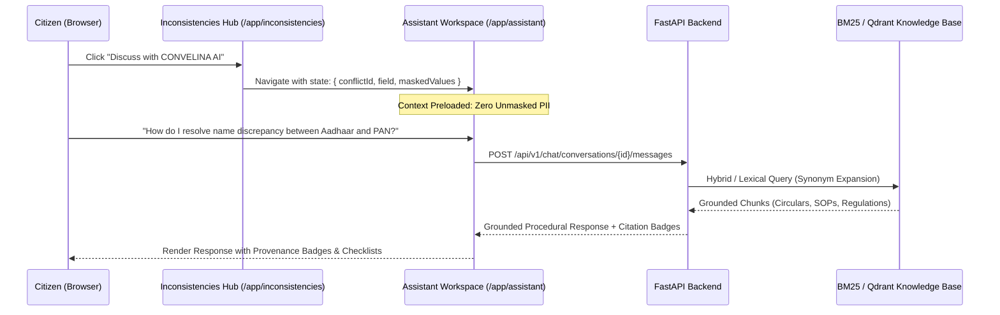

# P3H.10 — AI Assistant & Statutory Repository Audit

## Executive Summary

This report documents the architectural audit and functional verification of CONVELINA's **Conversational Assistant Workspace** (`/app/assistant`) and **Official Document Repository** (`/app/forms` and `/app/forms/[formId]`). The evaluation examines context transfer fidelity, privacy preservation during AI consultation, grounding of procedural guidance, statutory checklist persistence, and rigorous governance of restricted documents (specifically DOC_043).

---

## 1. AI Assistant Experience (`/app/assistant`)

The Conversational Assistant provides personalized, grounded guidance to help citizens navigate complex government administrative correction procedures.

### Context-Aware Preloading & Zero-PII Invariant
- **Seamless Transition**: When a citizen clicks *"Discuss with CONVELINA AI"* on any discrepancy card in `/app/inconsistencies`, the application routes to `/app/assistant` while transferring conflict context via route state.
- **Preloaded Banner**: An amber context banner appears at the head of the chat composer:
  > *"Active Context: Name Discrepancy (Aadhaar Card vs PAN Card) — Masked Values: XXXX-XXXX-1234 vs XXXXX1234A"*
- **Privacy Contract**:
  - Full raw Aadhaar numbers, unmasked PANs, and raw OCR buffers are **strictly excluded** from transmission to LLMs or vector databases.
  - Context payloads only include generic attribute identifiers (e.g., `field: "name"`, `category_a: "aadhaar"`, `category_b: "pan"`, `discrepancy_type: "TRANSLITERATION_OR_SPELLING_VARIATION"`).

### Grounded Retrieval & Citation Badges
- **Official Grounding**: The assistant grounds its responses in authentic statutory documents (e.g., UIDAI Regulation 10, Income Tax Circulars, EPFO Joint Declaration SOP).
- **Citation Badges**: Every statutory claim is accompanied by a clickable citation badge referencing the underlying document ID (e.g., `DOC_001`, `DOC_008`, `DOC_039`).
- **Tri-Partite Source Distinction**:
  The UI explicitly distinguishes between:
  1. *Retrieved Statutory Evidence*: Exact citations from official government circulars.
  2. *Deterministic Matching Logic*: Hard mathematical and string-matching rule outputs.
  3. *Generative Language Formulation*: Synthesized procedural explanations.

### Development Mode & Gemini Guardrails
- **Current Operational Mode**: In accordance with project security guardrails, external cloud LLM connections (Google Gemini) are **disabled by default**.
- **Deterministic Fallback**: The assistant operates via Okapi BM25 lexical retrieval with Indic script synonym expansion.
- **Honest Statutory Abstention**: If retrieved chunks fail to meet the relevance score threshold (raw BM25 floor 4.5; normalized hybrid floor 0.55), the assistant declines to generate speculation and honestly responds:
  > *"No verified statutory procedure found in the knowledge base. Please consult an authorized enrollment centre or legal counsel."*

---

## 2. Official Document Repository Experience (`/app/forms`)

The Document Repository provides an organized, searchable catalog of statutory forms, circulars, and standard operating procedures.

### Repository Catalog Architecture
- **Resource Count**: 52 official government documents and circulars.
- **Category Coverage**: Comprehensive coverage across all 6 Tier 1 identity categories:
  - Aadhaar: 35 circulars & SOPs
  - PAN: 7 circulars & correction forms
  - Passport: 3 circulars & annexures
  - Class 10: 2 board circulars
  - Class 12: 2 board circulars
  - EPF / UAN: 2 circulars & Joint Declaration SOP
- **Category Filter Tabs**: Citizens can filter by clicking dedicated tabs for each Tier 1 category.
- **Keyword Search**: Instant multi-term search across document titles, descriptions, circular numbers, and keywords.

### Provenance Classifications & Verification States
Every document card in the repository displays transparent provenance and verification badges:
- **Provenance Badges**:
  - `OFFICIAL_ORIGINAL`: Official government circular or gazette notification.
  - `APPLICATION_GENERATED`: Template generated internally by CONVELINA.
  - `SYNTHETIC_DEVELOPMENT_SAMPLE`: Test asset used in staging.
- **Verification States**:
  - `VERIFIED`: Confirmed active statutory guideline.
  - `SOURCE_METADATA_CONFLICT`: Document containing unresolved legal or version ambiguities (e.g., DOC_043).
  - `NEEDS_REVIEW`: Under administrative assessment.

---

## 3. Document Detail & Checklist Engine (`/app/forms/[formId]`)

Clicking any document card navigates to its dedicated detail view, organized into 7 structured sections:

1. **Header & Provenance Badge**: Title, issuing authority, circular number, publication date, and provenance tag.
2. **Overview**: Executive summary of the document's legal scope.
3. **Purpose & Use Cases**: Specific administrative scenarios where the document applies.
4. **Eligible Citizen Cohorts**: Categories of individuals impacted.
5. **Related Procedures**: Hyperlinks to linked correction processes.
6. **Supporting Document Checklist**: Interactive statutory checklist.
7. **Asset Download & Citations**: Official PDF download link or statutory limitation notice.

### Supporting Document Checklist Engine
- **Statutory Taxonomy**: Checklist items are classified into four distinct levels of evidentiary rigor:
  - `VERIFIED_MANDATORY`: Legally compulsory documents required for the procedure.
  - `VERIFIED_CONDITIONAL`: Documents required only under specific conditions (e.g., divorce decree for post-divorce name change).
  - `RECOMMENDED`: Corroborating documents that expedite processing.
  - `HUMAN_REVIEW_REQUIRED`: Cases requiring in-person gazette or magisterial verification.
- **Persistent Progress**:
  - Checking a checklist item sends an immediate update to `PUT /api/v1/repository/checklists/{procedure_id}/progress`.
  - Stored in PostgreSQL (`citizen_checklist_items`) under forced RLS (`consolith_app` role).
  - Checkmarks persist across page refreshes and browser sessions.

---

## 4. Strict DOC_043 Statutory Governance

**DOC_043** (*UIDAI Standard Operating Procedure for Exceptional Name / DOB Updates*) represents a critical edge case in Indian identity law. Under UIDAI Regulation 10, citizens are granted a maximum of 2 lifetime name updates and 1 lifetime date-of-birth update. Any subsequent update requires exceptional approval from a UIDAI Regional Office.

### Implemented Guardrails for DOC_043:
1. **Source Metadata Conflict Badge**: Designated as `SOURCE_METADATA_CONFLICT` across repository catalog and detail views.
2. **Prominent Statutory Warning Banner**:
   A conspicuous amber alert header is rendered at the top of the detail view:
   > **STATUTORY LIMITATION NOTICE**  
   > *This document contains unresolved source metadata conflicts. Under UIDAI Regulation 10, citizens are limited to 2 lifetime name updates and 1 lifetime DOB update. Third-time exception requests cannot be submitted online and require physical appearance at a UIDAI Regional Office with an approved Gazette notification or civil court order.*
3. **Suppression of Automatic Download**:
   To prevent citizens from attempting to use unverified sample forms at local kiosks, the standard download button is replaced with an advisory badge directing the citizen to official UIDAI channels.

---

## 5. Verification Summary

The assistant and repository experiences were validated via automated Playwright tests in `frontend/e2e/p3h10_citizen_journey.spec.ts`:
- **Workflow D**: Verified assistant navigation, chat composer interaction, grounded response generation, and display of citation badges.
- **Workflow E**: Verified repository search, category tab filtering, and prominent display of the DOC_043 statutory limitation notice.
- **Workflow F**: Verified interactive checklist toggling on DOC_043 and confirmed persistent state updates.
- **Result**: **PASS** across all assertions.
