# P3H.10 — Citizen Journey & Product Experience Acceptance Audit

## Executive Summary

This document presents a comprehensive, route-by-route audit of the 10-step citizen journey within CONVELINA (**Connect. Manage. Evolve.**), an AI-powered identity-document conflict detection and government correction assistance system.

The audit evaluates the complete user lifecycle from initial onboarding to administrative representation drafting and long-term progress persistence across all 9 citizen-facing routes in the application.

---

## 1. 10-Step Citizen Journey Evaluation

```mermaid
flowchart LR
    S1["1. Account & Workspace"] --> S2["2. Document Upload"]
    S2 --> S3["3. Stage 5 OCR Review"]
    S3 --> S4["4. Discrepancy Detection"]
    S4 --> S5["5. Discrepancy Explanation"]
    S5 --> S6["6. Assistant Consultation"]
    S6 --> S7["7. Forms Discovery"]
    S7 --> S8["8. Procedural Checklist"]
    S8 --> S9["9. Correction Draft"]
    S9 --> S10["10. Save & Return"]
```

### Step 1: Create Account & Access Workspace
- **Routes**: `/signup`, `/login`, `/setup-profile`, `/app`
- **Citizen Experience**:
  - The citizen arrives at `/signup` and registers with an email address and secure password.
  - Account creation assigns the non-privileged `user` role (`users_role_check CHECK (role IN ('user', 'admin'))`).
  - `/setup-profile` collects display name and profile details, immediately initializing user session metadata.
  - Upon completion, the citizen lands on `/app` (Citizen Dashboard), greeted with a personalized welcome banner (`Good afternoon, [Name]`) and the **Workspace Status Snapshot**.
- **Audit Findings**:
  - **Strengths**: Smooth transition from onboarding into the dashboard. No dead ends or confusing permission errors. Session persistence via localStorage and Firebase auth token simulation is immediate and resilient.
  - **Security & Integrity**: Role assignment is hardcoded to `user` on user-facing endpoints. Client-supplied role tampering is prevented by backend Pydantic validation and PostgreSQL RLS.

### Step 2: Upload Identity Documents
- **Route**: `/app/inconsistencies`
- **Citizen Experience**:
  - The citizen accesses the Inconsistencies Hub and selects a document category from the categorized dropdown selector.
  - Document types are grouped into **Tier 1 Primary Identity Categories** (Aadhaar Card, PAN Card, Passport, Class 10 Certificate, Class 12 Certificate, EPFO/UAN Records) and **Secondary Supporting Evidence** (Voter ID, Driving License, Other).
  - The citizen drags and drops or browses for a file (PDF, PNG, JPG up to 10MB).
  - An active in-memory processing progress banner appears during OCR extraction, informing the citizen that temporary byte buffers are processed strictly in memory and unlinked immediately in compliance with Section 29 of the Aadhaar Act (2016).
- **Audit Findings**:
  - **Strengths**: Clear format guidance (PDF, PNG, JPG up to 10MB). Native `<optgroup>` organization makes the statutory hierarchy instantly understandable.
  - **Security & Integrity**: Zero raw identity images or unmasked Aadhaar numbers are persisted to disk or database. Temporary file buffers are deleted immediately upon extraction.

### Step 3: Review OCR-Extracted Information (Stage 5 Review)
- **Route**: `/app/inconsistencies` (Stage 5 Modal)
- **Citizen Experience**:
  - Following upload, the **Stage 5 Verification & OCR Review Modal** opens automatically before extracted fields are committed.
  - Extracted fields (Full Name, Date of Birth, Gender, Document Number, Father's Name) are displayed with field-level OCR confidence meters (0–100%).
  - A prominent blue informational banner states: *"TENTATIVE MACHINE EXTRACTIONS — REVIEW REQUIRED. Fields below were automatically extracted by Tesseract OCR. Machine extractions are tentative until explicitly confirmed by you."*
  - Any field with confidence below 60% is highlighted with an amber manual-review warning badge (`MANUAL REVIEW RECOMMENDED (LOW CONFIDENCE)`).
  - The citizen can edit any misread field directly in input fields.
  - The citizen clicks *"Confirm & Save Credential"*, which calls `POST /api/v1/documents/{id}/confirm` to persist citizen-confirmed demographic values.
- **Audit Findings**:
  - **Strengths**: Prevents OCR hallucinations or noise from polluting the deterministic conflict detection engine. Empowers the citizen with complete autonomy over their data.
  - **Security & Integrity**: Server-side validation guarantees that only citizen-confirmed values (`confirmed_name`, `confirmed_dob`, etc.) take precedence in downstream comparison algorithms.

### Step 4: Identify Discrepancies Between Documents
- **Route**: `/app/inconsistencies`
- **Citizen Experience**:
  - Once two or more documents are confirmed, the deterministic conflict engine executes comparison across all demographic fields.
  - A summary comparison panel displays total documents analyzed, detected conflicts, and verified fields.
  - Each conflict is rendered as a dedicated card showing Doc A vs Doc B, the mismatched attribute (e.g., Full Name, Date of Birth), masked values (`XXXX-XXXX-1234`), and comparison badges.
- **Audit Findings**:
  - **Strengths**: Instant visualization of mismatches without needing manual cross-referencing. Clear visual distinction between matching and conflicting fields.
  - **Security & Integrity**: Deterministic algorithms (Jaro-Winkler, Levenshtein, exact date parser) provide 100% reproducible results with zero hallucination.

### Step 5: Understand Why a Discrepancy Was Detected
- **Route**: `/app/inconsistencies`
- **Citizen Experience**:
  - Each discrepancy card displays one of the 7 standard comparison distinction badges:
    1. `EXACT MATCH` (Emerald)
    2. `FORMATTING-ONLY DIFFERENCE` (Blue)
    3. `TRANSLITERATION / SPELLING VARIATION` (Purple)
    4. `POSSIBLE TRUNCATION` (Amber)
    5. `AMBIGUOUS MATCH` (Yellow)
    6. `GENUINE MISMATCH` (Rose)
    7. `MANUAL REVIEW REQUIRED` (Gray)
  - Cards include a detailed explanation of the comparison rule (e.g., *"Initials expanded from 'A. Sharma' to 'Aarav Sharma' — possible truncation or structural naming variation"*).
  - Every card features the mandatory legal boundary notice:
    > **AUTOMATED COMPARISON RESULT • NOT OFFICIAL GOVERNMENT VERIFICATION**  
    > *CONVELINA comparison results highlight potential inconsistencies for citizen awareness. CONVELINA does not declare which document is legally correct. Review statutory guidelines or consult official authorities.*
- **Audit Findings**:
  - **Strengths**: Transparent algorithmic explanations build user trust. Prominent disclaimers clearly prevent false impressions of official government adjudication.

### Step 6: Ask the AI Assistant for Guidance
- **Routes**: `/app/inconsistencies` -> `/app/assistant`
- **Citizen Experience**:
  - From any discrepancy card, the citizen clicks *"Discuss with CONVELINA AI"*.
  - The citizen is navigated seamlessly to `/app/assistant`, where the conflict context (document types, field names, masked values) is preloaded into the conversation session banner with zero unmasked PII.
  - The Assistant provides grounded procedural advice citing statutory circulars and SOPs (e.g., UIDAI Regulation 10, Income Tax Circulars, EPFO Joint Declaration SOP).
  - Gemini is disabled by default in development mode, activating deterministic BM25 retrieval with honest statutory abstention if confidence is below threshold.
- **Audit Findings**:
  - **Strengths**: Effortless handoff between discrepancy detection and procedural guidance. Zero PII transmission preserves citizen privacy.
  - **Security & Integrity**: LLM responses are strictly bounded by retrieved knowledge. The assistant never invents procedures or promises government outcomes.

### Step 7: Find Relevant Government Forms and Supporting Documents
- **Route**: `/app/forms`
- **Citizen Experience**:
  - The citizen accesses the Official Document Repository containing 52 statutory resources.
  - Filter tabs allow instant filtering across all 6 Tier 1 categories: All Categories, Aadhaar, PAN, Passport, Class 10, Class 12, and EPF/UAN.
  - Search bar allows keyword search (e.g., "name correction", "joint declaration", "gazette").
  - Each resource displays provenance classification (`OFFICIAL_ORIGINAL`, `APPLICATION_GENERATED`, etc.) and verification status (`VERIFIED`, `SOURCE_METADATA_CONFLICT`).
- **Audit Findings**:
  - **Strengths**: Comprehensive, indexed repository of authentic government circulars and standard operating procedures. Clean categorization and responsive filtering.

### Step 8: Understand Correction Procedure and Required Evidence
- **Route**: `/app/forms/[formId]`
- **Citizen Experience**:
  - Clicking any document opens its detailed view containing 7 structured sections: Overview, Purpose, Eligible Cohorts, Related Procedures, Statutory Checklist, Asset Download, and Citations & Limitations.
  - Interactive checklists classify items into `VERIFIED_MANDATORY`, `VERIFIED_CONDITIONAL`, `RECOMMENDED`, and `HUMAN_REVIEW_REQUIRED`.
  - For DOC_043, a prominent statutory warning banner (`STATUTORY LIMITATION NOTICE`) alerts the citizen to metadata conflicts and informs them that 3rd-time exception updates require physical Regional Office approval under Regulation 10.
  - Checklist item checks are saved in real-time to PostgreSQL (`citizen_checklist_items`) and persist across reloads.
- **Audit Findings**:
  - **Strengths**: Transforms passive document reading into an active, trackable preparation process. Transparent limitation notices protect citizens from misinformation.

### Step 9: Prepare and Review a Personalized Correction Draft
- **Routes**: `/app/assistant`, `/app/inconsistencies` (Administrative Drafting Modal)
- **Citizen Experience**:
  - The citizen initiates draft generation for one of 10 administrative letter types (e.g., Name Correction Representation, EPFO Joint Declaration Letter, Gazette Notification Application).
  - The 9-step wizard pulls **exclusively citizen-confirmed facts** (`confirmed_name`, `confirmed_dob`, etc.). Unverified inputs are highlighted in amber.
  - The citizen reviews and edits the generated representation in an editable preview pane.
  - Before generation, the citizen must check the mandatory confirmation box: *"I confirm that the factual particulars above are accurate and reflect my verified credentials."*
  - Any subsequent edit to a demographic field immediately invalidates the confirmation, requiring re-affirmation.
  - The citizen downloads the final representation as a formatted PDF complete with advisory representation disclaimers.
- **Audit Findings**:
  - **Strengths**: Rigorous safety guardrails prevent unverified or hallucinated facts from appearing in formal representations. The confirmation invalidation workflow enforces strict intentionality.
  - **Security & Integrity**: PDFs include prominent watermarks and disclaimers stating that the document is an advisory citizen representation, not an automatic government submission.

### Step 10: Save Progress and Return Later
- **Routes**: `/app`, `/app/inconsistencies`, `/app/forms/[formId]`, `/app/profile`
- **Citizen Experience**:
  - The citizen logs out or closes their browser.
  - Upon logging back in, all uploaded documents, confirmed demographic fields, detected discrepancies, checklist completion checkmarks, and saved correction drafts are intact.
  - The Dashboard Workspace Status Snapshot displays up-to-date counts reflecting their exact progress.
- **Audit Findings**:
  - **Strengths**: Complete end-to-end persistence backed by PostgreSQL 16 with forced RLS (`consolith_app` non-superuser role).
  - **Security & Integrity**: Multi-tenant isolation verified by Playwright E2E tests: logging in as Citizen B reveals zero data belonging to Citizen A.

---

## 2. Route-by-Route Evaluation Matrix

| Route | Primary Purpose | Role Scoping | Key Components | Audit Verdict |
| :--- | :--- | :--- | :--- | :--- |
| `/login` | Citizen authentication & token acquisition | Public | Email/Password inputs, test session switcher | **PASS** |
| `/signup` | Citizen registration & role provisioning | Public | Email/Password inputs, user role check | **PASS** |
| `/setup-profile` | Initial profile onboarding | User | Display Name, Phone input | **PASS** |
| `/app` | Workspace Status Snapshot & Action Hub | User | Metric cards, Recommended Next Step card | **PASS** |
| `/app/inconsistencies` | Upload, Stage 5 Review, Comparison | User | Upload dropzone, Stage 5 Modal, Conflict Table | **PASS** |
| `/app/assistant` | Grounded procedural guidance | User | AssistantComposer, ChatBanner, Citation badges | **PASS** |
| `/app/forms` | Official Statutory Document Repository | User | Search input, Category filter tabs, Form Cards | **PASS** |
| `/app/forms/[formId]` | Document Detail & Checklist Engine | User | 7 Sections, Interactive Checklist, DOC_043 banner | **PASS** |
| `/app/profile` | Citizen account & credential management | User | Profile details, PII masking, Logout | **PASS** |

---

## 3. Compliance and Security Verifications

1. **Aadhaar Act (2016) Section 29**:
   - Zero raw document images or 12-digit Aadhaar numbers persisted in database or disk storage.
   - In-memory OCR buffers unlinked immediately after text extraction.
   - UI and logs strictly mask identity numbers (`XXXX-XXXX-1234`).
2. **Two-Role Architecture Enforcement**:
   - Exactly two roles exist: `user` (citizen) and `admin`.
   - Verified zero references to `officer`, `verifier`, or intermediate case managers.
3. **Fail-Safe Deterministic Comparison**:
   - Deterministic matching rules govern all conflict classifications. LLM is never permitted to override comparison outcomes.
4. **Mandatory Advisory Disclaimers**:
   - Displayed across all conflict cards, form previews, and PDF exports.
   - Non-delegated representation: CONVELINA clearly states it is an advisory tool and does not guarantee government approval.
