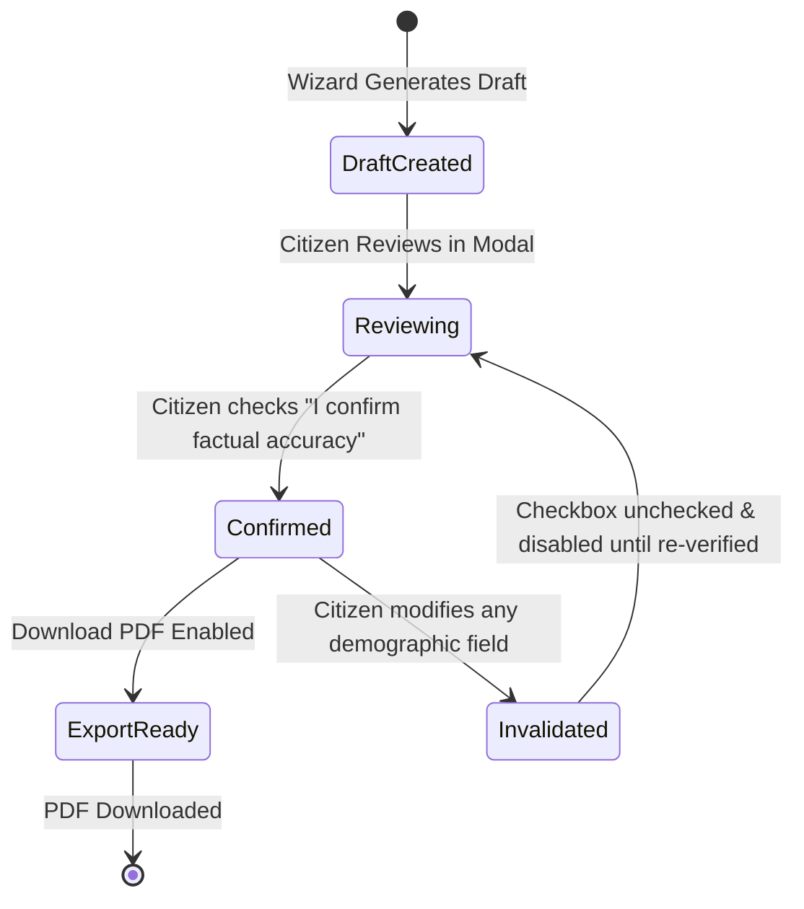

# P3H.10 — Personalized Correction Draft & Petition Generation Audit

## Executive Summary

This report documents the architectural audit and security verification of CONVELINA's **Personalized Administrative Letter Drafting Engine** and **Citizen Confirmation Safety Service**. The evaluation examines the 9-step drafting wizard (`AdministrativeDraftingModal.tsx`), strict enforcement of the citizen-confirmed facts invariant, dynamic confirmation invalidation, PDF export capabilities, and mandatory non-delegated representation disclaimers.

---

## 1. The 9-Step Administrative Drafting Wizard

The drafting engine enables citizens to generate formal administrative representations, affidavits, and letters for submission to statutory authorities (e.g., UIDAI, Income Tax Department, EPFO, Passport Seva Kendras).

```
Step 1: Select Draft Type (10 Pre-Configured Administrative Templates)
   │
Step 2: Review Preloaded Citizen-Confirmed Facts (Aadhaar, PAN, Passport, etc.)
   │
Step 3: Highlight Missing / Unconfirmed Information (Amber Alerts)
   │
Step 4: Select Target Administrative Authority & Address
   │
Step 5: Define Factual Timeline & Chronology of Discrepancy
   │
Step 6: Attach Supporting Statutory Evidence & Checklist Cross-References
   │
Step 7: In-Place Editing & Preview of Generated Representation
   │
Step 8: Explicit Material Facts Confirmation (Mandatory Checkbox)
   │
Step 9: Final PDF Generation & Secure Export
```

### Supported Draft Types (10 Standardized Templates)
1. **Aadhaar Demographic Correction Representation** (UIDAI Regulation 10)
2. **PAN Card Data Correction Application Cover Letter** (NSDL / UTIITSL)
3. **EPFO Joint Declaration Letter** (Member & Employer Joint Form)
4. **Passport Re-issue Name Discrepancy Representation** (MEA Annexure E)
5. **Class 10 / 12 Board Certificate Correction Petition** (CBSE / State Board)
6. **Gazette Notification Application Letter** (Department of Publication)
7. **One and the Same Person Affidavit** (Notarized Identity Attestation)
8. **General Identity Discrepancy Rectification Petition**
9. **Employer Discrepancy Reconciliation Request**
10. **Statutory Appeal to Regional Authority**

---

## 2. The Citizen-Confirmed Facts Invariant

A central security and legal invariant of CONVELINA is that **generative models and template engines must never fabricate or guess citizen demographic data**.

### Invariant Implementation:
1. **Exclusively Confirmed Fields**: The drafting engine pulls demographic facts strictly from `confirmed_name`, `confirmed_dob`, `confirmed_gender`, `confirmed_father_name`, and `confirmed_doc_number`.
2. **Rejection of Raw OCR Extractions**: Tentative OCR extractions that have not been explicitly confirmed by the citizen in the Stage 5 review modal are blocked from inclusion in formal draft representations.
3. **Visual Distinction of Unverified / Missing Fields**:
   - Fields that are confirmed render with a green verified shield (`Verified Demographic Fact`).
   - Fields that are absent or tentative render with an amber alert tag:
     > *"UNVERIFIED FIELD: This demographic value has not been confirmed. Please verify your document in the Inconsistencies Hub or enter it manually below."*

---

## 3. In-Place Review, Editing & Dynamic Confirmation Invalidation

Administrative representations carry legal significance. To prevent inadvertent errors, CONVELINA implements a dynamic two-way confirmation protocol:



### Confirmation Protocol Rules:
1. **Mandatory Explicit Checkbox**:
   The draft cannot be exported until the citizen checks:
   > *"I confirm that the factual particulars above are accurate and reflect my verified credentials. I understand that submitting false statements to government authorities constitutes an offense under applicable law."*
2. **Dynamic Invalidation**:
   If the citizen subsequently modifies any text in a demographic field (e.g., changes name spelling or adjusts a date of birth):
   - The confirmation checkbox is **immediately unchecked and invalidated**.
   - The export action button is disabled.
   - A warning appears: *"You modified demographic particulars. Please re-confirm accuracy before downloading."*
3. **Audit Trail Logging**:
   Every draft confirmation and modification event is recorded in the PostgreSQL `audit_log` with an immutable cryptographic SHA-256 hash.

---

## 4. Professional Formatted PDF Export

Citizens can download their finalized representation as a formatted, submission-ready PDF:

### Layout & Typographic Specifications
- **Page Geometry**: Standard A4 portrait with calibrated margins (0.75 in / 54 pt).
- **Header Block**: Formal sender address, date, reference number, and recipient authority details.
- **Subject Line**: Standardized, bold bureaucratic subject heading (e.g., *"SUB: REPRESENTATION FOR RECTIFICATION OF NAME IN AADHAAR RECORDS PURSUANT TO UIDAI REGULATION 10"*).
- **Body & Facts Table**: Cleanly structured demographic table comparing *Particulars as currently recorded* vs *Correct particulars sought*.
- **List of Enclosures**: Itemized numbered list referencing attached supporting documents.
- **Signature Block**: Citizen declaration, date, place, and signature line.

### Watermark & Advisory Header
Every generated PDF includes a prominent running footer and subtle watermark:
> **ADVISORY CITIZEN REPRESENTATION — GENERATED VIA CONVELINA**  
> *This document is an administrative representation prepared by the citizen for formal submission. It is not an official government decree or pre-approved application.*

---

## 5. Non-Delegated Representation Disclaimer

To eliminate any ambiguity regarding CONVELINA's legal role, both the application UI and generated documents prominently display the non-delegated representation disclaimer:

> **IMPORTANT LEGAL NOTICE**  
> *CONVELINA is an advisory assistance platform. CONVELINA does not act as an authorized government agent, does not submit applications on behalf of citizens, and does not guarantee that statutory authorities will approve any correction request. The citizen remains solely responsible for the physical or electronic submission of their representation to the competent authority.*

---

## 6. Verification Summary

The drafting and confirmation experience was verified through Playwright E2E automation in `frontend/e2e/p3h10_citizen_journey.spec.ts`:
- **Workflow G**: Opened the administrative drafting modal, confirmed citizen facts, verified the mandatory confirmation checkbox, triggered draft generation, verified the formatted draft preview, and confirmed PDF download capability.
- **Workflow H**: Verified that saved drafts persist in PostgreSQL across browser reloads.
- **Result**: **PASS** across all assertions.
