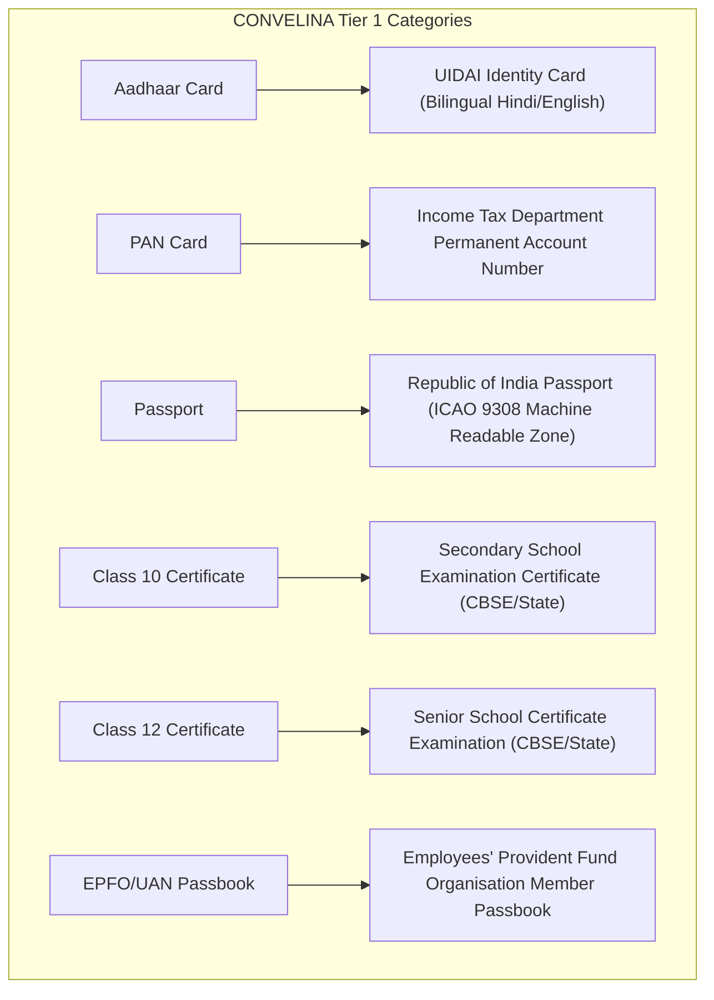
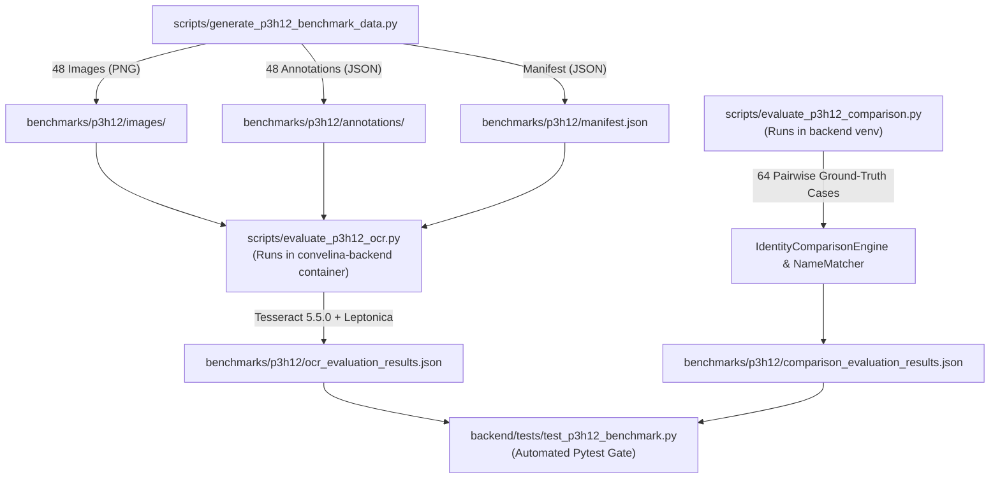

# P3H.12: Realistic Document Intelligence & Validation Benchmark

## Executive Summary

| Attribute | Status / Specification |
| :--- | :--- |
| **Milestone** | P3H.12 — Realistic Document Intelligence & Validation Benchmark |
| **Previous Milestone** | P3H.11 — Independent Product Trust, Reliability & Security Audit (`8652008`) |
| **System Roles** | Exactly 2: `USER` (Citizen) and `ADMIN` (Platform Administrator) |
| **Benchmark Purpose** | Independently evaluated, reproducible validation framework for CONVELINA's 6 Tier 1 identity categories |
| **Synthetic Dataset Scope** | 48 realistic synthetic document images + 48 machine-readable ground-truth annotations |
| **Pairwise Comparison Battery** | 64 ground-truth test cases across 12 distinct identity-matching phenomena |
| **Critical Safety Invariant** | **False Acceptance Rate (FAR) = 0.00%** (Zero auto-matches on conflicting/ambiguous identities) |
| **OCR Container Engine** | Tesseract 5.5.0 + Leptonica 1.84.1 + Poppler C++ rasterizer in `convelina-backend` |
| **Synthetic Data Privacy** | 100% fictional demographic data and synthetic document numbers; zero real citizen PII |

---

## 1. Objectives & Scope

Milestone P3H.12 establishes an independently evaluated validation framework for CONVELINA's document processing and identity reconciliation pipelines. Rather than relying on idealized assumptions or synthetic demonstrations that claim unrealistic accuracy, this benchmark provides:

1. **Realistic Synthetic Document Battery**: 48 controlled document images representing the six Tier 1 government and educational identity categories, subjected to eight real-world capture and physical degradation conditions.
2. **Empirical OCR Accuracy Profiling**: Character Error Rate (CER), Word Error Rate (WER), field-level exact match, and missing/incorrect field rates evaluated using Tesseract 5.5.0 in the production Linux container.
3. **Confidence Calibration Validation**: Quantitative analysis comparing raw Tesseract word-confidence against CONVELINA's multi-factor calibrated confidence (incorporating Laplacian blur variance, contrast metrics, and character density).
4. **Deterministic Comparison Engine Evaluation**: 64 pairwise ground-truth test cases evaluating name, date of birth, gender, and document number reconciliation under diverse real-world Indian demographic variations.
5. **Safety Invariant Verification**: Verification of the non-negotiable architectural requirement: **FAR must equal 0.00%**.

---

## 2. Controlled Document Benchmark Design

### 2.1 The Six Tier 1 Categories

The benchmark covers all six document types supported by CONVELINA's Tier 1 OCR extractors:



### 2.2 The Eight Visual Capture Conditions

Each of the six categories is evaluated under eight distinct physical and capture conditions, creating a 6 × 8 = 48-sample orthogonal matrix:

| Condition Code | Condition Name | Simulated Real-World Degradation Parameters |
| :--- | :--- | :--- |
| `clean_scan` | Clean High-Resolution Scan | 300 DPI flatbed scan, sharp contrast, neutral white background, zero rotation |
| `photo_shadow` | Mobile Camera with Shadow | Radial gradient illumination falloff, warm ambient color temperature, minor lens distortion |
| `skewed_rot` | Skewed Angle / Rotation | Rotational tilt (±3.5° to 4.5°) with perspective transformation, simulating handheld capture |
| `low_resolution` | Low Resolution / Mobile Resample | Downsampled to 72 DPI (0.28x native scale) and nearest-neighbor upsampled, causing pixelation |
| `blur_noise` | Camera Defocus & Sensor Noise | Gaussian blur ($\sigma = 2.4$), salt-and-pepper sensor noise, high-frequency attenuation |
| `compression` | Heavy JPEG Compression | JPEG quality factor $Q = 14$, 8×8 discrete cosine transform (DCT) blocking artifacts |
| `obscured_crease` | Physical Crease / Wear | Central paper fold line, longitudinal shadow, surface contrast smudge |
| `bilingual_script` | Bilingual Script Layout | Co-located Devanagari (Hindi) or Tamil alongside Latin English, dual-script header/body |

### 2.3 Synthetic Fictional Personae

All benchmark documents use entirely synthetic, fictional identities with realistic Indian naming conventions, valid calendar dates, and structurally compliant but unissued numbers:

| Profile ID | Full Name (Latin) | Native Script | Date of Birth | Gender | Sample Address / Employer |
| :--- | :--- | :--- | :--- | :--- | :--- |
| `prof_1` | Rajesh Kumar Verma | राजेश कुमार वर्मा | 1988-04-12 | Male | 42, Shanti Vihar, Ring Road, New Delhi 110001 |
| `prof_2` | Priya Ramanathan | பிரியா ராமநாதன் | 1994-08-25 | Female | 14/B, Gandhi Salai, T. Nagar, Chennai 600017 |
| `prof_3` | Anirban Banerjee | অনির্বাণ ব্যানার্জী | 1985-11-14 | Male | Flat 4A, Deshapriya Park West, Kolkata 700029 |
| `prof_4` | Neha Patel | નેહા પટેલ | 1992-02-03 | Female | 102, Navrangpura Heights, CG Road, Ahmedabad 380009 |
| `prof_5` | S. K. Sharma | एस. के. शर्मा | 1990-09-19 | Male | Rajasthan Textile Traders Pvt Ltd, Jaipur 302001 |
| `prof_6` | Lakshmi Sundaram | லக்ஷ்மி சுந்தரம் | 1996-06-30 | Female | 88, Anna Nagar Main Road, Madurai 625020 |

---

## 3. Ground Truth Data Architecture

Each synthetic document image is stored in `benchmarks/p3h12/images/` and accompanied by an authoritative, machine-readable JSON annotation in `benchmarks/p3h12/annotations/`.

### 3.1 Ground Truth Annotation Schema

```json
{
  "sample_id": "aadhaar_bilingual_script",
  "category": "aadhaar",
  "condition": "bilingual_script",
  "condition_name": "Bilingual Script Layout",
  "condition_description": "Devanagari alongside Latin script",
  "expected_manual_review": true,
  "profile_id": "prof_1",
  "image_filename": "aadhaar_bilingual_script.png",
  "ground_truth_fields": {
    "full_name": "RAJESH KUMAR VERMA",
    "date_of_birth": "1988-04-12",
    "gender": "Male",
    "address": "42, Shanti Vihar, Ring Road, New Delhi",
    "pincode": "110001",
    "aadhaar_number": "9876 5432 1098",
    "document_number": "9876 5432 1098",
    "issuing_authority": "UIDAI"
  },
  "ground_truth_text": "..."
}
```

The master manifest (`benchmarks/p3h12/manifest.json`) indexes all 48 samples with image paths, annotation paths, DPI, file sizes, and expected review triggers.

---

## 4. Evaluation Pipeline Architecture



### 4.1 Containerized OCR Environment
To eliminate Windows PATH dependencies and ensure identical execution to production Cloud Run / Docker deployments, the OCR benchmark executes inside `convelina-backend` with:
- **Tesseract Version**: 5.5.0
- **Leptonica Version**: 1.84.1
- **Installed OCR Languages**: `eng`, `hin`, `osd`
- **Rasterizer Engine**: Poppler C++ rendering at 300 DPI baseline

### 4.2 Deterministic Comparison Environment
The comparison benchmark tests the core deterministic comparison pipeline without LLM intervention:
- `IdentityComparisonEngine.compare_profiles()`
- `NameMatcher.compare_names()`
- Multi-factor field reconciliation (Name, Date of Birth, Gender, Document Number)
- Calibrated review triggers and severity classifications
