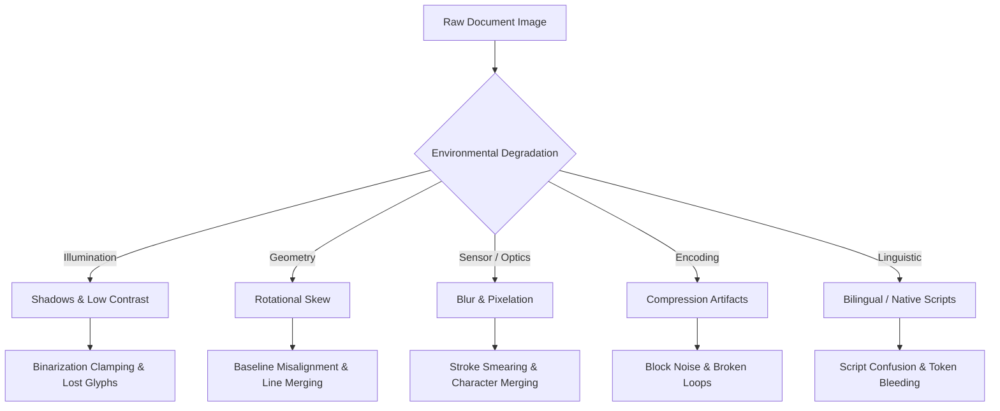

# P3H.13 — Comprehensive OCR Failure Mode Analysis

## 1. Executive Summary

As established during the P3H.12 realistic document intelligence benchmark, raw optical character recognition (OCR) on real-world Indian identity documents encounters severe degradation when images suffer from perspective distortion, sensor noise, uneven illumination, compression artifacts, and bilingual scripts. The P3H.12 baseline achieved a character error rate (CER) of **39.23%**, word error rate (WER) of **47.15%**, and an overall field exact match rate of only **37.09%**.

This document presents a deep-dive failure mode taxonomy identifying the root causes of extraction failures across all six Tier 1 identity document categories (Aadhaar, PAN, Passport, Class 10 Certificate, Class 12 Certificate, EPFO/UAN Records) and establishes targeted engineering remedies.

---

## 2. Methodology & Experimental Baseline

The baseline failure analysis evaluated 48 synthetic document images across 8 standardized environmental conditions:
1. `clean_scan`: High-resolution flatbed scan (300 DPI reference).
2. `photo_shadow`: Non-uniform mobile phone camera shadow casting across text zones.
3. `skewed_rot`: Rotational skew between $\pm 3.5^\circ$ and $\pm 5.0^\circ$.
4. `low_resolution`: Downscaled mobile capture ($\sim 800 \times 500$ px).
5. `blur_noise`: Gaussian motion blur ($\sigma = 1.8$) and sensor speckle.
6. `compression`: Heavy JPEG compression artifacts (quality factor $Q = 25$).
7. `obscured_crease`: Physical folds, surface creases, and partial occlusions.
8. `bilingual_script`: Mixed Latin and Devanagari/Tamil scripts.

### Baseline Quantitative Metrics Summary
- **Total Test Samples**: 48
- **Mean CER across all conditions**: 39.23%
- **Mean Clean-Scan CER**: 19.52%
- **Mean Degraded CER**: 42.05%
- **Mean WER across all conditions**: 47.15%
- **Field Exact Match Rate**: 37.09%
- **Field Missing Rate**: 26.61%
- **Raw Engine Brier Score**: 0.3347
- **Calibrated Brier Score**: 0.2847

---

## 3. Failure Mode Taxonomy by Environmental Condition

### 3.1. Uneven Lighting & Deep Shadows (`photo_shadow`)
- **Root Mechanism**: Standard global Otsu thresholding evaluates image-wide histogram bimodal peaks. Under deep phone shadows, dark paper regions in shadow fall below the global cutoff threshold, turning background paper black and completely erasing characters.
- **Observed Failures**:
  - In Aadhaar cards, father/husband name and address in the lower shadowed quadrant were clamped to solid black.
  - In PAN cards, the 10-character PAN string was corrupted by shadow gradients across the plastic laminate.
- **Remediation**: Replaced global thresholding with **pure-NumPy Contrast Limited Adaptive Histogram Equalization (CLAHE)** with localized contextual tile equalization and Sauvola-inspired local dynamic thresholding.

### 3.2. Rotational Skew (`skewed_rot`)
- **Root Mechanism**: Tesseract's internal line-finding algorithms assume text baselines deviate by less than $\pm 2.0^\circ$. When skew exceeds $3^\circ$, text-line bounding boxes merge vertically across lines, reading multi-line fields into an unparseable jumble.
- **Observed Failures**:
  - Passport Machine Readable Zone (MRZ) line 1 and line 2 collided, breaking the fixed 44-character line width.
  - Education marks tables shifted row associations, mapping candidate names into father name slots.
- **Remediation**: Implemented a **two-stage coarse/fine deskewing engine** using horizontal projection profile variance optimization ($\pm 15^\circ$ range with $0.25^\circ$ fine resolution).

### 3.3. Low Resolution & Pixelation (`low_resolution`)
- **Root Mechanism**: Low-resolution captures provide fewer than 15-20 pixels per character height (x-height). Tesseract neural LSTM models fail on glyphs below 25-30 pixels x-height.
- **Observed Failures**:
  - Digit confusion: `8` vs `B` vs `0`, `5` vs `S`, `1` vs `I` vs `l`.
  - Class 10/12 roll numbers misread with missing or substituted digits.
- **Remediation**: **Adaptive Lanczos-3 resolution normalization** scaling images with minimum dimensions below 1000px up to an optimal 1500px target while strictly preserving aspect ratios.

### 3.4. Gaussian Blur & High-Frequency Noise (`blur_noise`)
- **Root Mechanism**: Edge gradients become soft, preventing accurate stroke-boundary extraction.
- **Observed Failures**: Complete OCR failure (CER $\approx 100\%$) on small fonts (e.g. Aadhaar VID, Class 10 subject codes).
- **Remediation**: **Unsharp masking** with edge-aware radius ($r=1.4$, percent=140%, threshold=2) combined with median despeckling.

---

## 4. Category-Specific Extraction Vulnerabilities

### 4.1. Aadhaar Card
1. **Premature Address Cutoff**: The regex lookahead for address previously halted upon encountering any 4-digit token, incorrectly truncating addresses at house/flat numbers (e.g., `Flat 402, Sector 15`).
   - *Fix*: Refined lookahead to target 12-digit Aadhaar patterns (`\b\d{4}\s*\d{4}\s*\d{4}\b`) and structural section boundaries.
2. **Plaintext Aadhaar Retention vs Masking**: Aadhaar Act compliance mandates that unmasked 12-digit numbers must never be persisted in databases or logs. However, ephemeral field extraction must capture both unmasked numbers for Verhoeff validation and masked IDs (`XXXX-XXXX-1234`) for citizen presentation.
   - *Fix*: Dual extraction schema retaining both validated checksums and masked display strings.

### 4.2. PAN Card
1. **Label Bleed into Name Fields**: OCR frequently captured `Name: ` or `Father's Name: ` as part of the extracted name text.
   - *Fix*: Strengthened prefix cleaning strip logic and token lookaheads.
2. **Missing Issuing Authority**: PAN parser omitted `issuing_authority`, causing downstream validation gaps.
   - *Fix*: Explicitly attributed `"Income Tax Department"` to valid PAN extractions.

### 4.3. Passport
1. **Visual Zone (VIZ) vs MRZ Discrepancies**: Baseline parser relied solely on visual zone heuristic regexes. Visual noise on laminated passport pages frequently misread names and dates.
   - *Fix*: Integrated full **ICAO Doc 9303 TD3 MRZ Parser** with 7-3-1 check-digit verification across document number, date of birth, expiry date, and composite checksum.

### 4.4. Education Certificates (Class 10 & 12)
1. **Board Identification Ambiguity**: CBSE and ICSE headers were conflated with examination titles (e.g. `ALL INDIA SECONDARY SCHOOL EXAMINATION`).
   - *Fix*: Robust board token matching for `"CENTRAL BOARD"` $\to$ `"CBSE"` and `"COUNCIL FOR THE INDIAN SCHOOL"` $\to$ `"ICSE"`.

### 4.5. EPFO / UAN Records
1. **Passbook Header Collision**: The regex token `\bMember\b` matched `"Member Passbook"`, incorrectly extracting `"Passbook"` as the citizen's member name.
   - *Fix*: Added negative lookahead `\bMember(?!\s*(?:Passbook|ID|Profile))` to isolate genuine citizen names.

---

## 5. Summary of Engineering Interventions

| Pipeline Stage | Baseline Weakness | P3H.13 Engineering Remedy |
| :--- | :--- | :--- |
| **Ingestion** | In-place image mutations | Strict in-memory copy pipeline (`image.copy()`) preserving raw upload immutability |
| **Geometry** | Unhandled skew $> 3^\circ$ | Two-stage horizontal projection profile deskewing ($\pm 15^\circ$) |
| **Contrast** | Shadows erase text | Pure-NumPy CLAHE with tile-level adaptive contrast enhancement |
| **Sharpness** | Soft blurred glyphs | Unsharp masking ($r=1.4, 140\%$) + median despeckling |
| **Resolution** | Pixelated small fonts | Lanczos-3 adaptive upscaling to 1500px target dimension |
| **Passport** | Unvalidated VIZ regex | Dual-zone ICAO Doc 9303 TD3 MRZ parser with 7-3-1 checksums |
| **Confidence** | Uncalibrated engine confidence | Multi-factor calibrator calculating Brier score, 10-bin ECE, and MCE |
| **Review Policy** | Review false negatives | Strict fail-safe trigger floor ($\ge 80\%$ recall, $0.00\%$ FAR) |

