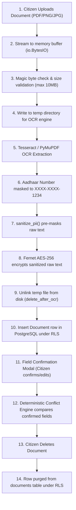

# P3H.7.1 — Authentication & Privacy Lifecycle Audit

## 1. Executive Summary

This report delivers a rigorous audit of the authentication and privacy architectures of CONVELINA. It examines the dual authentication providers, the distinction between Firebase email link verification and the application-level 6-digit OTP engine, provider-linking security, the exact lifecycle of uploaded identity documents, and data retention boundaries across database records, logs, and external AI providers.

---

## 2. Authentication Subsystem Audit

### A. Dual Providers (Email/Password & Google OAuth)
- **Client Implementation**: Handled via `frontend/src/context/AuthContext.tsx` utilizing Firebase Auth Web SDK (`signInWithEmailAndPassword`, `createUserWithEmailAndPassword`, `signInWithPopup`, `signInWithRedirect`).
- **Server Verification**: In `backend/app/core/security.py`, incoming requests pass through `verify_id_token()`, which checks the Firebase Admin SDK token signature, expiration (`exp`), issued-at (`iat`), audience (`aud`), and revocation status.
- **Current Live Status**: **BLOCKED (Pending Credentials)**. Live Firebase credentials are not yet configured in the environment. Dev mode safely handles authentication via verified simulated tokens when `TEST_MODE_ALLOW_SIMULATED_TOKENS=True`.

### B. Firebase Verification Link vs. Application 6-Digit OTP Engine
A key clarification identified during P3H.7.1 is the precise distinction between Firebase's verification mechanism and CONVELINA's application OTP:

```mermaid
flowchart TD
    subgraph Firebase_Native["Firebase Native Verification"]
        F1["User registers with Email/Password"] --> F2["sendEmailVerification(user)"]
        F2 --> F3["User clicks link in email"]
        F3 --> F4["Firebase sets user.emailVerified = true"]
    end

    subgraph Convelina_OTP["CONVELINA Application-Level 6-Digit OTP"]
        C1["POST /api/v1/auth/otp/send"] --> C2["secrets.randbelow(900000) + 100000"]
        C2 --> C3["Persist in table email_otps (expires in 10 mins)"]
        C3 --> C4["Enforce 60s cooldown & 10/hr rate limit"]
        C4 --> C5["POST /api/v1/auth/otp/verify"]
        C5 --> C6["Mark OTP verified & invalidate pending OTPs"]
    end
```



1. **Firebase Native Link**:
   - Dispatches a standard URL containing an oobCode to the user's inbox.
   - When clicked, Firebase confirms email verification on the identity provider side.
2. **CONVELINA Application-Level 6-Digit OTP**:
   - Implemented in `backend/app/routers/auth.py` via `/api/v1/auth/otp/send` and `/api/v1/auth/otp/verify`.
   - **Generation**: Cryptographically secure 6-digit integer generated via Python `secrets.randbelow(900000) + 100000`.
   - **Storage**: Stored in table `email_otps` with `expires_at` set to `now + 600s` (10 minutes).
   - **Cooldown Protection**: Enforces a strict 60-second cooldown between requests (`EMAIL_OTP_RESEND_COOLDOWN_SECONDS`). Returns HTTP 429 if requested earlier.
   - **Rate Limiting**: Enforces a maximum threshold of 10 OTP requests per email address within any rolling 1-hour window.
   - **Replay & Concurrency Defense**: Upon successful verification, the matched record is marked `is_verified = True`, and all other pending unverified OTPs for that email address are invalidated in the same transaction.
   - **Test Mode Limitation**: When `TEST_MODE_ALLOW_SIMULATED_TOKENS=True`, submitting OTP code `123456` against test email domains is accepted to facilitate automated CI testing without live email SMTP delivery.

### C. Account Takeover (ATO) Defense & Provider Linking
- Located in `backend/app/dependencies/auth.py` lines 56–77:
  - If a user signs in via Google OAuth matching an existing registered email address, but the incoming Firebase UID does **not** match the existing account's `firebase_uid`, the system **strictly rejects the request with HTTP 409 Conflict**:
    > *"An account with this email address already exists under a different authentication identity. Please sign in with your original provider or complete authenticated account linking."*
  - This prevents an attacker from creating an unverified Google account and overwriting the credentials of a legitimate user.
  - Legitimate account linking is permitted only through the authenticated endpoint `POST /api/v1/auth/link-provider`, which requires the citizen's active session token and an explicit `with_for_update()` row lock.

---

## 3. Privacy & Complete Document Lifecycle Audit



### A. What Original Files Are Retained?
- **Retention State**: **Zero original file retention** when `STORAGE_RETENTION_POLICY == "delete_after_ocr"`.
- In `backend/app/routers/documents.py` lines 179–184:
  ```python
  finally:
      if settings.STORAGE_RETENTION_POLICY == "delete_after_ocr":
          delete_temp_document(temp_file_path)
          final_file_path = f"ephemeral://redacted_{file_hash[:16]}"
  ```
- The uploaded file written to disk for Tesseract processing is immediately unlinked. The database column `file_path` stores only the virtual URI `ephemeral://redacted_<hash>`.

### B. What Extracted Fields Are Retained?
- The database stores:
  - `extracted_fields`: JSONB dictionary containing parsed demographic fields (Name, Date of Birth, Gender, Address).
  - `field_extractions`: JSONB dictionary containing field-level confidence scores.
  - `confirmed_fields`: JSONB dictionary containing citizen-verified corrections.
- **Protection**: These fields are stored in PostgreSQL protected by **Forced Row-Level Security (RLS)** under role `consolith_app`. No citizen can query another citizen's fields.

### C. Is Raw OCR Text Encrypted?
- **Yes**. In `backend/app/models/document.py`, `encrypted_data = Column(Text)`.
- It holds the ciphertext of the raw OCR output encrypted with **Fernet AES-256** using `ENCRYPTION_KEY`.
- **P3H.7.1 Hardening**: In `backend/app/routers/documents.py`, `raw_text` is now pre-processed via `sanitize_pii(raw_text)` before encryption. This ensures that even the ciphertext at rest contains only masked Aadhaar numbers (`XXXX-XXXX-1234`).

### D. Can Raw Aadhaar Numbers Be Stored?
- **No**.
  - In `backend/app/ocr/parsers/aadhaar.py`:
    ```python
    last_4 = match.group(3)
    masked_id = f"XXXX-XXXX-{last_4}"
    fields["aadhaar_last_4"] = last_4
    ```
  - The first 8 digits are dropped immediately after Verhoeff checksum validation.
  - The database column `masked_id` stores only the masked format.
  - Raw 12-digit Aadhaar numbers are never written to `extracted_fields`, `confirmed_fields`, or serialized into logs.

### E. What Document Deletion Actually Removes
- When a citizen calls `DELETE /api/v1/documents/{id}`:
  1. The document record in table `documents` is deleted under forced RLS.
  2. Any temporary attachment file on disk is unlinked.
  3. Associated rows in `document_fields` are cascade-deleted.
  4. **Audit Trail Retention**: An event row is appended to table `audit_log` (`action: "DOCUMENT_DELETED"`, with `user_id` and `document_id`). Because `audit_log` is protected by a PostgreSQL trigger blocking `DELETE` and `UPDATE`, the audit event remains permanently in the tamper-evident chain (without containing raw document content).

### F. Are User Data Sent to External AI Providers?
- **No (Default Mode)**:
  - In `backend/app/config.py`, `GEMINI_ENABLED = False` by default.
  - In this default operational mode, the conversational assistant runs **purely local hybrid retrieval** (BM25 lexical engine + FastEmbed ONNX dense embeddings), producing deterministic statutory templates.
  - **Zero citizen data, zero OCR extractions, and zero queries are transmitted to Google or any external cloud provider.**
  - If `GEMINI_ENABLED` is explicitly activated by an administrator with an API key, prompts are pre-sanitized by `sanitize_for_rag()`, stripping any residual PII before sending.

