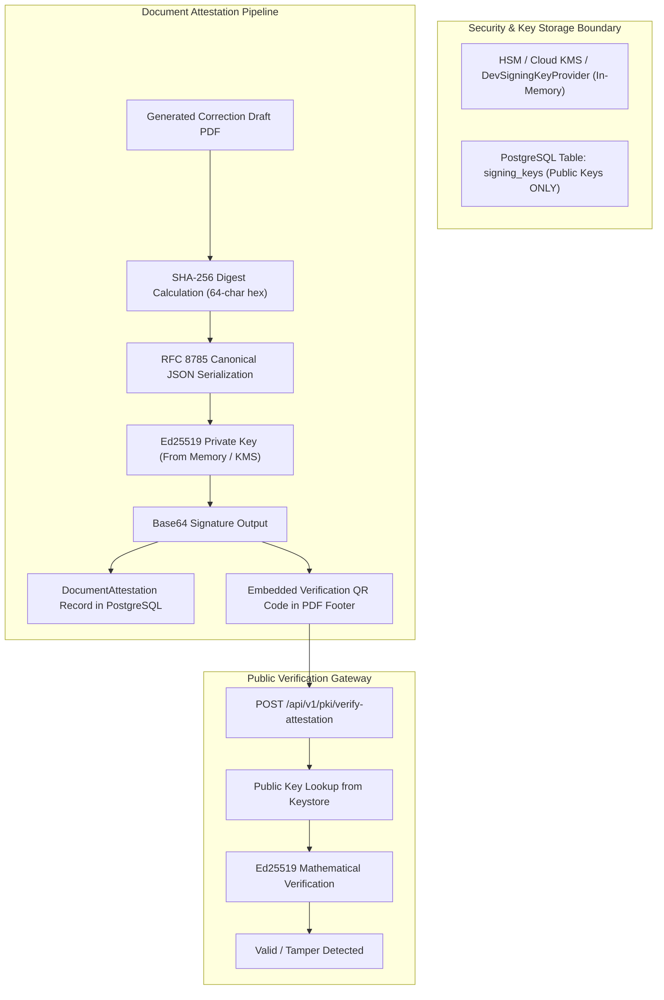

# P3H.7.1 — Cryptographic Subsystem & Ed25519 PKI Audit

## 1. Executive Summary

This report provides a security, operational, and legal audit of CONVELINA's cryptographic document attestation subsystem. It details the Ed25519 asymmetric signature architecture, canonical payload structure, private key isolation, tamper-detection mechanisms, ReportLab anti-counterfeiting guardrails, and statutory legal boundaries.

---

## 2. Ed25519 Subsystem Architecture & Key Isolation



### A. Where the Platform Private Signing Key Is Stored
- **Database Non-Storage Invariant**: In `backend/app/models/pki.py`, table `signing_keys` contains columns: `id`, `key_id`, `public_key`, `fingerprint`, `algorithm`, `purpose`, `status`, `valid_from`, `valid_until`.
- **Zero Private Key Persistence**: The table contains **no column** for private keys. Private keys are never persisted in the database, committed to Git, or returned in API responses.
- **Development Key Provider**: In local development, `DevSigningKeyProvider` (`backend/app/core/crypto.py`) maintains private keys in isolated Python memory (`_dev_keys` dictionary).
- **Production KMS Abstraction**: In production environments, this interface hooks into hardware security modules (HSM) or cloud key management services (GCP Cloud KMS / AWS KMS).

### B. Can Private Keys Be Exposed Through APIs or Logs?
- **No**.
  - `SigningKeyResponse` schema (`backend/app/schemas/pki.py`) defines only: `id`, `key_id`, `public_key`, `fingerprint`, `algorithm`, `purpose`, `status`, `valid_from`, `valid_until`.
  - The signing methods accept a private key object and return only the resulting base64 signature string.
  - No logging statements output private key bytes or seeds.

### C. Key Rotation & Revocation
- **Endpoint**: `POST /api/v1/pki/admin/rotate-keys` (Administrative role required).
- Generates a new Ed25519 keypair, persists the new public key in `signing_keys` with status `active`, marks previous keys as `retired`, and logs an immutable audit event in `audit_log`.
- Compromised keys can be revoked via `POST /api/v1/pki/admin/revoke-key` with a mandatory revocation reason.

---

## 3. What Exactly Is Signed? (Canonical RFC 8785 Payload)

The digital signature does not sign an arbitrary string or raw PDF stream directly. It signs a strictly ordered, UTF-8 encoded canonical JSON dictionary following RFC 8785 principles (`CanonicalJSONSerializer`):

```json
{
  "attestation_id": "8f3b2e1a-4c5d-6e7f-8a9b-0c1d2e3f4a5b",
  "attestation_type": "Platform Administrative Attestation",
  "citizen_id": "usr_cit_001",
  "document_fingerprint": "a3f5b7c912de84092b74051a89c362145890eef5312789bc4512034871928374",
  "document_id": "doc_0182",
  "document_type": "name_change_representation",
  "expires_at": "2027-11-09T14:00:00Z",
  "hash_algorithm": "SHA-256",
  "issued_at": "2026-11-09T14:00:00Z",
  "issuer": "CONVELINA Platform Attestation Service",
  "key_fingerprint": "d98e72fa123b...",
  "key_id": "consolith-platform-key-2026-v1",
  "policy_version": "2026.1",
  "schema_version": "1.0",
  "signer_id": "usr_admin_001",
  "signing_algorithm": "Ed25519",
  "signing_purpose": "document_attestation",
  "user_id": "usr_cit_001"
}
```

---

## 4. Tamper Detection & QR Verification

- **Mechanism**:
  1. The citizen or verifying official uploads the document to `/api/v1/pki/verify-attestation` or scans the embedded QR code.
  2. The system recalculates the SHA-256 hash of the presented document.
  3. If even a **single byte** of the PDF has been altered, the calculated digest differs from `document_fingerprint`.
  4. The endpoint immediately returns:
     ```json
     {
       "is_valid": false,
       "verification_status": "TAMPERED_OR_INVALID",
       "reason": "Calculated document fingerprint does not match the signed attestation record."
     }
     ```
  5. If the hash matches, the system mathematically verifies the base64 signature against the public key stored in the keystore.

---

## 5. Anti-Counterfeiting Guardrails & Legal Boundaries

### A. ReportLab Anti-Counterfeiting Guardrail
In `backend/app/services/correction_draft_service.py`:
- Attempting to generate a PDF with provenance `OFFICIAL_ORIGINAL` or `OFFICIAL_COPY` is trapped by an unrecoverable `SecurityViolationError`:
  ```python
  if provenance in ("OFFICIAL_ORIGINAL", "OFFICIAL_COPY"):
      raise SecurityViolationError(
          "Refusing to generate document: CONVELINA is strictly prohibited from "
          "manufacturing or simulating official government originals."
      )
  ```
- Every generated draft document has a mandatory diagonal background watermark rendered across every page:
  ```
  SYNTHETIC DEVELOPMENT SAMPLE — NOT AN OFFICIAL GOVERNMENT FORM
  ```

### B. Legal Boundary: Not a Government Endorsement or Statutory eSign
- **Statutory Truth**: An Ed25519 platform signature generated by CONVELINA is an **internal cryptographic attestation of application integrity**.
- It is **NOT**:
  1. A legally recognized statutory digital signature under Section 3A of the Information Technology Act, 2000 (such as an Aadhaar-based eSign issued by a licensed Certifying Authority like CDAC, NSDL, or eMudhra).
  2. A government attestation, endorsement, or approval from UIDAI, Income Tax Department, MEA, or EPFO.
  3. A substitute for notarization, deed poll affidavits, or court decrees where statutory law requires them.
- All generated documents and verification screens clearly state:
  > *"This cryptographic attestation confirms that the document was generated within CONVELINA and has not been altered since generation. It does not represent government authorization or official statutory certification."*

