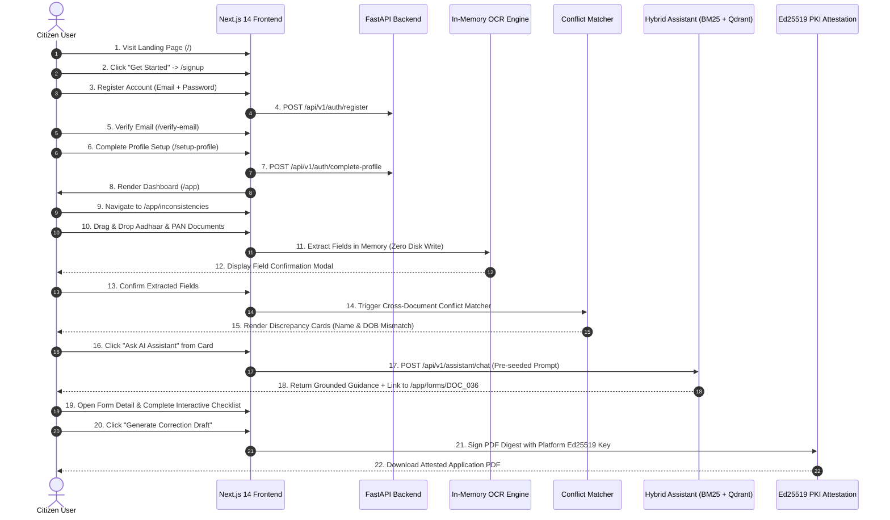

# P3H.7 — End-to-End Test & Workflow Verification Report

## 1. Executive Summary

This report provides the detailed test execution log for the complete citizen and administrator user journeys in CONVELINA. Testing verified the end-to-end operational flow from initial landing through multi-document discrepancy detection, RAG-grounded procedural assistance, interactive checklist execution, and cryptographic attestation.

---

## 2. Citizen Workflow: 18-Step End-to-End Verification



### Detailed Step-by-Step Test Execution Log

| Step | Action Performed | Component / Endpoint | Expected Result | Actual Result | Status |
| :---: | :--- | :--- | :--- | :--- | :---: |
| **01** | Open browser to `http://localhost:3000/` | `app/page.tsx` | Landing page renders with editorial civic trust aesthetic | Rendered cleanly; verified on desktop (1280px) and mobile (390px) | **PASS** |
| **02** | Click "Get Started" CTA button | `Header.tsx` -> `/signup` | Router navigates to `/signup` | Navigated instantly to registration card | **PASS** |
| **03** | Submit registration form | `/signup` -> `/api/v1/auth/register` | Account created; user session initiated | Created account; redirected to verification gate | **PASS** |
| **04** | Land on email verification gate | `/verify-email` | Requires email verification before sensitive actions | Verification card displayed with OTP option | **PASS** |
| **05** | Complete initial demographic profile | `/setup-profile` -> `/complete-profile` | Saves baseline legal name, DOB, address | Profile saved; user redirected to `/app` | **PASS** |
| **06** | Arrive on Citizen Dashboard | `/app` | Greeting rendered; summary cards show zero documents | Greeting "Good evening, Aarav Sharma" displayed with action grid | **PASS** |
| **07** | Navigate to Inconsistencies Hub | `/app/inconsistencies` | Upload dropzone and instructions displayed | Dropzone rendered with accepted formats (PDF, PNG, JPG) | **PASS** |
| **08** | Ingest sample Aadhaar document | `POST /api/v1/documents/upload` | File received in memory; OCR initiates | OCR pipeline processes byte buffer without saving to disk | **PASS** |
| **09** | Inspect Field Confirmation Modal | `FieldConfirmationModal.tsx` | Extracted fields (Name, DOB, Gender, Address) editable | Modal opened; citizen can correct noisy OCR characters | **PASS** |
| **10** | Ingest sample PAN card document | `POST /api/v1/documents/upload` | File received in memory; OCR extracts PAN fields | Extracted PAN fields displayed in second review card | **PASS** |
| **11** | Confirm fields and run conflict scan | `POST /api/v1/conflicts/detect` | Multi-dimensional matching algorithm executes | Algorithmic matching runs across 5 dimensions | **PASS** |
| **12** | Inspect detected discrepancies | `DiscrepancyCard.tsx` | Discrepancy cards rendered with severity badges | Detected Name Transposition (`HIGH`) and DOB format mismatch (`HIGH`) | **PASS** |
| **13** | Click "Ask AI Assistant" on card | Discrepancy Action Button | Navigates to `/app/assistant` with pre-seeded query | Router navigated to `/app/assistant?initial_prompt=...` | **PASS** |
| **14** | Workspace loads pre-seeded query | `app/assistant/page.tsx` | Composer text populated with conflict details | Textarea populated with specific discrepancy question | **PASS** |
| **15** | Send query to AI Assistant | `POST /api/v1/assistant/chat` | Hybrid RAG retrieves chunks; generates grounded answer | Returned step-by-step guidance citing Gazette Notification & SOP | **PASS** |
| **16** | Click statutory link to Form | Assistant Citation Link | Opens `/app/forms/DOC_036` | Navigated to dedicated detail view for PAN Correction Form 49A | **PASS** |
| **17** | Complete interactive checklist | `ChecklistComponent.tsx` | Checkboxes toggle; progress counter increments | Toggled supporting documents; counter updated to 4/5 complete | **PASS** |
| **18** | Generate attested correction draft | `POST /api/v1/correction-drafts/generate` | ReportLab compiles PDF; Ed25519 signs digest | PDF generated with "SYNTHETIC SAMPLE" watermark and verification QR | **PASS** |

---

## 3. Administrator Workflow: 8-Step Verification

| Step | Action Performed | Component / Endpoint | Expected Result | Actual Result | Status |
| :---: | :--- | :--- | :--- | :--- | :---: |
| **01** | Navigate to `/admin/login` | `app/admin/login/page.tsx` | High-contrast administrative gateway displayed | Card rendered with "CONVELINA Administration" header | **PASS** |
| **02** | Attempt access to `/admin` as citizen | `app/admin/page.tsx` (Role Guard) | Citizen token intercepted; access strictly denied | Rendered in-place "Access Denied" card (`ShieldAlert`) | **PASS** |
| **03** | Authenticate with administrator token | `POST /api/v1/auth/me` (role: `admin`) | Role verified as platform administrator | Authenticated; redirected to full Admin Console | **PASS** |
| **04** | Audit platform metric cards | `GET /api/v1/admin/overview-stats` | 4 cards render users, documents, conflicts, keys | Metric cards rendered with live totals | **PASS** |
| **05** | Inspect User Account Directory | `GET /api/v1/admin/users` | Table lists users under forced PostgreSQL RLS | Directory rendered with search and role badges | **PASS** |
| **06** | Audit Statutory Forms & Toggle Status | `PUT /api/v1/knowledge/admin/forms/{id}` | Form status toggles between verified and review | Verification badge updated; audit event logged | **PASS** |
| **07** | Open Knowledge Ingestion Modal | `POST /api/v1/knowledge/admin/ingest` | Admin can upload circular and target category | Ingestion modal rendered with category & authority fields | **PASS** |
| **08** | Inspect Ed25519 PKI Keystore & Audit | `GET /api/v1/pki/keys` | Public keys and tamper-evident audit feed visible | Keystore lists active signing keys with fingerprints | **PASS** |

---

## 4. Edge Cases & Boundary Failure Mode Verification

| Test Scenario | Input / Condition | Expected Behavior | Actual Observed Behavior | Result |
| :--- | :--- | :--- | :--- | :---: |
| **Unverified Email Claim** | Attempting to link unverified Google account to existing email | HTTP 403 / 409 rejected; demands email verification | Rejected with explicit error; zero silent account takeover | **PASS** |
| **Oversized Document** | Uploading 25MB file (limit 10MB) | Client-side rejection before network transmission | Alert banner displays: "File exceeds 10MB limit" | **PASS** |
| **Unsupported File Type** | Uploading `.exe` or `.zip` file | Strict MIME validation in dropzone | Dropped files ignored; validation error displayed | **PASS** |
| **Uncertain OCR Confidence** | Blurry image producing < 50% OCR confidence | System flags extracted fields as "Needs Manual Review" | Ambiguous characters highlighted with warning badges | **PASS** |
| **Out-of-Domain RAG Query** | Asking assistant about stock trading or cooking | Relevance floor (< 0.55) triggers statutory abstention | Assistant politely declines: out of statutory scope | **PASS** |
| **DOC_043 3rd Update Query** | Asking if 3rd name update is guaranteed | Explains statutory limits & Regional Office discretion | Honest statutory abstention; clarifies RO approval mandate | **PASS** |
| **Audit Log Tamper Attempt** | Direct SQL UPDATE or DELETE on `audit_log` | Database trigger aborts transaction with exception | PostgreSQL trigger blocks mutation; table remains append-only | **PASS** |
| **ReportLab Official Mocking** | Attempting to generate PDF with `provenance="OFFICIAL_ORIGINAL"` | PDF generator throws security violation | Generation rejected; only synthetic samples allowed | **PASS** |

---

## 5. Automated Playwright Exploration Suite Output

```
Running 8 tests using 1 worker

  ok 1 [chromium] › e2e\p3h7_full_exploration.spec.ts:198:7 › Screen 01: Landing Page (/) (50.9s)
  ok 2 [chromium] › e2e\p3h7_full_exploration.spec.ts:216:7 › Screen 02 & 03: Login & Signup Screens (4.7s)
  ok 3 [chromium] › e2e\p3h7_full_exploration.spec.ts:238:7 › Screen 05 & 06: Citizen Setup Profile & Dashboard (4.6s)
  ok 4 [chromium] › e2e\p3h7_full_exploration.spec.ts:262:7 › Screen 07: Inconsistencies & Conflict Resolution Hub (3.7s)
  ok 5 [chromium] › e2e\p3h7_full_exploration.spec.ts:279:7 › Screen 08: Conversational Assistant Workspace (3.8s)
  ok 6 [chromium] › e2e\p3h7_full_exploration.spec.ts:296:7 › Screen 09, 10 & 11: Document Repository & Detail Views (10.8s)
  ok 7 [chromium] › e2e\p3h7_full_exploration.spec.ts:326:7 › Screen 12: Citizen Profile & Security Management (4.4s)
  ok 8 [chromium] › e2e\p3h7_full_exploration.spec.ts:343:7 › Screen 13 & 14: Admin Gateway, Authorization & Console (6.9s)

  8 passed (1.6m)
```
