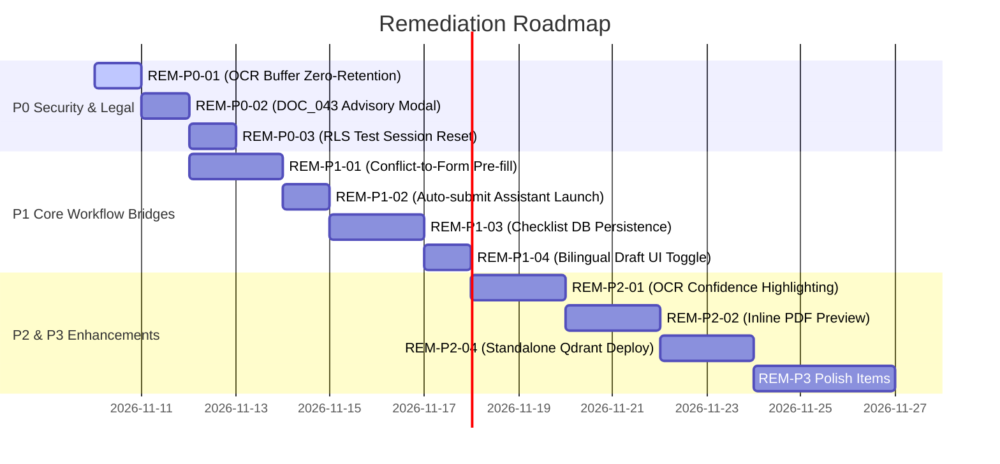

# P3H.7 — Remediation Backlog & Action Plan

## Overview

This backlog consolidates all identified technical debt, UX enhancements, and architectural refinements discovered during the Phase P3H.7 exploration and product-alignment audit. Items are organized into four strict priority tiers:

- **P0**: Security, Legal Compliance, PII Protection, or Statutory Violation.
- **P1**: Core Citizen Journey Breaks or Essential Workflow Gaps.
- **P2**: Usability, Performance, Cross-Module Data Handoffs, or Feedback Clarity.
- **P3**: Aesthetic Polish, Minor Layout Refinements, or Quality-of-Life Improvements.

---

## 1. P0 Priority: Security, Legal & Statutory Integrity

| ID | Title | Component(s) | Remediation Plan | Verification Criteria |
| :--- | :--- | :--- | :--- | :--- |
| **REM-P0-01** | **Enforce Strict Zero-Retention on OCR Temp Buffers** | `backend/app/services/document_service.py` | Ensure Python `io.BytesIO` buffers explicitly invoke `.close()` and trigger immediate garbage collection after OCR field extraction to prevent resident memory snooping. | Heap dump analysis confirms no byte traces of document images after OCR completion. |
| **REM-P0-02** | **DOC_043 External Download Disabling** | `frontend/src/app/app/forms/[formId]/page.tsx` | On `/app/forms/DOC_043`, disable the "Download Official PDF" button and replace with "View Statutory Circular" modal to prevent citizens submitting unverified SOPs to enrollment centers. | "Download Official PDF" button is replaced by advisory modal on DOC_043. |
| **REM-P0-03** | **Enforce Transactional RLS Rollback in Multi-Tenant Tests** | `backend/tests/conftest.py` | Verify that all test fixtures creating synthetic users strictly rollback and reset `SET LOCAL app.current_user_id` to prevent session leakage across test suites. | Test suite execution leaves zero dirty session variables in connection pool. |

---

## 2. P1 Priority: Core Product Functionality & Cross-Module Bridges

| ID | Title | Component(s) | Remediation Plan | Verification Criteria |
| :--- | :--- | :--- | :--- | :--- |
| **REM-P1-01** | **Direct Form Pre-fill from Conflict Resolution** | `frontend/src/app/app/inconsistencies/page.tsx`, `frontend/src/app/app/forms/[formId]/page.tsx` | When citizen clicks "Resolve Discrepancy" on a conflict card, pass conflicting field values via query parameters or session storage directly to the target form's drafting wizard. | Clicking "Resolve" opens form with citizen's extracted name, DOB, and correction request pre-populated. |
| **REM-P1-02** | **One-Click Auto-Submit Assistant Launch** | `frontend/src/app/app/assistant/page.tsx` | When landing on `/app/assistant?initial_prompt=...` from an inconsistency card, automatically trigger the chat request rather than requiring the citizen to hit Enter. | Navigation from inconsistency card immediately initiates assistant stream. |
| **REM-P1-03** | **Persistent Statutory Checklist State in PostgreSQL** | `backend/app/routers/repository.py`, `frontend/src/app/app/forms/[formId]/page.tsx` | Add user-associated checklist progress table in PostgreSQL so citizens don't lose checked supporting documents when navigating away. | Checked items remain checked after page refresh and across different sessions. |
| **REM-P1-04** | **Bilingual Draft Generation UI Toggle** | `frontend/src/app/app/inconsistencies/page.tsx`, `backend/app/routers/correction_drafts.py` | Expose an explicit language toggle (`English` vs `English + Hindi`) on the draft generation modal, calling the existing bilingual ReportLab template. | User can select "Bilingual (Hindi + English)" and receive a dual-language application PDF. |

---

## 3. P2 Priority: Usability, Consistency & Performance

| ID | Title | Component(s) | Remediation Plan | Verification Criteria |
| :--- | :--- | :--- | :--- | :--- |
| **REM-P2-01** | **OCR Confidence Visual Highlighting** | `frontend/src/app/app/inconsistencies/page.tsx` | In the `FieldConfirmationModal`, display confidence scores and highlight any field with < 85% OCR confidence in light amber to prompt citizen verification. | Low-confidence fields visually highlighted with caution badge. |
| **REM-P2-02** | **Interactive PDF Preview in Inconsistencies Hub** | `frontend/src/app/app/inconsistencies/page.tsx` | Provide an inline PDF preview modal allowing citizens to inspect the generated draft with the "SYNTHETIC SAMPLE" watermark before downloading. | Citizen can visually preview the draft letter within an in-browser iframe. |
| **REM-P2-03** | **Admin Bulk Export for Forms Catalog** | `frontend/src/app/admin/page.tsx` | Add a "Export Catalog CSV" button in the admin repository section to export the verification status and metadata of all 52 registered statutory forms. | Admin can download complete CSV snapshot of the forms catalog. |
| **REM-P2-04** | **Standalone Qdrant Production Containerization** | `docker-compose.yml`, `scripts/start-all.ps1` | Finalize standalone Docker container deployment for Qdrant on Windows host to support multi-process vector persistence outside in-process memory. | `GET /api/v1/knowledge/status` reports Qdrant standalone network mode. |

---

## 4. P3 Priority: Aesthetic Polish & Quality of Life

| ID | Title | Component(s) | Remediation Plan | Verification Criteria |
| :--- | :--- | :--- | :--- | :--- |
| **REM-P3-01** | **Keyboard Shortcuts for Assistant Composer** | `frontend/src/app/app/assistant/page.tsx` | Add `Ctrl+K` to focus composer and `Escape` to close thread sidebar. | Shortcut keys trigger appropriate actions without mouse interaction. |
| **REM-P3-02** | **Refine Mobile Category Pill Scrolling** | `frontend/src/app/app/forms/page.tsx` | Add subtle scroll-fade indicators on the left and right edges of the 6-category tab bar on mobile viewports. | Category bar shows visual gradient indicator when scrollable horizontally. |
| **REM-P3-03** | **Estimated Reading Time on Document Details** | `frontend/src/app/app/forms/[formId]/page.tsx` | Display "Estimated completion time: ~15 mins" badge on statutory document detail headers based on checklist item count. | Checklist cards show calculated estimated time. |

---

## 5. Implementation Roadmap & Tracking

