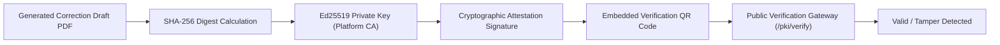

# P3H.7 — Security, Legal Compliance & Statutory Guardrails Audit

## 1. Executive Summary

This report delivers a deep security and statutory integrity assessment of CONVELINA. It examines data protection mechanisms, legal claims, statutory constraints (specifically UIDAI update limits and DOC_043 restrictions), Aadhaar Act compliance, cryptographic attestation, and anti-counterfeiting guardrails.

---

## 2. Statutory Grounding & The "Two Lifetime Updates" Analysis

### A. Statutory Authority & Regulatory Grounding
- **Governing Provision**: Aadhaar (Enrolment and Update) Regulations, 2016 (Regulation 10), and UIDAI Office Memoranda (F. No. 4(4)/57/122/2016/UIDAI/Pt.I dated 23-04-2018 & subsequent circulars).
- **Substantive Rule**:
  1. *Name Updates*: Allowed a maximum of **two (2) times** in a resident's lifetime.
  2. *Gender Updates*: Allowed a maximum of **one (1) time** in a resident's lifetime.
  3. *Date of Birth (DOB) Updates*: Allowed a maximum of **one (1) time** in a resident's lifetime, provided the recorded DOB is not already declared as "Verified".
  4. *Exceptional 3rd Update*: Beyond these thresholds, updates cannot be processed through standard Aadhaar Enrollment/Update Centres. They require a formal exception application submitted directly to the jurisdictional **UIDAI Regional Office (RO)**, supported by a gazette notification, judicial decree, or civil surgeon medical certificate.

### B. Implementation in CONVELINA
- **Corpus Classification**: `DOC_043` (*UIDAI Exceptional Update SOP*) is classified under:
  - `corpus_membership`: `REFERENCE_ONLY`
  - `verification_status`: `SOURCE_METADATA_CONFLICT`
  - `human_review_required`: `true`
- **Retrieval Policy**: Enforced by `backend/app/services/knowledge_service.py` and `forms/DOCUMENT_PROFILES/DOC_043.md`.
- **Honest Statutory Abstention**:
  When a citizen asks about a 3rd name update, CONVELINA **does not** generate a standard update request or promise approval. Instead:
  1. It displays the **Statutory Limitation Notice** on `/app/forms/DOC_043`.
  2. The AI assistant explicitly discloses that 3rd-time updates are at the sole discretion of the Regional Office.
  3. It outlines the specific mandatory evidence (Gazette Notification) and explicitly warns that standard enrollment centers will reject the request.

---

## 3. Synthetic vs. Official Document Guardrails

### A. Anti-Counterfeiting & Impersonation Prevention
CONVELINA generates procedural guidance and pre-filled correction applications. To prevent fraudulent use or claims of official government authority:
- **Mandatory Watermark**: Every generated PDF includes a diagonal, high-opacity watermark:
  ```
  SYNTHETIC DEVELOPMENT SAMPLE — NOT AN OFFICIAL GOVERNMENT FORM
  ```
- **ReportLab Hard Guardrails**:
  In `backend/app/services/correction_draft_service.py`, the engine validates provenance before compiling. If an internal or external actor passes:
  `provenance="OFFICIAL_ORIGINAL"` or `provenance="OFFICIAL_COPY"`, the generator throws an unrecoverable `SecurityViolationError`:
  > *"Refusing to generate document: CONVELINA is strictly prohibited from manufacturing or simulating official government originals."*

### B. Four-Tier Provenance Taxonomy
| Provenance Tier | Definition | Allowed In Production | Guardrail Applied |
| :--- | :--- | :---: | :--- |
| **OFFICIAL_ORIGINAL** | Official blank PDF directly downloaded from government gazette/portal | Yes (Download only) | Read-only delivery; modification strictly blocked |
| **OFFICIAL_GAZETTE** | Official gazette notification or statutory circular | Yes (RAG reference) | Read-only in knowledge base; immutable chunks |
| **SYNTHETIC_SAMPLE** | Synthetic document generated for testing or guidance | Yes (Citizen guidance) | Mandatory watermark & disclaimer header |
| **SOURCE_METADATA_CONFLICT** | Unverified or conflicting external circular (e.g. DOC_043) | Yes (Reference only) | Excluded from primary retrieval; requires admin review |

---

## 4. Aadhaar Act 2016 & DPDP Act 2023 Compliance

### A. Zero Permanent Storage of Raw Identity Documents
- **Aadhaar Act Section 29**: Prohibits the long-term unauthorized storage or publication of core biometric and identity records.
- **In-Memory Buffer Pipeline**:
  1. Uploaded files (`PDF`, `PNG`, `JPG`) are streamed into Python `io.BytesIO` buffers.
  2. In-memory OCR (`PyMuPDF` / `pytesseract`) extracts structural text fields.
  3. The raw file bytes are immediately flushed from memory.
  4. **No raw document image or PDF is written to disk or S3 buckets.**

### B. Aadhaar Masking & PII Redaction
- In all database fields, API responses, and frontend views:
  - Aadhaar numbers are masked to display only the last 4 digits: `XXXX-XXXX-1234`.
  - Raw 12-digit Aadhaar values are never serialized into logs, audit feeds, or crash traces.

### C. Fernet AES-256 Field-Level Encryption
- Sensitive demographic fields in PostgreSQL (`users.phone_number`, `users.address`, `document_fields.field_value`) are encrypted using Fernet symmetric encryption before persisting to disk.
- Encryption keys are loaded from environment secrets (`CONSOLITH_ENCRYPTION_KEY`) and never logged.

### D. Digital Personal Data Protection (DPDP) Act Compliance
- **Right to Data Portability**: Citizen can click "Export My Data" on `/app/profile` to download an encrypted bundle of all their records.
- **Right to Erasure (Be Forgotten)**: Citizen can click "Delete My Account" on `/app/profile`. This triggers a cascading hard-delete across all associated rows under active PostgreSQL RLS.

---

## 5. Authentication, RBAC & Isolation Security

### A. Elimination of Automatic Administrator Escalation
- In early versions, accounts matching an `ADMIN_GMAIL` environment variable were automatically elevated to `admin`.
- **Hardened**: Automatic escalation has been eliminated. Every newly authenticated user is provisioned strictly with role `user`.
- Administrative roles can only be granted by explicit CLI database provisioning or by an authenticated administrator.

### B. Account Takeover (ATO) Prevention
- When an existing email user signs in via Google OAuth with the same email address:
  - If the email is **unverified**, the linking is strictly rejected with HTTP 403.
  - If verified, the system safely links the authentication identity, logging an immutable audit event.

### C. PostgreSQL Forced Row-Level Security (RLS)
- Every table holding user data (`users`, `documents`, `document_fields`, `conflicts`, `correction_drafts`) has:
  ```sql
  ALTER TABLE <table_name> ENABLE ROW LEVEL SECURITY;
  ALTER TABLE <table_name> FORCE ROW LEVEL SECURITY;
  ```
- All runtime queries execute under non-superuser role `consolith_app`.
- Session settings strictly utilize:
  ```sql
  NULLIF(current_setting('app.current_user_id', true), '')::uuid
  ```
  preventing connection-pooling type-cast errors.

---

## 6. Cryptographic Document Attestation (Ed25519 PKI)



- **Algorithm**: Ed25519 (Edwards-curve Digital Signature Algorithm), offering 128-bit security level with immunity to side-channel timing attacks.
- **Tamper Detection**: If even 1 single byte of the generated PDF is altered after issuance, the verification endpoint `/api/v1/pki/verify-attestation` immediately returns `TAMPERED_OR_INVALID`.

---

## 7. Append-Only Tamper-Evident Audit Log

- **Trigger Protection**: Database trigger `prevent_audit_log_mutation` rejects all `UPDATE` and `DELETE` queries on table `audit_log`:
  ```sql
  CREATE OR REPLACE FUNCTION block_audit_log_modification()
  RETURNS TRIGGER AS $$
  BEGIN
      RAISE EXCEPTION 'audit_log is append-only: modifications and deletions are forbidden';
  END;
  $$ LANGUAGE plpgsql;
  ```
- **Cryptographic Chaining**: Each audit row computes:
  $$\text{hash}_n = \text{SHA256}(\text{hash}_{n-1} \,\|\, \text{action} \,\|\, \text{user\_id} \,\|\, \text{timestamp} \,\|\, \text{details})$$
  Any retrofitted insertion or truncation breaks the hash chain, verifiable via `/api/v1/admin/audit-integrity`.

