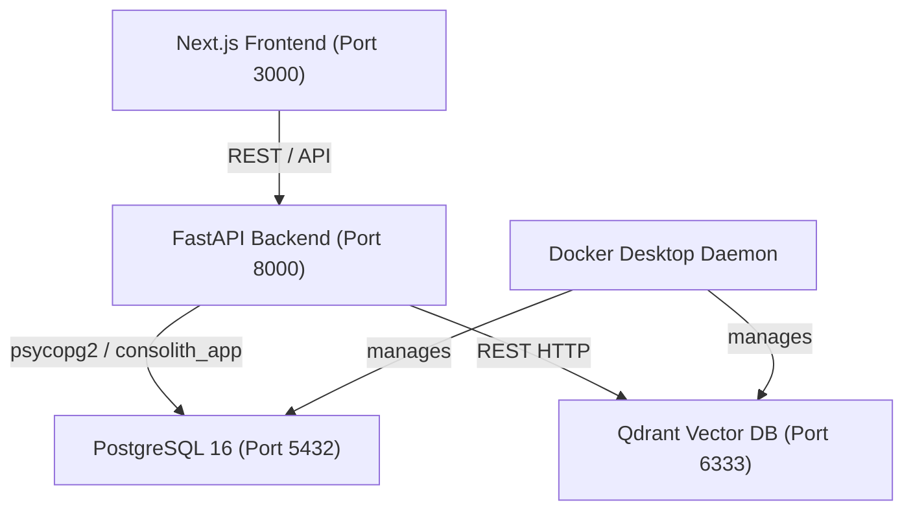

# CONVELINA P3H.8 — Local Runtime & Operational Guide (Windows 11)

## Executive Summary

This guide provides end-to-end instructions for cold-starting, operating, verifying, and testing the complete CONVELINA local runtime stack on Windows 11.

---

## 1. System Architecture Overview



---

## 2. Cold-Start Procedure (Step-by-Step)

### Step 1: Ensure Docker Daemon is Running
If Docker CLI reports named pipe errors (`open //./pipe/dockerDesktopLinuxEngine`), initialize the backend:
```powershell
& "C:\Users\ajaya\AppData\Local\Programs\DockerDesktop\resources\com.docker.backend.exe"
```

### Step 2: Start PostgreSQL & Qdrant Containers
```powershell
cd C:\Users\ajaya\Desktop\consolin
docker start convelina-postgres convelina-qdrant
```
Confirm containers are up:
```powershell
docker ps --filter "name=convelina"
```
*Expected*: `convelina-postgres` (port 5432) and `convelina-qdrant` (port 6333) should report `Up (healthy)`.

### Step 3: Run Database Migrations
Ensure the database schema is at migration 021:
```powershell
.\backend\.venv\Scripts\python.exe scripts/run_migrations.py
```
*Expected output*:
```text
Found 21 migration files in backend/migrations.
Current applied migrations in database: 21
No pending migrations to apply. Database is fully up to date!
```

### Step 4: Start FastAPI Backend
```powershell
$env:PYTHONPATH='backend'
.\backend\.venv\Scripts\python.exe -m uvicorn app.main:app --port 8000
```
Backend will be available at `http://127.0.0.1:8000`.

### Step 5: Start Next.js Frontend
In a separate terminal:
```powershell
cd frontend
npm run start # or npm run dev
```
Frontend will be available at `http://localhost:3000`.

---

## 3. Runtime Health Verification

Verify system readiness by querying the enhanced diagnostics endpoint:
```powershell
curl.exe -s http://127.0.0.1:8000/health | jq
```
Expected output:
```json
{
  "status": "healthy",
  "services": {
    "fastapi": {
      "status": "up",
      "version": "1.0.0"
    },
    "postgres": {
      "status": "up",
      "role": "consolith_app",
      "database": "consolith"
    },
    "database_migrations": {
      "status": "up",
      "applied_count": 21,
      "latest_applied": "021_citizen_checklist_progress.sql"
    },
    "qdrant": {
      "status": "up",
      "mode": "in_process",
      "collections": [
        "consolith_knowledge",
        "consolith_forms"
      ]
    },
    "ocr_engine": {
      "status": "up",
      "engine": "tesseract",
      "available": true
    },
    "storage": {
      "status": "up",
      "retention_policy": "delete_after_ocr",
      "temp_dir_available": true
    },
    "firebase_auth": {
      "status": "configured"
    },
    "gemini": {
      "status": "disabled",
      "model": null
    }
  }
}
```

---

## 4. Verification Test Commands

### 4.1 RLS Multi-Tenant Security Suite
Executes 10 database-level isolation and privilege checks:
```powershell
.\backend\.venv\Scripts\python.exe scripts/test_rls_isolation.py
```
*Target*: 10/10 tests passed.

### 4.2 Backend Persistence & RLS Pytest Suite
```powershell
.\backend\.venv\Scripts\python.exe -m pytest backend/tests/test_p3h8_database_persistence.py -v
```
*Target*: 4/4 tests passed.

### 4.3 Knowledge Ingestion & Citizen Repository Pytest Suites
```powershell
.\backend\.venv\Scripts\python.exe -m pytest backend/tests/test_p3h6_citizen_repository.py backend/tests/test_p3h5_knowledge_ingestion.py -v
```
*Target*: 25/25 tests passed.

### 4.4 Frontend TypeScript Verification
```powershell
cd frontend
npx tsc --noEmit
```
*Target*: Exited with code 0 (zero type errors).

### 4.5 Full Application Exploration E2E Playwright Suite
```powershell
cd frontend
npx playwright test e2e/p3h7_full_exploration.spec.ts
```
*Target*: 8/8 tests passed across 14 screens.
