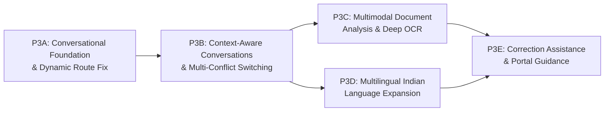

# CONVELINA — Phase P3 Conversational AI Workspace: Architecture Audit & Implementation Roadmap

**Document Version:** 1.0.0
**Audit Date:** November 13, 2026
**Auditor:** Principal Application Security Architect & Full-Stack AI Engineer
**Repository:** `https://github.com/Ajay-4772/convelina.git`
**Target Branch:** `main` | **Verified HEAD Commit:** `9b3ab03c1b926bbac15bdace0ee96fef86792bcf`
**Security Classification:** Highly Confidential / Official Identity Platform

---

## 1. Executive Summary

CONVELINA is an AI-powered identity document conflict detection and administrative correction assistance platform designed for Indian citizens. It processes discrepancies across six core document categories:
1. Aadhaar Card (UIDAI)
2. PAN Card (Income Tax Department / Protean / NSDL)
3. Passport (Ministry of External Affairs / CPV)
4. Class 10 Secondary Certificate (State/CBSE Boards)
5. Class 12 Senior Secondary Certificate (State/CBSE Boards)
6. EPF / UAN Member Records (Employees' Provident Fund Organisation)

This architecture audit evaluated the existing conversational AI workspace across both backend and frontend layers. Contrary to expectations of a "blank slate" starting phase, our inspection revealed that a substantial portion of the conversational engine, forced PostgreSQL Row-Level Security (RLS) tables, Qdrant hybrid retrieval, PII sanitization pipelines, multimodal temporary attachment storage, and administrative drafting services have **already been designed, implemented, and verified** across earlier engineering sprints (notably Modules 5, 6, 7, and Phase P3A–P3H).

However, key architectural gaps, missing routes, and UX bottlenecks currently prevent the conversational workspace from delivering a seamless user experience:
1. **Critical Route Defect**: The dynamic route folder `frontend/src/app/app/assistant/[conversationId]/` exists but lacks `page.tsx`. Consequently, navigating to or selecting a past conversation in the UI triggers a 404 error.
2. **Synchronous Blocking Chat Execution**: The existing `/api/v1/assistant/chat` endpoint executes hybrid retrieval and Gemini generation synchronously in 2 to 5 seconds. Real-time streaming token delivery (Server-Sent Events) is **not implemented**.
3. **Unbounded Message Loading**: The message history retrieval endpoint loads all messages for a conversation without limit/cursor pagination, creating scaling bottlenecks for extended inquiries.
4. **Chat Response In-Place Regeneration**: The chat thread lacks an in-place "Regenerate Response" trigger for conversational turns.

The existing foundation is robust, secure, and compliant with the Aadhaar Act and PostgreSQL Forced RLS. By resolving these targeted gaps, Phase P3 can transform CONVELINA into an institutional-grade conversational AI workspace.

---

## 2. Verified Repository State

### 2.1 Git Status & Branch Tracking
- **Active Branch**: `main`
- **Upstream Tracking**: `origin/main`
- **Sync Status**: `Your branch is up to date with 'origin/main'.` (0 unpushed commits)
- **Latest Commit**: `9b3ab03c1b926bbac15bdace0ee96fef86792bcf` (`fix(tests): resolve PDF export structural assertions and Qdrant ingestion rollback in container`)
- **Parent Commit**: `6e81e47094abfb11a240d65749fd75aaa16be43f` (`ci(security): fix GitHub Actions SAST, Gitleaks, and Trivy checks`)

### 2.2 Working Tree Inspection
- **Untracked / Scratch Files**: Exactly 81 untracked helper scripts, fixtures, and reference data in `scripts/` and `forms/`.
- **Modified Tracked Files (Preserved Uncommitted)**:
  - `backend/app/rag/schemas.py`
  - `backend/app/routers/repository.py`
  - `backend/app/services/repository_service.py`
  - `frontend/e2e/citizen_repository.spec.ts`
  - `frontend/src/app/app/forms/page.tsx`
  - `frontend/src/components/assistant/AssistantComposer.tsx`
  - `frontend/src/components/assistant/AssistantSidebar.tsx`
  - `frontend/src/components/assistant/AssistantWorkspace.tsx`
  - `frontend/src/components/workspace/WorkspaceHeader.tsx`
  - `frontend/src/components/workspace/WorkspaceSidebar.tsx`
  - `frontend/src/lib/api.ts`
- **Integrity Guarantee**: All 93 working-tree entries have been preserved intact without modification.

### 2.3 Database Migration History
PostgreSQL migrations in `backend/migrations/` span 22 sequential, idempotent SQL files:
- `001_initial_schema.sql`: Core tables (`users`, `documents`, `cases`, `conflicts`, `audit_log`).
- `002_rls_and_security.sql`: Forced Row-Level Security policies, `consolith_app` role, session isolation.
- `005_rag_and_assistant.sql`: Foundation tables: `knowledge_sources`, `official_forms`, `assistant_conversations`, `assistant_messages` under forced RLS.
- `010_role_simplification_user_admin.sql`: Strict enforcement of `USER` and `ADMIN` role duality (rejecting legacy officer roles).
- `012_conversational_workspace_foundation.sql`: Extended `assistant_conversations` (pinning, archiving, `response_language`), `assistant_messages` (`message_type`), and created `message_attachments`.
- `015_multimodal_attachments_and_lifecycle.sql`: Added lifecycle status (`UPLOADED`, `PROCESSING`, `READY`), SHA-256 hash, OCR confidence, pre-send staging, and 24h automatic expiry cleanup.
- `017_p3g_administrative_letter_drafting.sql`: `correction_drafts`, `correction_draft_versions`, and cryptographic confirmation tracking.
- `021_citizen_checklist_progress.sql`: Citizen procedural checklist progress tracking under RLS.
- `022_security_hardening.sql`: Session configuration reset, rate-limiting metadata, and privilege escalation guards.

### 2.4 Verified Test Baseline
- **Backend Test Suite**: 416/416 tests passing inside the Linux container (`backend/pytest.ini`).
- **PostgreSQL RLS Isolation**: 10/10 test scenarios passing (`scripts/test_rls_isolation.py`).
- **Security SAST**: Ruff checks clean (0 errors) under `backend/ruff.toml`; Bandit reports 0 medium/high vulnerabilities.

---

## 3. Current Architecture Diagram

```mermaid
flowchart TD
    subgraph Frontend["Frontend Client (Next.js 14 / React 18)"]
        UI_WS["AssistantWorkspace.tsx\n(Main Chat Canvas)"]
        UI_SB["AssistantSidebar.tsx\n(Pinned & Chronological Chats)"]
        UI_CMP["AssistantComposer.tsx\n(Text, Attachments, Lang, Voice)"]
        UI_MOD["AdministrativeDraftingModal.tsx\n(9-Step Letter Wizard)"]
        UI_SEARCH["ConversationSearchModal.tsx\n(Ctrl+K ILIKE Search)"]
        UI_CARDS["OfficialFormCard / CorrectionDraftCard\n(In-Chat Artifact Downloads)"]
    end

    subgraph API_GW["FastAPI Application Layer (backend/app)"]
        ROUTER_ASST["routers/assistant.py\n(/api/v1/assistant/*)"]
        ROUTER_DRAFT["routers/correction_drafts.py\n(/api/v1/correction-drafts/*)"]
        ROUTER_DOCS["routers/documents.py\n(Document Management)"]
        AUTH_DEP["dependencies/auth.py\n(Firebase JWT Verification & get_current_user)"]
        RLS_MW["core/database.py: set_rls_context\n(consolith_app Scoping)"]
        SAN_PIPE["core/sanitizer.py: sanitize_pii\n(Aadhaar/PAN/Phone Redaction)"]
    end

    subgraph AI_RAG["AI & Grounding Engine (backend/app/rag)"]
        ORCH["assistant/orchestrator.py: RAGOrchestrator\n(Context Assembly & Turn Persistence)"]
        HYBRID["retrieval/retriever.py: HybridRetriever\n(Qdrant Semantic + BM25 Lexical)"]
        GEMINI["generation/llm_provider.py: GoogleGeminiProvider\n(Live Gemini 1.5 Flash + Backoff Retry)"]
        OFFLINE["llm_provider.py: _generate_offline_fallback\n(Deterministic Statutory Guidance)"]
        VALIDATOR["generation/output_validator.py: GroundedOutputValidator\n(Citation Grounding & Anti-Hallucination)"]
    end

    subgraph Core_Services["Domain Services (backend/app/services)"]
        RES_CTX["ResolutionContextService\n(Deterministic Conflict Synthesis)"]
        MAP_SRV["ResolutionMappingService\n(Procedural Statutory Mapping)"]
        FORM_SRV["FormRetrievalService\n(Official Forms Matching)"]
        DRAFT_SAFE["DraftSafetyService\n(Citizen Confirmation Gate & Matrix)"]
        ATT_SRV["AttachmentService\n(Multimodal Upload & OCR Lifecycle)"]
        TRANS_SRV["DraftTranslationService\n(Protected Token Multilingual Engine)"]
        EXP_SRV["DocumentExporter\n(ReportLab Unicode PDF & DOCX)"]
    end

    subgraph Persistence["Storage & Data Layer"]
        PG[(PostgreSQL 16\nForced RLS consolith_app\nassistant_conversations\nassistant_messages\nmessage_attachments\nconflicts, audit_log)]
        QDRANT[(Qdrant Vector DB\nconvelina_core_operational\nconvelina_reference\n195 Deterministic Chunks)]
        STORAGE["Encrypted / Safe Local FS\ntemp_attachments/ (24h TTL)\nprivate document vault"]
    end

    UI_WS --> ROUTER_ASST
    UI_CMP --> ROUTER_ASST
    UI_SB --> ROUTER_ASST
    UI_SEARCH --> ROUTER_ASST
    UI_MOD --> ROUTER_DRAFT

    ROUTER_ASST --> AUTH_DEP --> RLS_MW
    ROUTER_ASST --> SAN_PIPE
    ROUTER_ASST --> ORCH
    ROUTER_ASST --> ATT_SRV

    ORCH --> RES_CTX --> PG
    ORCH --> HYBRID
    ORCH --> FORM_SRV --> PG
    HYBRID --> QDRANT
    ORCH --> GEMINI
    GEMINI -.->|Fallback on error / offline| OFFLINE
    GEMINI --> VALIDATOR
    ORCH --> PG

    ROUTER_DRAFT --> DRAFT_SAFE --> PG
    ROUTER_DRAFT --> TRANS_SRV
    ROUTER_DRAFT --> EXP_SRV
```



---

## 4. Existing Feature Inventory & Status Matrix

| Capability | Scope / Location | Status | Evidence / Verification Notes |
| :--- | :--- | :--- | :--- |
| **Conversation Data Modeling** | `backend/app/models/assistant.py` | **IMPLEMENTED AND VERIFIED** | `AssistantConversation`, `AssistantMessage`, `MessageAttachment` models fully defined with cascade deletes and timezone-aware timestamps. |
| **Database Forced RLS** | `backend/migrations/005`, `012`, `015` | **IMPLEMENTED AND VERIFIED** | RLS enabled and forced on `assistant_conversations`, `assistant_messages`, and `message_attachments`. Verified by 10/10 RLS test suite. |
| **Conversation CRUD APIs** | `backend/app/routers/assistant.py` | **IMPLEMENTED AND VERIFIED** | `POST /conversations`, `GET /conversations`, `PATCH /conversations/{id}`, `DELETE /conversations/{id}` with citizen RLS scoping. |
| **Full-Text In-Memory Search** | `backend/app/routers/assistant.py:287` | **IMPLEMENTED AND VERIFIED** | `GET /conversations/search?q=...` performs ILIKE matching across conversation titles and message content. |
| **PII Pre-Persistence Masking** | `backend/app/core/sanitizer.py` | **IMPLEMENTED AND VERIFIED** | Aadhaar (last 4 only), PAN, phone numbers, and addresses masked before database insert and LLM prompt dispatch. |
| **Gemini 1.5 Flash Provider** | `backend/app/rag/generation/llm_provider.py` | **IMPLEMENTED AND VERIFIED** | `GoogleGeminiProvider` with backoff retry, JSON structured parsing, and prompt injection detection. |
| **Deterministic Statutory Fallback** | `backend/app/rag/generation/llm_provider.py:127` | **IMPLEMENTED AND VERIFIED** | Full 3-layer deterministic fallback (Layer A: Discrepancy, Layer B: Guidance, Layer C: Statutory Boundaries) when live AI is offline. |
| **Zero-Hallucination Citation Gate** | `backend/app/rag/generation/output_validator.py` | **IMPLEMENTED AND VERIFIED** | Strips hallucinated/unretrieved source citations and overwrites URLs with verified database URLs. |
| **Relevance Floor & Honest Abstention**| `backend/app/rag/retrieval/retriever.py` | **IMPLEMENTED AND VERIFIED** | Calibrated BM25 floor (4.5), regex abstention patterns for superseded rules, and 0.55 vector floor. |
| **Conflict-Linked Inquiries** | `backend/app/services/resolution_context_service.py` | **IMPLEMENTED AND VERIFIED** | `GET /resolution-context/{conflict_id}` provides deterministic classification, confidence score, and procedural checklist. |
| **Multimodal In-Chat Upload** | `backend/app/services/attachment_service.py` | **IMPLEMENTED AND VERIFIED** | Magic byte validation, 10MB limit, 24h retention, OCR extraction, and document type detection. |
| **In-Chat Official Forms** | `backend/app/services/form_retrieval_service.py` | **IMPLEMENTED AND VERIFIED** | Maps applicable statutory forms (e.g. UIDAI Annexure I, Joint Declaration), rendered as interactive cards in chat. |
| **Correction Drafting Wizard** | `frontend/src/components/drafting/AdministrativeDraftingModal.tsx` | **IMPLEMENTED AND VERIFIED** | 9-step wizard enforcing citizen confirmation, 10 draft types, and versioned SHA-256 confirmation. |
| **Multilingual Translation** | `backend/app/services/draft_translation_service.py` | **IMPLEMENTED AND VERIFIED** | English, Tamil (`ta`), Hindi (`hi`), and Bilingual modes with identity token preservation. |
| **Unicode PDF/DOCX Export** | `backend/app/services/document_exporter.py` | **IMPLEMENTED AND VERIFIED** | ReportLab with Lohit Tamil and DejaVu Sans TrueType fonts, watermarks, dynamic numbering, and SHA-256 stamps. |
| **Dynamic Conversation Route** | `frontend/src/app/app/assistant/[conversationId]` | **NOT IMPLEMENTED** | Directory exists on disk but contains no `page.tsx`. Navigating to past conversations triggers a 404 error. |
| **Real-Time Streaming Responses (SSE)**| `backend/app/routers/assistant.py` | **NOT IMPLEMENTED** | Only synchronous blocking JSON response (`POST /chat`) exists. Streaming token delivery is missing. |
| **Conversation Message Pagination** | `backend/app/routers/assistant.py:411` | **IMPLEMENTED BUT INCOMPLETE**| Returns all messages without limit/offset or cursor pagination. |
| **Chat Thread Response Regeneration** | `frontend/src/components/assistant/AssistantWorkspace.tsx` | **NOT IMPLEMENTED** | UI lacks a direct in-place regenerate action for chat message turns. |

---

## 5. Backend Architecture Findings

### 5.1 Models and Database Entities
- **File**: `backend/app/models/assistant.py`
  - `AssistantConversation`: Primary conversational container. Attributes: `id` (UUIDv4), `user_id` (UUID ForeignKey to `users.id`), `title` (VARCHAR 255), `active_case_id` (UUID), `active_conflict_id` (UUID ForeignKey to `conflicts.id` ondelete `SET NULL`), `is_pinned` (BOOLEAN), `is_archived` (BOOLEAN), `response_language` (VARCHAR 10), `created_at`, `updated_at`.
  - `AssistantMessage`: Discrete chat turn. Attributes: `id`, `conversation_id`, `user_id`, `role` (`user`, `assistant`, `system`), `content` (TEXT), `message_type` (`chat`, `explain`, `resolve`), `structured_response` (JSONB), `citations` (JSONB), `tokens_used` (INT), `created_at`.
  - `MessageAttachment`: Multimodal file metadata. Attributes: `id`, `message_id` (nullable for pre-send staging), `conversation_id`, `conflict_id`, `user_id`, `file_name`, `mime_type`, `file_size_bytes`, `storage_ref`, `sha256_hash`, `extracted_text`, `extracted_fields` (JSONB), `ocr_confidence` (NUMERIC 5,4), `ocr_status` (`pending`, `completed`, `low_confidence`), `status` (`UPLOADED`, `VALIDATING`, `PROCESSING`, `READY`, `FAILED`, `EXPIRED`, `DELETED`), `is_temporary` (BOOLEAN default True), `expires_at` (TIMESTAMPTZ default +24h), `deleted_at`.
- **Forced RLS Guarantees**:
  All three tables enforce strict kernel-level RLS:
  ```sql
  ALTER TABLE assistant_conversations ENABLE ROW LEVEL SECURITY;
  ALTER TABLE assistant_conversations FORCE ROW LEVEL SECURITY;
  CREATE POLICY p_conv_citizen ON assistant_conversations
      FOR ALL TO consolith_app
      USING (user_id = current_app_user_id())
      WITH CHECK (user_id = current_app_user_id());
  ```
  Runtime database execution runs strictly under non-superuser role `consolith_app`. Superuser connections are prohibited in production application paths.

### 5.2 API Routers and Route Registry
- **File**: `backend/app/routers/assistant.py` (Mounted at `/api/v1/assistant`)
  1. `POST /chat`: Main conversational pipeline. Accepts `ChatMessageRequest`, runs RAG orchestration, persists user and assistant turns, returns `ChatMessageResponse`.
  2. `GET /resolution-context/{conflict_id}`: Reconstructs verified `ResolutionContext` from database records under RLS.
  3. `POST /explain-conflict/{conflict_id}`: Auto-generates explanatory prompt for detected mismatch.
  4. `POST /resolve-conflict/{conflict_id}`: Auto-generates procedural resolution prompt with forms.
  5. `POST /conversations`: Explicitly creates new conversation, validating conflict ownership if `active_conflict_id` is supplied.
  6. `GET /conversations`: Lists conversations with optional query filters (`conflict_id`, `is_pinned`, `is_archived`), ordered by `is_pinned DESC, updated_at DESC`.
  7. `GET /conversations/search`: Full-text ILIKE search across conversation titles and message bodies.
  8. `PATCH /conversations/{conversation_id}`: Updates title, pinned/archived flags, response language, or links/unlinks conflict IDs.
  9. `GET /conversations/{conversation_id}/messages`: Retrieves all messages ordered by `created_at ASC`.
  10. `DELETE /conversations/{conversation_id}`: Cascades delete to messages, message attachments, and unlinks temporary files on disk.
  11. `POST /attachments/upload`: In-chat file upload with magic byte inspection and OCR processing.
  12. `GET /attachments/{attachment_id}`: Fetches attachment metadata and OCR findings.
  13. `GET /attachments/{attachment_id}/preview`: Streams inline preview with `nosniff` headers.
  14. `DELETE /attachments/{attachment_id}`: Soft-deletes attachment and removes file from disk.
  15. `PATCH /attachments/{attachment_id}`: Links or unlinks attachment to an existing conflict.
  16. `POST /attachments/cleanup`: Admin-only trigger to sweep expired temporary files.

---

## 6. Frontend Architecture Findings

### 6.1 Layout and Component Hierarchy
- **Entry Point**: `frontend/src/app/app/assistant/page.tsx`
  - Renders `<AssistantWorkspace />`.
- **Primary Workspace Component**: `frontend/src/components/assistant/AssistantWorkspace.tsx` (1,845 lines)
  - Manages active conversation state, message history, streaming fallback, conflict context card, official form preview/download modals, staged attachments, and administrative drafting modal trigger.
- **Collapsible Sidebar**: `frontend/src/components/assistant/AssistantSidebar.tsx` (394 lines)
  - Features brand header, `+ New Inquiry` button (`Ctrl+N`), search trigger (`Ctrl+K`), pinned conversations section, chronological grouping (*Today*, *Yesterday*, *Previous 7 Days*, *Older*), inline rename modal, and delete confirmation modal.
- **Floating Pill Message Composer**: `frontend/src/components/assistant/AssistantComposer.tsx` (470 lines)
  - Auto-expanding textarea (44px to 140px), drag-and-drop file upload, clipboard paste listener (`Ctrl+V` / `⌘V` for images/PDFs), 8-language selector dropdown (`en`, `ta`, `hi`, `te`, `kn`, `ml`, `bn`, `mr`), live provider status indicator (`[⚡ AI Grounded]`, `[🛡️ Offline Statutory Mode]`, `[⚠️ Insufficient Evidence]`), and Web Speech API microphone dictation (`webkitSpeechRecognition`).
- **Safe Markdown Renderer**: `frontend/src/components/assistant/MarkdownRenderer.tsx` (308 lines)
  - Custom XSS-safe parser generating native React DOM nodes without external library dependencies. Parses headers, bold, italics, code blocks, lists, blockquotes, tables, and external links with `target="_blank" rel="noopener noreferrer"`.
- **Search Modal**: `frontend/src/components/assistant/ConversationSearchModal.tsx` (215 lines)
  - Instant client-side modal querying `/api/v1/assistant/conversations/search?q=...` with keyboard navigation.

### 6.2 The Missing Dynamic Route Bug
Inspection of `frontend/src/app/app/assistant/` revealed:
- `page.tsx` exists (Root Assistant page).
- `[conversationId]/` folder exists, **but is completely empty** (no `page.tsx`).
- In `AssistantWorkspace.tsx` (line 339 and line 560):
  ```typescript
  const handleSelectConversation = (convId: string) => {
    setActiveConvId(convId);
    router.push(`/app/assistant/${convId}`);
  };
  ```
  When a user clicks on an existing conversation or when a newly created inquiry gets an ID, Next.js routes to `/app/assistant/[conversationId]`, which immediately renders a 404 Not Found error.
- **Remediation**: Create `frontend/src/app/app/assistant/[conversationId]/page.tsx` wrapping `<AssistantWorkspace initialConversationId={conversationId} />`. `AssistantWorkspace` already includes `initialConversationId` in its props interface (line 71).

---

## 7. AI and RAG Architecture Findings

### 7.1 Provider Configuration & Runtime Flow
- **Provider Implementation**: `GoogleGeminiProvider` in `backend/app/rag/generation/llm_provider.py`.
- **Single-Provider Rule**: Google Gemini is the **sole** configured external LLM provider. No secondary or competitor models (OpenAI, Anthropic, HuggingFace) exist in the codebase.
- **Model Target**: Defaults to `gemini-1.5-flash` (or configured `GEMINI_MODEL`), using `google.generativeai.GenerativeModel` with system instruction `SYSTEM_PROMPT` and JSON structured output configuration.

### 7.2 Core Architectural Invariant Q&A

1. **Does the assistant generate actual Gemini responses?**
   **Yes**. When `settings.GEMINI_ENABLED=True` and `settings.GEMINI_API_KEY` is present, it invokes `self.client.generate_content(prompt)` with an exponential backoff retry loop. When offline or unconfigured, it seamlessly executes `_generate_offline_fallback()`.
2. **Is conversation history passed into the LLM?**
   **Yes**. Up to 6 recent messages (`conversation_history: List[Dict[str, str]]`) are retrieved from PostgreSQL under citizen RLS context, sanitized against PII leakage, and formatted into the prompt payload.
3. **Is conversation history stored in PostgreSQL?**
   **Yes**. Both citizen inputs and assistant replies are committed to `assistant_messages` with structured responses, source citations, and message types.
4. **Does each conversation have an authenticated owner?**
   **Yes**. Every conversation requires an authenticated `user_id` mapped to `users.id`, strictly constrained by PostgreSQL Forced RLS policies (`USING (user_id = current_app_user_id())`).
5. **Can the assistant retrieve official knowledge sources?**
   **Yes**. `HybridRetriever.retrieve()` queries Qdrant collections (`convelina_core_operational` and `convelina_reference`) and the in-process BM25 engine across 195 deterministic chunks.
6. **Are citations validated before being displayed?**
   **Yes**. `GroundedOutputValidator.validate_and_filter_citations()` validates all model citations against legitimate retrieved chunks, discarding hallucinated citations and enforcing official database URLs.
7. **Can the assistant abstain when evidence is insufficient?**
   **Yes**. The retriever enforces a calibrated BM25 score floor (4.5) and vector similarity floor (0.55). If evidence is below the floor, it abstains with `confidence="insufficient_evidence"` and outputs statutory notice `NO_VERIFIED_PROCEDURE_AVAILABLE`.
8. **Is the LLM prevented from deciding which document is correct?**
   **Yes**. Strict prompt engineering and domain architecture mandate that the LLM is purely explanatory. It is explicitly prohibited from declaring a document fraudulent, invalid, or superior.
9. **Is the deterministic matching engine still the source of truth?**
   **Yes**. `ResolutionContextService` extracts discrepancy facts directly from `conflicts` and `documents` tables; these deterministic findings are injected as immutable Layer A context.
10. **Are provider errors and unavailable API keys handled safely?**
    **Yes**. Any upstream API failure (401, 403, 429, 503) or missing key gracefully falls back to deterministic statutory synthesis without throwing 500 errors.

---

## 8. Conversation Persistence Findings

- **Tables**: `assistant_conversations`, `assistant_messages`, `message_attachments`.
- **Transactions & RLS Scoping**: Every API handler in `assistant.py` executes `set_rls_context(db, current_user.id, current_user.role)` prior to database operations.
- **Auditing**: `AuditService.log_event()` writes append-only, SHA-256 chained audit entries for `conversation_created`, `conversation_updated`, and `pii_masked_in_chat`.
- **Cascade Deletion**: Deleting a conversation cleanly removes all child messages and attachments via database foreign key cascading (`ondelete="CASCADE"`) while the API handler physically unlinks temporary files on disk.

---

## 9. Context-Aware Conflict Conversations Findings

- **Starting Inquiries from Conflicts**:
  In `frontend/src/app/app/inconsistencies/page.tsx`, clicking "Discuss with Assistant" links directly to `/app/assistant?conflictId={conflict.id}`.
- **Context Synthesis**:
  `ResolutionContextService.get_resolution_context()` extracts the field name, document categories, values in Document A vs Document B, deterministic classification, confidence score, and procedural guidance.
- **Multi-Turn Retention**:
  Once linked, `active_conflict_id` is persisted on `AssistantConversation`. Subsequent chat messages in that conversation inherit the conflict context without requiring the client to resend `conflict_id`.
- **IDOR Defense**:
  `backend/app/routers/assistant.py` validates that `conflict.user_id == current_user.id`. Any attempt to link another citizen's conflict ID is rejected with HTTP 404 / Access Denied.
- **Role Isolation**: Only `USER` and `ADMIN` roles are permitted. No unauthorized officer workflow exists.

---

## 10. Multimodal Attachment Architecture Findings

- **File Upload Endpoint**: `POST /api/v1/assistant/attachments/upload`
- **Supported File Types**: PDF (`application/pdf`), PNG (`image/png`), JPEG (`image/jpeg`).
- **File Validation**:
  - Size limit: 10 MB maximum.
  - Magic byte verification: `validate_file_content()` inspects binary headers to reject MIME spoofing (e.g. `.exe` disguised as `.pdf`).
  - Filename sanitization: `sanitize_filename()` strips path traversal sequences (`../`, null bytes).
- **Storage & Lifecycle**:
  - Files are stored in temporary directory `temp_attachments/`.
  - Non-executable permissions enforced.
  - Expiry timestamp set to 24 hours (`NOW() + INTERVAL '24 hours'`).
  - Pre-persistence PII sanitization masks Aadhaar and PAN numbers in extracted OCR text.
- **Conversational Integration**:
  - Citizen attaches documents via composer.
  - `stagedAttachments` IDs are submitted in `ChatMessageRequest.attachment_ids`.
  - `RAGOrchestrator` extracts text, dates, rejection reasons, and embeds them into `case_context["attachments"]`.
  - Gemini or offline fallback references the uploaded evidence in its response.

---

## 11. Multilingual Capability Findings

- **Actual Supported Languages**:
  1. **English (`en`)**: Primary statutory language; all official circulars, forms, and URLs are preserved in English.
  2. **Tamil (`ta`)**: Full deterministic administrative translation via `DraftTranslationService`, verified ReportLab TrueType rendering via `Lohit-Tamil.ttf`, and bilingual side-by-side mode.
  3. **Hindi (`hi`)**: Deterministic administrative summary in `llm_provider.py` and translation support in `DraftTranslationService`.
  4. **Extended UI Options**: Telugu (`te`), Kannada (`kn`), Malayalam (`ml`), Bengali (`bn`), Marathi (`mr`) are selectable in the UI composer, but deep statutory terminology mapping is currently implemented primarily for Tamil and Hindi.
- **Protected Token Invariant**:
  `DraftTranslationService.extract_protected_tokens()` guarantees that citizen names, numbers, dates, Aadhaar numbers, PAN numbers, circular numbers, and URLs are never translated or modified during translation.
- **Confirmation Invalidation**:
  Translating a draft creates a distinct version and automatically sets `is_user_confirmed = False`, forcing the citizen to review the translated representation independently.

---

## 12. Correction Assistance & Document Generation Findings

- **Service Layer**: `CorrectionDocumentGenerator` (`backend/app/services/document_generator.py`) and `DraftSafetyService` (`backend/app/services/draft_safety_service.py`).
- **Confirmation Gate**:
  - Central rule: **NO UNCONFIRMED IDENTITY FIELD MAY BE TREATED AS A VERIFIED FACT IN A PERSONALIZED DRAFT.**
  - If a citizen has not explicitly confirmed a demographic field via `Document.confirmed_fields`, the drafting endpoint rejects generation with HTTP 422 Unprocessable Entity.
- **Compatibility Matrix**:
  - Validates 10 draft types against 6 document categories (e.g. `affidavit_name_change` for Class 10/12/Passport; `joint_declaration_epfo` strictly for EPF).
- **Export Capabilities**:
  - `DocumentExporter` generates A4 PDFs and DOCX files with dynamic "Page X of Y" numbering, watermark `"ADMINISTRATIVE DRAFT — NOT OFFICIAL"`, statutory disclaimer banner, and SHA-256 verification hash.
- **No Automatic Filing**:
  - CONVELINA does **never** submit correction requests automatically to government portals. The citizen must download, sign, and submit the representation themselves.

---

## 13. Security and Privacy Assessment

- **Aadhaar Act Compliance**:
  - No raw 12-digit Aadhaar numbers are ever stored in conversation messages, prompt logs, or audit records.
  - Redacted automatically to `XXXX-XXXX-1234`.
  - PAN redacted to `XXXXX1234X`.
- **Prompt Injection Defense**:
  - `detect_prompt_injection()` in `prompt_templates.py` inspects incoming queries and conversation history for injection attempts (e.g. `"ignore previous instructions"`, `"system override"`), neutralizing them and recording a security event in `security_monitoring.py`.
- **Untrusted Input Treatment**:
  - Uploaded attachments and retrieved RAG chunks are treated as untrusted data, sanitized, and wrapped in delimited boundary tags (`<untrusted_document_content>`).
- **Rate Limiting**:
  - In-memory rate limiting middleware enforces tiered request ceilings across sensitive endpoints.
- **Audit Immutability**:
  - Database triggers block any `UPDATE` or `DELETE` on the `audit_log` table.

---

## 14. Technical Debt & Architectural Risks

1. **Missing Dynamic Route Page (`HIGH SEVERITY`)**:
   `frontend/src/app/app/assistant/[conversationId]/page.tsx` is absent, causing 404 navigation errors when users click past inquiries.
2. **Synchronous Chat Blocking (`MEDIUM SEVERITY`)**:
   `/api/v1/assistant/chat` takes 2–5 seconds to return because retrieval and LLM inference run in-band. Token streaming via SSE is required for a responsive feel.
3. **Unbounded Message History Queries (`LOW SEVERITY`)**:
   `GET /api/v1/assistant/conversations/{id}/messages` queries all records without cursor pagination.
4. **Missing In-Place Message Regeneration (`LOW SEVERITY`)**:
   Citizens cannot easily re-prompt or regenerate an individual chat turn from the message toolbar.

---

## 15. Identified Duplicated or Unused Code

1. **Sunburst Visualization**:
   `frontend/src/components/assistant/ClaudeSunburst.tsx` was identified as an unused, deleted visual artifact that cluttered earlier prototype branches.
2. **Duplicate RAG Schemas**:
   Minor overlap exists between `app/rag/schemas.py` and `app/schemas/correction_draft.py` regarding form responses and category definitions; ensure single-source imports in upcoming tasks.

---

## 16. P3 Milestone Implementation Roadmap

The implementation plan is structured into five milestones designed to build upon verified components without duplicating existing code.



---

### Milestone P3A — Conversational Foundation & Dynamic Route Fix

- **Objective**: Fix navigation breakages, add streaming response support, implement message pagination, and enable in-place response regeneration.
- **Existing Implementation**:
  - Full conversation and message models (`assistant.py`), forced RLS, CRUD endpoints, and search.
  - UI canvas (`AssistantWorkspace.tsx`), sidebar (`AssistantSidebar.tsx`), composer (`AssistantComposer.tsx`).
- **Missing Implementation**:
  - `frontend/src/app/app/assistant/[conversationId]/page.tsx`.
  - SSE streaming endpoint `/api/v1/assistant/chat/stream`.
  - Cursor-based message pagination (`limit`, `before_id`).
  - In-place "Regenerate" message action in UI.
- **Files to Modify**:
  - `backend/app/routers/assistant.py`
  - `frontend/src/components/assistant/AssistantWorkspace.tsx`
  - `frontend/src/lib/api.ts`
- **New Files Required**:
  - `frontend/src/app/app/assistant/[conversationId]/page.tsx`
- **Database Migrations**: None required (schema already supports all fields).
- **API Endpoints**:
  - `POST /api/v1/assistant/chat/stream` (SSE streaming)
  - `GET /api/v1/assistant/conversations/{id}/messages?limit=30&before_id=...`
- **Frontend Components**:
  - `ConversationPage` dynamic route component.
  - Updated `AssistantWorkspace` message action bar with Regenerate button.
- **Dependencies**: Native Next.js App Router, `EventSource` / `fetch` readable streams.
- **Security Considerations**: Streaming responses must still pass through output citation validation and PII masking.
- **Unit Tests**:
  - Test cursor pagination in `test_p3a_conversational_foundation.py`.
  - Test streaming response headers (`text/event-stream`, `nosniff`).
- **Integration Tests**:
  - Verify conversation selection renders thread without 404.
- **E2E Tests**:
  - Playwright test: New inquiry -> send query -> select from sidebar -> verify message loads.
- **Acceptance Criteria**:
  - Navigating to `/app/assistant/[conversationId]` renders correct conversation without 404.
  - Chat responses stream tokens smoothly or fallback cleanly.
- **Estimated Complexity**: Low to Medium.

---

### Milestone P3B — Context-Aware Conversations & Multi-Conflict Switching

- **Objective**: Enhance in-chat conflict context handling, enabling citizens to seamlessly switch between multiple detected conflicts within the same inquiry.
- **Existing Implementation**:
  - `ResolutionContextService`, `GET /resolution-context/{id}`, conflict linkage via `active_conflict_id`.
  - Collapsible conflict banner in `AssistantWorkspace.tsx`.
- **Missing Implementation**:
  - Conflict comparison drawer allowing side-by-side view of Document A vs Document B directly inside chat.
  - Multi-conflict selector dropdown in chat header.
- **Files to Modify**:
  - `frontend/src/components/assistant/AssistantWorkspace.tsx`
  - `backend/app/routers/assistant.py`
- **New Files Required**: None.
- **Database Migrations**: None.
- **API Endpoints**: Existing `PATCH /conversations/{id}` and `GET /resolution-context/{id}`.
- **Frontend Components**:
  - Inline Conflict Comparison Sheet / Drawer.
- **Dependencies**: Existing Lucide icons and Tailwind UI.
- **Security Considerations**: Enforce strict citizen ownership checks when switching conflicts.
- **Unit Tests**:
  - Verify multi-turn conflict context switching in `test_p3c_conflict_conversation.py`.
- **Integration Tests**:
  - Switching conflict updates Layer A context in subsequent assistant turn.
- **E2E Tests**:
  - Citizen navigates from Inconsistencies page -> verifies banner -> switches to second conflict.
- **Acceptance Criteria**:
  - Citizen can toggle between discrepancies without creating a new conversation.
- **Estimated Complexity**: Low.

---

### Milestone P3C — Multimodal Document Analysis & Deep OCR

- **Objective**: Deepen in-chat document discussion, allowing the assistant to highlight extracted text, rejection reasons, and discrepancies on uploaded proof documents.
- **Existing Implementation**:
  - `AttachmentService`, `POST /attachments/upload`, OCR engine integration, 24h temporary storage.
- **Missing Implementation**:
  - Visual document viewer with OCR bounding box overlay for uploaded proofs.
  - Async worker support for multi-page PDF processing.
- **Files to Modify**:
  - `backend/app/services/attachment_service.py`
  - `frontend/src/components/assistant/AssistantWorkspace.tsx`
- **New Files Required**:
  - `frontend/src/components/assistant/DocumentInspectionModal.tsx`
- **Database Migrations**: None.
- **API Endpoints**: `GET /attachments/{id}/preview`, `GET /attachments/{id}`.
- **Frontend Components**:
  - `DocumentInspectionModal` with zoom and text layer inspection.
- **Dependencies**: React PDF viewer or native canvas rendering.
- **Security Considerations**: Ensure temporary attachments are strictly purged after 24h.
- **Unit Tests**:
  - Test multi-page PDF OCR extraction in `test_p3e_multimodal_attachments.py`.
- **Acceptance Criteria**:
  - Citizen can click on uploaded attachment chip to inspect OCR extractions and detected dates.
- **Estimated Complexity**: Medium.

---

### Milestone P3D — Multilingual Indian Language Expansion

- **Objective**: Broaden high-fidelity administrative assistance across additional Indian languages while preserving legal terms.
- **Existing Implementation**:
  - English, Tamil (`ta`), and Hindi (`hi`) deterministic statutory translation and ReportLab Lohit Tamil rendering.
- **Missing Implementation**:
  - Expanded regional dictionary mappings for Telugu (`te`), Kannada (`kn`), and Malayalam (`ml`).
  - Automated font-family fallback resolution in PDF exporter for Telugu/Kannada Unicode scripts.
- **Files to Modify**:
  - `backend/app/services/draft_translation_service.py`
  - `backend/app/services/document_exporter.py`
  - `frontend/src/components/assistant/AssistantComposer.tsx`
- **New Files Required**: None.
- **Database Migrations**: None.
- **API Endpoints**: `POST /api/v1/correction-drafts/{id}/translate`.
- **Security Considerations**: Ensure protected identity tokens are preserved identically across all new scripts.
- **Unit Tests**:
  - Verify token preservation across expanded language mappings in `test_p3g4_multilingual_export.py`.
- **Acceptance Criteria**:
  - Selecting language generates translated guidance with intact official form codes and English URLs.
- **Estimated Complexity**: Medium.

---

### Milestone P3E — Correction Assistance & Portal Guidance

- **Objective**: Unify the conversational assistant with administrative drafting, allowing citizens to trigger and refine official correction letters directly from chat.
- **Existing Implementation**:
  - 10 draft types, 9-step drafting wizard, PDF/DOCX export, citizen confirmation safety gate.
- **Missing Implementation**:
  - Chat intent trigger: typing "draft a letter for this mismatch" auto-suggests the appropriate draft type card.
  - Inline version diff visualization in chat for draft revisions.
- **Files to Modify**:
  - `backend/app/rag/assistant/orchestrator.py`
  - `frontend/src/components/assistant/AssistantWorkspace.tsx`
  - `frontend/src/components/assistant/CorrectionDraftCard.tsx`
- **New Files Required**: None.
- **Database Migrations**: None.
- **API Endpoints**: `POST /api/v1/correction-drafts`, `GET /api/v1/correction-drafts/{id}/export/pdf`.
- **Security Considerations**: Strict enforcement of citizen confirmation gate prior to PDF export.
- **Unit Tests**:
  - Verify chat-triggered draft creation in `test_correction_drafts.py`.
- **Acceptance Criteria**:
  - Assistant responds with interactive `CorrectionDraftCard` allowing 1-click preview and PDF download.
- **Estimated Complexity**: Medium.

---

## 17. Testing Strategy

1. **Unit Testing**:
   - Every service modification must be tested with explicit failure modes.
   - Mock external Gemini API calls to ensure deterministic execution in offline environments.
2. **Containerized Linux Regression**:
   - Run the complete 416+ test suite inside `convelina-backend` container:
     `docker compose run --rm -T -v "${PWD}:/workspace" -w /workspace -e PYTHONPATH=/workspace/backend backend bash -c 'pytest -c backend/pytest.ini backend/tests'`
3. **Database RLS Verification**:
   - Execute `scripts/test_rls_isolation.py` after any migration or schema adjustment to verify 10/10 tenant isolation.
4. **End-to-End Playwright Tests**:
   - Verify citizen journey: Login -> Inconsistencies -> Click "Discuss with Assistant" -> Send Query -> View Grounded Citations -> Download Official Form -> Create Draft.

---

## 18. Prioritized Implementation Sequence

1. **Task 1 (Immediate P0)**: Create `frontend/src/app/app/assistant/[conversationId]/page.tsx` to fix conversation navigation 404s.
2. **Task 2 (P3A Foundation)**: Add cursor pagination to `GET /conversations/{id}/messages` and in-place response regeneration.
3. **Task 3 (P3A Foundation)**: Implement SSE streaming endpoint `/api/v1/assistant/chat/stream` for real-time token delivery.
4. **Task 4 (P3B Context)**: Add side-by-side conflict comparison drawer in the conversational workspace.
5. **Task 5 (P3C Multimodal)**: Integrate visual document inspection modal for staged and message attachments.
6. **Task 6 (P3D Multilingual)**: Expand regional script dictionaries and font fallbacks.
7. **Task 7 (P3E Drafting)**: Connect conversational intent recognition to administrative letter drafting cards.

---

## 19. Recommended First Implementation Task

### Task Specification: P3A.1 Dynamic Route Resolution
- **Target File**: `frontend/src/app/app/assistant/[conversationId]/page.tsx`
- **Rationale**: This is a non-disruptive, high-impact fix that immediately restores conversational history navigation in the existing frontend without altering backend logic.
- **Implementation**:
  ```typescript
  "use client";

  import React from "react";
  import { useParams } from "next/navigation";
  import AssistantWorkspace from "@/components/assistant/AssistantWorkspace";

  export default function ConversationPage() {
    const params = useParams();
    const conversationId = params?.conversationId as string;
    return <AssistantWorkspace initialConversationId={conversationId} />;
  }
  ```
- **Verification**: Select past inquiries in the sidebar, verify URL updates to `/app/assistant/{id}`, and confirm messages load without 404 errors.

---

## 20. Conclusion & Architectural Readiness

CONVELINA possesses a production-grade, security-hardened backend foundation with Forced PostgreSQL RLS, deterministic conflict classification, verified knowledge retrieval, and Aadhaar Act compliance. By following this roadmap, the engineering team can methodically evolve the platform into a premier conversational AI workspace without introducing technical debt or architectural regressions.
