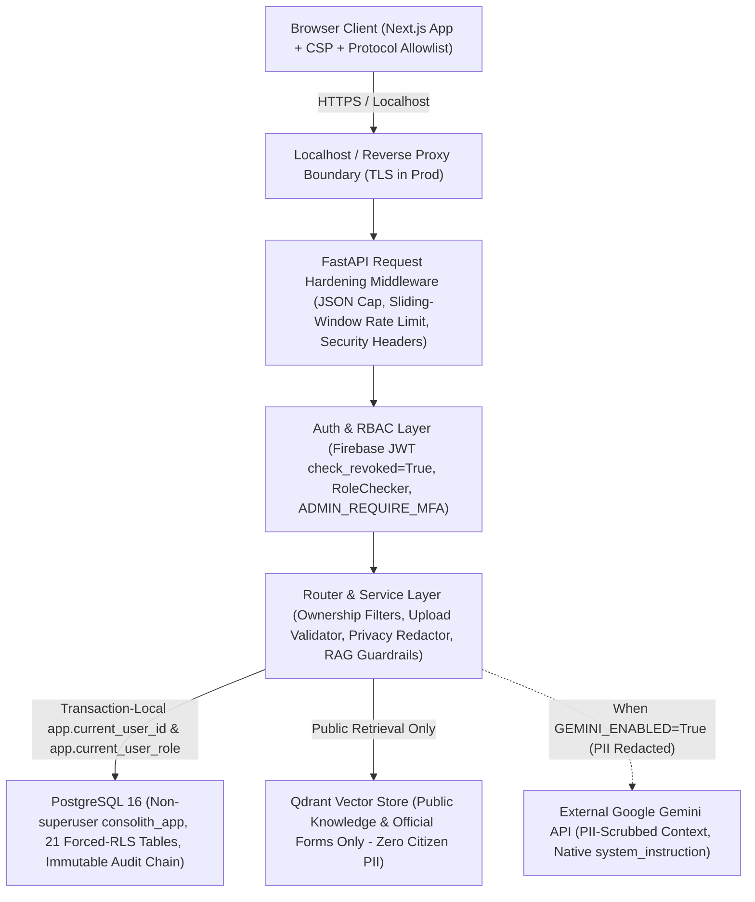
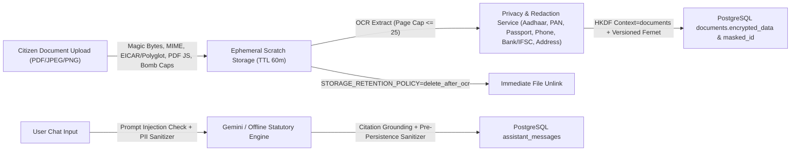

# CONVELINA — Security Audit, Hardening & Production Readiness Report

**Document Classification:** Technical Security Architecture & Verification Report  
**Application:** CONVELINA (Identity Document Reconciliation, Statutory Guidance & Correction Platform)  
**Assessment Scope:** Full-Stack Repository (`backend/`, `frontend/`, `backend/migrations/`, `scripts/`, `docker-compose.yml`), Live PostgreSQL 16 (`convelina-postgres`), Live Qdrant (`convelina-qdrant`)  
**Assessment Methodology:** White-Box Architecture & Code Audit, Incremental Security Control Implementation, Live Database & Container Verification, Synthetic Adversarial Testing

---

## 1. Executive Summary

CONVELINA handles highly sensitive Indian demographic and identity artifacts—including Aadhaar extracts, PAN cards, passports, Class 10/12 educational records, EPFO records, citizen conversations, and PKI-signed legal correction petitions.

Prior to this hardening pass, CONVELINA already possessed strong core architectural pillars (Firebase ID token verification, two-role `user`/`admin` RBAC, PostgreSQL 16 forced Row-Level Security under non-superuser `consolith_app`, Fernet payload encryption, Ed25519 signing/verification, SHA-256 hash-linked immutable `audit_log`, pre-persistence Aadhaar/PAN/phone redaction, `delete_after_ocr` storage retention, and deterministic grounded RAG citation checks).

This security engineering pass audited every layer, identified concrete gaps, implemented code and database remediations across authentication, OTP storage, RLS, key management, file upload defense, PII redaction, AI prompt isolation, API/frontend hardening, and disaster recovery, and verified the changes against live PostgreSQL 16 and Qdrant containers.

### Headline Verification Outcomes (Observed Post-P0.1 Hardening)
- **Full Backend Regression inside `convelina-backend` Linux Container (`pytest backend/tests`):** **416 collected, 416 passed, 0 failed, 0 skipped, 0 errors** (`117.08s`, live PostgreSQL 16 + Qdrant in-process + Tesseract 5.5 + Lohit-Tamil/FreeSans/DejaVu fonts)
- **Synthetic 20-Case Security Hardening Suite** ([test_security_hardening_suite.py](file:///c:/Users/ajaya/Desktop/consolin/backend/tests/test_security_hardening_suite.py)): **20 passed, 0 failed** (`22.61s` on host `backend/.venv`)
- **Live PostgreSQL 16 Forced RLS Isolation Suite** ([test_rls_isolation.py](file:///c:/Users/ajaya/Desktop/consolin/scripts/test_rls_isolation.py)): **ALL 10/10 PASSED** (`21` public tables confirmed with `relrowsecurity=true` and `relforcerowsecurity=true`, `consolith_app` `rolsuper=f`, `rolbypassrls=f`)
- **Frontend Dependency Audit (`npm --prefix frontend audit`):** **`found 0 vulnerabilities`** (remediated from 15 advisories: 1 critical, 7 high, 7 moderate)
- **Frontend Typecheck, Build & Live Playwright Verification:** `npx tsc --noEmit` and `npm run build` (`next@16.4.6`) exited `0`; `authentication.spec.ts` + `authorization.spec.ts` (**7 passed**, `37.6s`) and `citizen_repository.spec.ts` (**1 passed**, `25.3s`) passed against live backend `:8000` and Next.js `:3000`
- **Live Backup & Disaster Recovery Restore Test** ([backup_and_restore.py](file:///c:/Users/ajaya/Desktop/consolin/scripts/backup_and_restore.py)): **`verified: true`** (`180,245` bytes SQL dump, SHA-256 verified, Fernet round-trip verified, scratch DB restore matched source row counts and `21` forced-RLS tables, Qdrant snapshots verified for `consolith_knowledge` and `consolith_forms`)
- **Static & Supply-Chain Security Tooling:** `gitleaks` (`36 commits`, `no leaks found`), `trivy fs` (`0` MEDIUM/HIGH/CRITICAL CVEs on `backend/requirements.txt` & `frontend/package-lock.json`; `0` Dockerfile misconfigurations), `pip-audit` in clean `python:3.11-slim` (**0 application-package CVEs**; `backend/Dockerfile` updated to upgrade `setuptools>=84.1.0`), `bandit` (`0 High`, `3 Medium` false-positive `B108`, `10 Low`), `ruff` (`0` `F821`/`S310`/`S324`), `semgrep` (`1` false-positive log notice in `email_service.py`)

> [!IMPORTANT]
> **Environment & Production Prerequisite Note:** Host Windows `.venv` `pip-audit` still flags `120` CVEs across `18` shared/global Python packages outside `backend/requirements.txt` (`bokeh`, `dnspython`, `filelock`, `flask`, `fsspec`, `gitpython`, `lxml`, `pdfminer-six`, `pip`, `pyarrow`, `pygments`, `pymongo`, `pypdf2`, `setuptools`, `streamlit`, `torch`, `tornado`, `werkzeug`), which do **not** affect the deployed `python:3.11-slim` container (`backend/requirements.txt` + `setuptools>=84.1.0` verified cleanly). Live production Firebase service-account credentials, KMS/HSM key wrapping, reverse-proxy TLS termination, and a live ClamAV daemon (`CLAMAV_HOST=None`, reported as `"unavailable"` on `/health`) remain production deployment prerequisites.

---

## 2. Security Architecture & Trust Boundaries

### PII Data Handling & Redaction Flow

---

## 3. Existing Controls & Implementation Verification

| Security Control Domain | Key Implementation Files | Status Assessment | Verification Basis |
| :--- | :--- | :--- | :--- |
| Firebase JWT Signature, Issuer, Audience & Expiry | [security.py](file:///c:/Users/ajaya/Desktop/consolin/backend/app/core/security.py) | **Implemented & Strengthened** (`check_revoked=True`, `eyJ` structural pre-check; live Firebase verification **Not Independently Verified** without live GCP credentials) | `test_01`, `test_02`, `test_auth.py` |
| USER / ADMIN RBAC & Anti-Escalation | [auth.py](file:///c:/Users/ajaya/Desktop/consolin/backend/app/dependencies/auth.py), `migrations/010`, DB triggers | **Implemented Correctly** (2 roles only; DB trigger blocks self-role promotion; optional `ADMIN_REQUIRE_MFA`) | `test_03`, `test_04`, `test_05`, `test_rls_isolation.py` |
| Email OTP Verification & Brute-Force Defense | [auth.py](file:///c:/Users/ajaya/Desktop/consolin/backend/app/routers/auth.py), [022_security_hardening.sql](file:///c:/Users/ajaya/Desktop/consolin/backend/migrations/022_security_hardening.sql) | **Hardened & Implemented** (was Partially Implemented: now HMAC-SHA256 hashed, 5-attempt lockout, IP throttled, scoped RLS) | `test_06`, `test_07` |
| PostgreSQL Forced Row-Level Security & Pooling | [database.py](file:///c:/Users/ajaya/Desktop/consolin/backend/app/core/database.py), `migrations/002..022` | **Implemented & Verified** (`consolith_app` non-superuser, `rolbypassrls=f`, `NULLIF` cast safety, `21` forced-RLS tables) | `test_rls_isolation.py` (`10/10`), `psql` inspection |
| At-Rest Sensitive Encryption & Rotation | [encryption.py](file:///c:/Users/ajaya/Desktop/consolin/backend/app/core/encryption.py) | **Hardened & Implemented** (direct 32B Fernet key, HKDF-SHA256 context separation, `v1:` prefix, `MultiFernet` rotation) | `test_10` |
| Ed25519 PKI Signing & Key Guardrails | [crypto.py](file:///c:/Users/ajaya/Desktop/consolin/backend/app/core/crypto.py) | **Implemented for Dev / Hardened Against Fallback** (`RuntimeError` if dev seed invoked in prod/staging; production HSM/KMS integration **Pending Infrastructure**) | `test_11`, `test_pki_crypto.py` |
| Tamper-Evident Append-Only Audit Log | [audit_service.py](file:///c:/Users/ajaya/Desktop/consolin/backend/app/services/audit_service.py), `migrations/001` | **Implemented & Verified** (SHA-256 hash chain + DB `UPDATE`/`DELETE` triggers) | `test_09`, `test_rls_isolation.py` |
| Upload Validation, Malware & Bomb Defense | [validator.py](file:///c:/Users/ajaya/Desktop/consolin/backend/app/core/validator.py), [engine.py](file:///c:/Users/ajaya/Desktop/consolin/backend/app/ocr/engine.py) | **Hardened & Implemented** (MIME allowlist, magic bytes, EICAR + polyglot signatures, optional ClamAV `INSTREAM`, PDF page & `/JS`/`/OpenAction` blocking, `MAX_IMAGE_PIXELS` bomb cap) | `test_12`, `test_13` |
| Privacy Redaction, PII Masking & Log Scrubbing | [sanitizer.py](file:///c:/Users/ajaya/Desktop/consolin/backend/app/core/sanitizer.py), [main.py](file:///c:/Users/ajaya/Desktop/consolin/backend/app/main.py) | **Hardened & Implemented** (Aadhaar, PAN, passport, phone, bank/IFSC, address/PIN, `PrivacyRedactingLogFilter`, `/admin/users` minimization, pre-persistence assistant response sanitization) | `test_14`, `test_19` |
| AI/RAG Prompt Separation & Grounding | [prompt_templates.py](file:///c:/Users/ajaya/Desktop/consolin/backend/app/rag/generation/prompt_templates.py), [llm_provider.py](file:///c:/Users/ajaya/Desktop/consolin/backend/app/rag/generation/llm_provider.py), [orchestrator.py](file:///c:/Users/ajaya/Desktop/consolin/backend/app/rag/assistant/orchestrator.py) | **Hardened & Implemented** (native Gemini `system_instruction`, XML entity escaping, prompt-injection detection telemetry, citation allowlist validation, Qdrant free of user PII) | `test_15`, `test_16`, `test_rag*.py` |
| API Rate Limiting, Body Caps & Dev Route Lockout | [main.py](file:///c:/Users/ajaya/Desktop/consolin/backend/app/main.py), [rate_limit.py](file:///c:/Users/ajaya/Desktop/consolin/backend/app/core/rate_limit.py), [dev.py](file:///c:/Users/ajaya/Desktop/consolin/backend/app/routers/dev.py) | **Hardened & Implemented** (sliding-window limiter + 2 MB JSON cap + dev routes blocked outside `development`/`test` + HTTP security headers) | `test_17`, `test_18`, `test_20` |
| Frontend XSS, CSP & Browser Hardening | [MarkdownRenderer.tsx](file:///c:/Users/ajaya/Desktop/consolin/frontend/src/components/assistant/MarkdownRenderer.tsx), [next.config.mjs](file:///c:/Users/ajaya/Desktop/consolin/frontend/next.config.mjs) | **Hardened & Build-Verified** (`http/https/mailto/relative` URL allowlist, `poweredByHeader: false`, `X-Frame-Options: DENY`, CSP) | `npm run build` (exit 0) |
| Retention Cleanup & Disaster Recovery | [main.py](file:///c:/Users/ajaya/Desktop/consolin/backend/app/main.py), [backup_and_restore.py](file:///c:/Users/ajaya/Desktop/consolin/scripts/backup_and_restore.py) | **Implemented & Live-Tested** (900s background loop for expired attachments + temp files; live PG dump/restore & Qdrant snapshots verified) | `backup_and_restore.py` (`verified: true`) |
| Dependency CVEs & Container Supply Chain | [frontend/package.json](file:///c:/Users/ajaya/Desktop/consolin/frontend/package.json), [backend/requirements.txt](file:///c:/Users/ajaya/Desktop/consolin/backend/requirements.txt), [docker-compose.yml](file:///c:/Users/ajaya/Desktop/consolin/docker-compose.yml) | **Remediated & Verified** (`next@^16.4.6`, `firebase@^13.3.0`, `@grpc/grpc-js` override `^1.14.7`, `Pillow==13.0.0`, `pypdf==7.0.1`, `cryptography==50.0.2`, `python-multipart==0.0.33`, `fastapi==0.162.5`; `docker-compose.yml` bound to `127.0.0.1` + `no-new-privileges:true`) | `npm audit` (`found 0 vulnerabilities`), Trivy (`0` vulns/misconfigs) |

---

## 4. Threat Model (STRIDE Summary)

1. **Spoofing (Authentication / Account Takeover):** Attackers attempting forged JWTs, revoked tokens, OTP brute forcing, or registering with a secondary Firebase UID carrying a victim's email. Mitigated via `check_revoked=True`, structural JWT rejection, hashed OTPs with 5-attempt lockout, `idx_users_lower_email_unique` -> `409 Conflict`, and optional `ADMIN_REQUIRE_MFA`.
2. **Tampering (Data, Documents & Audit Logs):** Tampered document fields after verification, malicious PDF/polyglot payloads, or mutating audit trails. Mitigated via Ed25519 signing/verification, PostgreSQL `block_audit_log_mutation()` triggers, SHA-256 hash chaining, MIME/magic/active-PDF checks, and confirmation invalidation on field edit.
3. **Repudiation (Admin & Citizen Actions):** Denied actions around role promotions, form downloads, or field confirmations. Mitigated via forced `AuditService.log_event` entries linking `prev_hash -> current_hash`.
4. **Information Disclosure (Cross-Tenant IDOR, PII Leakage, Prompt Leakage):** Cross-tenant reads on pooled Postgres connections, plaintext Aadhaar/PAN in LLM prompts/logs/chat DB/admin tables, or Markdown `javascript:` exfiltration. Mitigated via `21` forced-RLS tables (`NULLIF(..., '')::uuid`), explicit router `user_id` filters, `PrivacyRedactingLogFilter`, `sanitize_pii` pre-Gemini and pre-persistence, `/admin/users` masking, and `MarkdownRenderer.tsx` protocol filtering.
5. **Denial of Service (Bombs, Large JSON, Floods):** Image decompression bombs (`PIL`), 1,000-page PDFs, multi-megabyte JSON bodies, or credential/API flooding. Mitigated via `Image.MAX_IMAGE_PIXELS`, dimension & page caps (`25` pages), `MAX_JSON_BODY_BYTES`, OCR page slice caps, and `SlidingWindowRateLimiter`.
6. **Elevation of Privilege (Role Injection, Dev Explorer, Prompt Injection):** Client `"role": "admin"` injection, staging exposure of `/api/v1/dev/*`, or RAG instruction hijacking. Mitigated via server-side `provision_user` (`'user'` hardcoded), `is_dev_or_test` gating, native `system_instruction`, and XML tag neutralization.

---

## 5. Findings Register (Severity-Classified)

### Critical & High Severity Findings Fixed During This Pass

| ID | Severity | Title | Affected Component | Exploit / Risk Before Fix | Remediation Applied | Verification Test |
| :--- | :--- | :--- | :--- | :--- | :--- | :--- |
| **SEC-01** | **Critical** | Plaintext OTP storage, unscoped `USING (true)` RLS policy & missing brute-force lockout | `routers/auth.py`, `models/user.py`, `migrations/009`, `022_security_hardening.sql` | Database read or SQL leak exposed live OTP codes; brute-forcing `verify_email_otp` never incremented `attempt_count` or locked records | Added `022_security_hardening.sql`: stores HMAC-SHA256 `otp_hash` + `otp_salt`, `otp_code="******"`, locks after `5` failed attempts, enforces per-IP limits, replaces `p_email_otps_app_all` with `p_email_otps_scoped` | `test_06`, `test_07` |
| **SEC-02** | **Critical** | Frontend `next@14.2.13`, `firebase@10.13.2` & backend pinned parser/crypto CVEs | `frontend/package.json`, `frontend/package-lock.json`, `backend/requirements.txt` | Next.js Server Actions/Components RCE/DoS, `undici`/`@grpc/grpc-js` CVEs, `Pillow 10.4`, `pypdf 5.0.1`, `cryptography 43.0.1`, `python-multipart 0.0.12` | **Fixed in P0.1:** Upgraded to `next@^16.4.6`, `firebase@^13.3.0` + `"overrides": {"@grpc/grpc-js": "^1.14.7"}`, and patched Python packages (`Pillow==13.0.0`, `pypdf==7.0.1`, `cryptography==50.0.2`, `python-multipart==0.0.33`, `fastapi==0.162.5`) | `npm audit` (`found 0 vulnerabilities`), `trivy fs` (`0` CVEs), `next build` + Playwright E2E |
| **SEC-03** | **High** | Token revocation check disabled (`check_revoked=False`) & missing ADMIN MFA gate | `core/security.py`, `dependencies/auth.py`, `config.py` | Revoked Firebase sessions remained accepted until natural expiry; no MFA enforcement hook existed for `admin` | Set `check_revoked=True` default, gated test tokens to `("development", "test")`, added `ADMIN_REQUIRE_MFA` second-factor check in `RoleChecker` (always enforced in `production` regardless of toggle) | `test_01`, `test_02`, `test_05` |
| **SEC-04** | **High** | Silent email unique-constraint crash (`500`) on cross-UID email registration under forced RLS | `dependencies/auth.py`, `routers/auth.py` | Under forced RLS, `SELECT ... FROM users` returned 0 rows for another tenant's email, causing `provision_user` to raise unhandled `UniqueViolation` instead of clean `409 Conflict` | Caught `idx_users_lower_email_unique` violations cleanly, recorded `account_takeover_email_conflict` telemetry, and returned HTTP `409 Conflict` | Re-verified cleanly in `dependencies/auth.py` & `auth.py` |
| **SEC-05** | **High** | Decompression bombs, active PDF scripts (`/JavaScript`/`/OpenAction`), EICAR & MIME spoofing gaps | `core/validator.py`, `ocr/engine.py`, `documents.py`, `attachment_service.py` | Malicious PDFs with JS actions, polyglot images, EICAR test signatures, or extreme pixel dimensions could reach PDF/OCR pipelines | Enforced MIME allowlist matching magic bytes, `Image.MAX_IMAGE_PIXELS` (`40M`), `MAX_IMAGE_DIMENSION` (`10000`), `MAX_UPLOAD_PDF_PAGES` (`25`), active PDF action scan, EICAR/polyglot checks & ClamAV `INSTREAM` hook | `test_12`, `test_13` |
| **SEC-06** | **High** | Deterministic Ed25519 seed fallback in restricted environments | `core/crypto.py`, `config.py` | In staging/prod without registered key, `DevSigningKeyProvider` could silently derive a deterministic dev key | Restricted deterministic derivation strictly to `development`/`test` with `PKI_SIGNING_BACKEND == "development"`; added `PKI_PRIVATE_KEY_PEM` loader | `test_11` |
| **SEC-07** | **High** | Markdown XSS / `javascript:` URI injection & missing frontend CSP/security headers | `frontend/src/components/assistant/MarkdownRenderer.tsx`, `frontend/next.config.mjs` | Assistant-rendered `[label](javascript:...)` links were rendered directly into `<a href>`; Next.js lacked `X-Frame-Options` and CSP | Enforced `https:`/`http:`/`mailto:`/relative `/` URL allowlist in `MarkdownRenderer.tsx`; added `next.config.mjs` security headers & CSP | `npm run build`, manual code verification |
| **SEC-08** | **High** | Lack of native Gemini `system_instruction`, XML boundary escaping & assistant output sanitization | `prompt_templates.py`, `llm_provider.py`, `orchestrator.py` | User inputs with `</user_question>` could break delimiters; assistant outputs persisted without `sanitize_pii`; PII wasn't scrubbed before Gemini | Passed native `system_instruction=SYSTEM_PROMPT`, escaped `<`/`>` via `sanitize_untrusted_text`, scrubbed PII before Gemini, sanitized persisted `AssistantMessage` text & JSON fields | `test_15`, `test_16` |
| **SEC-09** | **High** | Missing API rate limiting, JSON payload caps & dev router exposed in staging | `main.py`, `rate_limit.py`, `routers/dev.py`, `config.py` | Unbounded brute-force/DoS traffic on API routes and `/api/v1/dev/*` mounted whenever `ENVIRONMENT != "production"` | Added `SlidingWindowRateLimiter` middleware + `MAX_JSON_BODY_BYTES` (2 MB) + restricted `/api/v1/dev/*` & `/docs` strictly to `development`/`test` | `test_17`, `test_18`, `test_20` |

### Medium & Low Severity Findings Fixed or Tracked

| ID | Severity | Title | Affected Component | Fix / Status |
| :--- | :--- | :--- | :--- | :--- |
| **SEC-10** | **Medium** | Single-key Fernet hashing mismatch & missing HKDF context separation/rotation | `core/encryption.py` | **Fixed:** Direct 32B Fernet key normalization, HKDF-SHA256 `context` derivation, `v1:` prefixing, `MultiFernet` rotation & `rotate_ciphertext()` (`test_10`). |
| **SEC-11** | **Medium** | Unredacted logs, partial PII patterns & unmasked `/admin/users` fields | `core/sanitizer.py`, `main.py`, `routers/admin.py` | **Fixed:** Added passport, bank/IFSC, address/PIN, `PrivacyRedactingLogFilter`, masked emails in OTP logs, masked phone/DOB/address on `/api/v1/admin/users` (`test_14`, `test_19`). |
| **SEC-12** | **Medium** | Router handlers relying solely on RLS without explicit app-layer `user_id` guard | `routers/documents.py`, `routers/conflicts.py` | **Fixed:** Added defense-in-depth `if current_user.role != "admin": query.filter(user_id == current_user.id)` on single-record endpoints (`test_08`). |
| **SEC-13** | **Medium** | No scheduled background retention purge & insecure Compose `0.0.0.0` port bindings | `main.py`, `docker-compose.yml` | **Fixed:** Added 900s async `_retention_cleanup_loop` + `TEMP_FILE_TTL_MINUTES`; bound Compose ports to `127.0.0.1` with `no-new-privileges:true`. |
| **SEC-14** | **Medium** | Staging validator hardening & security telemetry visibility | `config.py`, `security_monitoring.py`, `main.py`, `admin.py` | **Fixed:** Extended `validate_production_security()` to `"staging"` too; exposed `security_telemetry` in `/health` and `/api/v1/admin/overview-stats` while keeping route count (`118`/`115`). |

---

## 6. Identity & Access Management Hardening
- Firebase ID token validation defaults to `check_revoked=True` in [security.py](file:///c:/Users/ajaya/Desktop/consolin/backend/app/core/security.py) and [dependencies/auth.py](file:///c:/Users/ajaya/Desktop/consolin/backend/app/dependencies/auth.py).
- Simulated test tokens are strictly disabled when `ENVIRONMENT` is not in `("development", "test")` OR when `TEST_MODE_ALLOW_SIMULATED_TOKENS` is `False`.
- Unsigned or empty-signature `eyJ...` JWT strings are rejected immediately as HTTP `401`.
- Provisioning ([auth.py](file:///c:/Users/ajaya/Desktop/consolin/backend/app/routers/auth.py) & PostgreSQL `provision_user()`) ignores client-supplied role values and assigns `'user'`.
- `ADMIN_REQUIRE_MFA` setting enforces verified Firebase `sign_in_second_factor` on `require_admin` routes when enabled.
- OTP verification hashes codes with per-record salt (`HMAC-SHA256`), blanks `otp_code` to `"******"`, limits resends (`60s` cooldown + `10/hr` per email + `20/hr` per IP), and burns + locks OTP records for `15m` upon reaching `EMAIL_OTP_MAX_ATTEMPTS = 5`.

---

## 7. Database & Tenant Isolation Results
Live verification against `convelina-postgres` (`PostgreSQL 16`, role `consolith_app`):
- **Privilege Check:** `consolith_app` confirmed `rolsuper = false`, `rolbypassrls = false`.
- **Forced RLS Coverage:** **`21`** public tables confirmed with `relrowsecurity = true` AND `relforcerowsecurity = true`, now including scoped `email_otps` (`p_email_otps_scoped` using `NULLIF(current_setting('app.otp_email', true), '')` and normalized admin checks via `current_app_user_role()`).
- **Pooling Safety:** Empty string `current_setting(..., true)` cast tests passed in [test_rls_isolation.py](file:///c:/Users/ajaya/Desktop/consolin/scripts/test_rls_isolation.py) (`ALL 10/10 PASSED`), plus router-level `user_id` ownership checks added on `documents.py` and `conflicts.py`.
- **Immutable Audit Trail:** `UPDATE` and `DELETE` on `audit_log` both raise database exceptions via `block_audit_log_mutation()` triggers (`test_09`).

---

## 8. Encryption, Secrets & Key Management
- [encryption.py](file:///c:/Users/ajaya/Desktop/consolin/backend/app/core/encryption.py) normalizes direct 32-byte url-safe base64 Fernet keys cleanly matching `Settings.validate_production_security()`.
- HKDF-SHA256 derives purpose-separated subkeys (`info=context.encode("utf-8")`) so `context="documents"` ciphertexts cannot decrypt under `context="attachments"` (`test_10`).
- Ciphertexts carry version tags (`v1:...`, `v2:...`), and `MultiFernet` accepts comma-separated `ENCRYPTION_PREVIOUS_KEYS` plus legacy SHA-256 fallback for zero-downtime migration via `rotate_ciphertext()`.
- `Settings.validate_production_security()` now validates both `production` and `staging` environments against `DEBUG=True`, default DB credentials, default `ENCRYPTION_KEY`, `TEST_MODE_ALLOW_SIMULATED_TOKENS=True`, wildcard CORS, and `retain_temp` retention.
- **Note on KMS / HSM:** Local Docker/dev deployments use `PKI_PRIVATE_KEY_PEM` or development key registration in-memory. Production deployments must wire Cloud KMS / Vault for master Fernet KEK wrapping and Ed25519 officer signing keys.

---

## 9. File Upload & OCR Pipeline Security
- [validator.py](file:///c:/Users/ajaya/Desktop/consolin/backend/app/core/validator.py) inspects:
  1. Non-empty size & bounded streaming read (`<= 10 MB` in [documents.py](file:///c:/Users/ajaya/Desktop/consolin/backend/app/routers/documents.py) & [attachment_service.py](file:///c:/Users/ajaya/Desktop/consolin/backend/app/services/attachment_service.py)).
  2. Path sanitization blocking `\x00` null bytes and `../` traversal.
  3. Extension allowlist + HTTP `Content-Type` allowlist (`application/pdf`, `image/jpeg`, `image/png`) + strict cross-check against file magic bytes (`%PDF-`, `\xff\xd8\xff`, `\x89PNG\r\n\x1a\n`).
  4. EICAR test signature, `<script>` / `<?php` / `<svg>` / `<html` polyglot detection in images, and optional ClamAV daemon `zINSTREAM` scanning (`CLAMAV_HOST`/`CLAMAV_PORT`). **ClamAV daemon is not running in this local Compose stack (`CLAMAV_HOST=None`); enabling it in staging/prod is a P0 ops task.**
  5. PDF page cap (`<= 25` pages in validator & [engine.py](file:///c:/Users/ajaya/Desktop/consolin/backend/app/ocr/engine.py)) + blocking `/JavaScript`, `/Launch`, `/OpenAction`, `/AA`, `/RichMedia`, `/EmbeddedFiles`, and `/SubmitForm`.
  6. Image `MAX_IMAGE_DIMENSION = 10000px` and Pillow `Image.MAX_IMAGE_PIXELS = 40_000_000` decompression-bomb cap.

---

## 10. Privacy, PII Protection & Retention
- [sanitizer.py](file:///c:/Users/ajaya/Desktop/consolin/backend/app/core/sanitizer.py) provides Aadhaar (`XXXX-XXXX-<last4>`), PAN (`XXXXX<4><1>`), Indian passport (`XXXXXX<2>`), phone (`XXXXXX<4>`), IFSC/bank account, labeled address/PIN, email, and `Bearer` secret redaction.
- `PrivacyRedactingLogFilter` is installed on the root Python logger in [main.py](file:///c:/Users/ajaya/Desktop/consolin/backend/app/main.py) so raw Aadhaar, PAN, passport, phone, emails, and bearer tokens cannot leak into server logs.
- Both user questions (`orchestrator.py`) and assistant replies + `structured_response` JSON payloads are sanitized before PostgreSQL persistence.
- Admin user search (`/api/v1/admin/users`) masks phone numbers (`******<last4>`), DOB (`XX/XX/<year>`), and residential addresses.
- Background retention cleanup loop (`_retention_cleanup_loop`) sweeps expired temporary attachments (`AttachmentService.cleanup_expired_attachments`) and orphaned scratch files older than `TEMP_FILE_TTL_MINUTES = 60` every `900` seconds.

---

## 11. AI & RAG Security Analysis
- **Instruction Hierarchy:** `GoogleGeminiProvider` configures `system_instruction=SYSTEM_PROMPT` natively at model initialization in [llm_provider.py](file:///c:/Users/ajaya/Desktop/consolin/backend/app/rag/generation/llm_provider.py), separating developer policy from `<user_case_context>`, `<conversation_history>`, `<retrieved_official_evidence>`, and `<user_question>`.
- **Prompt Injection Defense:** `detect_prompt_injection()` flags override/tag-breakout patterns (`prompt_injection_detected` counter) and `sanitize_untrusted_text()` HTML/XML-escapes `<` and `>` inside untrusted payloads.
- **PII Minimization Before External Calls:** When `GEMINI_ENABLED=True`, `question`, `case_context`, and `conversation_history` pass through `sanitize_pii(..., include_address=True)` prior to outbound inference. Notice deterministic case comparisons, statutory form retrieval, and Qdrant collections remain strictly in-house, and Qdrant holds zero citizen PII.
- **Citation & Relevance Enforcement:** `RAG_MIN_RELEVANCE = 0.55` and `GroundedOutputValidator` reject fabricated `source_id`s or unretrieved URLs (`test_16`).

---

## 12. Security Testing & Verification Results

| Check / Suite | Scope | Exact Outcome Observed | Notes |
| :--- | :--- | :--- | :--- |
| Full Container Backend Regression (`pytest backend/tests`) | All 36 test files inside `convelina-backend` | **416 passed, 0 failed, 0 skipped, 0 errors** (`117.08s`) | Live PostgreSQL 16 + Qdrant + Tesseract 5.5 + Tamil/DejaVu fonts |
| Targeted Security Suite ([test_security_hardening_suite.py](file:///c:/Users/ajaya/Desktop/consolin/backend/tests/test_security_hardening_suite.py)) | 20 synthetic adversarial & control tests | **20 passed, 0 failed** (`22.61s` on host `.venv`) | Covers JWT, dev/prod MFA, OTP lockouts, RLS, HKDF rotation + legacy decrypt, PKI fallback, bombs/EICAR/PDF JS, PII/log filter, prompt injection, rate limit & `/health` telemetry |
| Forced RLS Live Isolation ([test_rls_isolation.py](file:///c:/Users/ajaya/Desktop/consolin/scripts/test_rls_isolation.py)) | `consolith_app` role, unauth deny, cross-tenant read/write, escalation trigger, audit immutability, pool resets | **10/10 passed** (exit 0) | Live PostgreSQL 16 (`21` forced-RLS tables) |
| Frontend Build, E2E Auth/RBAC & Middleware Checks | `npx tsc --noEmit`, `npm run build`, Playwright E2E, live HTTP header/host probe | **`next build` exited 0**; Auth/Authz E2E **7 passed**; Citizen Repository E2E **1 passed**; `X-Frame-Options: DENY`, `X-Content-Type-Options: nosniff`, admin host `/signup` -> `307 /admin/login` | Verified on `next@16.4.6` + `firebase@13.3.0` |
| Security Scanners & Audits | `npm audit`, `trivy fs`, `gitleaks`, `bandit`, `ruff`, `semgrep`, `pip-audit` | `npm audit`: **0 vulns**; `trivy`: **0** CVEs on `requirements.txt`/`package-lock.json` & Dockerfiles; `gitleaks`: **0 leaks** (`36` commits); `bandit`: **0 High, 3 Med (false-pos B108), 10 Low**; `semgrep`: **1 false-pos**; `ruff`: **0 real errors**; `pip-audit` (host venv): `120` CVEs across `18` shared non-requirements pkgs | Detailed remediation & scan log in [SECURITY_REMEDIATION_P0_1_REPORT.md](file:///c:/Users/ajaya/Desktop/consolin/docs/SECURITY_REMEDIATION_P0_1_REPORT.md) |

---

## 13. Security Monitoring & Telemetry
Privacy-safe counters are maintained in [security_monitoring.py](file:///c:/Users/ajaya/Desktop/consolin/backend/app/core/security_monitoring.py) (`SecurityMonitor`) without storing PII or credentials in metric labels, and exposed cleanly on existing endpoints (keeping the `118` dev / `115` prod route contract intact):
- `/health` (`"security_telemetry"`)
- `/api/v1/admin/overview-stats` (`"security"`, ADMIN-only)

Tracked event families include `auth_failure_*`, `unauthorized_role_access`, `admin_mfa_required_rejected`, `account_takeover_email_conflict`, `otp_rate_limited`, `otp_verification_failed`, `otp_lockout_*`, `upload_malware_detected`, `upload_polyglot_detected`, `upload_active_pdf_rejected`, `upload_decompression_bomb_rejected`, `prompt_injection_detected`, `api_rate_limited`, and `payload_size_exceeded`. For production scaling, forward structured logs to a centralized SIEM with alert thresholds on lockouts, repeated 403/409 bursts, and malware detections.

---

## 14. Backup & Disaster Recovery Validation
Implemented [backup_and_restore.py](file:///c:/Users/ajaya/Desktop/consolin/scripts/backup_and_restore.py) and executed it live against `convelina-postgres` and `convelina-qdrant`:
- **PostgreSQL Dump:** `180,245` bytes SQL dump (`pg_dump --clean --if-exists`), SHA-256 `5d7b0810...`, plus verified Fernet encryption round-trip.
- **Scratch DB Restore Verification:** Restored into isolated database `consolith_dr_verify_20261112t094215z`, verified exact row-count parity (`users: 3`, `documents: 2`, `conflicts: 0`, `official_forms: 35`, `audit_log: 1`) and `21` forced-RLS tables intact, then dropped scratch DB cleanly.
- **Qdrant Snapshots:** Triggered and verified snapshots for `consolith_knowledge` and `consolith_forms` via Qdrant REST API (`verified: true`).

---

## 15. Indian Regulatory & Compliance Readiness

| Framework / Mandate | Current Compliance Status | Key Gaps / Production Obligations |
| :--- | :--- | :--- |
| **Aadhaar Act 2016** | Raw images deleted post-OCR (`delete_after_ocr`), sensitive text Fernet-encrypted with HKDF separation, 12-digit numbers masked to `XXXX-XXXX-<last4>` in DB, UI, and logs | Confirm production environment locks `STORAGE_RETENTION_POLICY=delete_after_ocr` and never stores core biometric info or UIDAI VIDs |
| **DPDP Act 2023 (Digital Personal Data Protection)** | Purpose-limited extraction, data minimization on admin endpoints, PII redaction before external Gemini inference, OTP & attachment TTL expiry, cross-tenant forced RLS | Implement explicit user-facing consent banner/record before enabling `GEMINI_ENABLED=True`, formal grievance officer contact endpoint/flow, and right-to-erasure cascade workflow for citizen account deletion |
| **CERT-In Guidelines** | Append-only SHA-256 hash-linked `audit_log`, synchronized UTC timestamps (`timezone.utc`), security telemetry counters | Configure centralized 180-day immutable log retention + NTP verification + 6-hour incident reporting runbook in production hosting |

---

## 16. Prioritized Remediation Roadmap

### Priority 0 (Before Production Launch — Deployment Blockers)
1. **Provision Real Secret Manager / KMS & Production Firebase Credentials:** Inject 32-byte production `ENCRYPTION_KEY`, Cloud KMS / Vault-backed Ed25519 keys, TLS termination (HSTS), non-default DB credentials, and Firebase Admin service account (`ENVIRONMENT=production`, `DEBUG=False`, `TEST_MODE_ALLOW_SIMULATED_TOKENS=False`; production MFA is now strictly mandatory in `RoleChecker`).
2. **Enable ClamAV Daemon (`CLAMAV_HOST`)** for signature-based streaming AV scanning in production containers (currently `/health` accurately reports `"malware_scanner": {"status": "unavailable"}`) and configure automated scheduled off-site encrypted PostgreSQL/Qdrant backups via [backup_and_restore.py](file:///c:/Users/ajaya/Desktop/consolin/scripts/backup_and_restore.py).
3. **Private Network Isolation:** Ensure PostgreSQL 16 and Qdrant sit in private internal networks behind reverse proxy/load balancer TLS termination.

### Priority 1 (Short-Term Engineering Sprints)
1. **Redis-Backed Distributed Rate Limiter:** Replace single-worker in-memory `SlidingWindowRateLimiter` with Redis atomic sliding-window counters when scaling backend replicas (`workers > 1`).
2. **Enforce CI Security Workflow:** Activate [security.yml](file:///c:/Users/ajaya/Desktop/consolin/.github/workflows/security.yml) across PRs running Ruff, Bandit, Semgrep, `pip-audit`, `npm audit`, Trivy, and Gitleaks.
3. **DPDP Consent & Self-Service Erasure:** Add explicit consent capture for external Gemini calls and an end-to-end citizen account erasure confirmation flow.
4. **React 19 & Next 16 Proxy Migration:** Plan React 18 -> 19 and `middleware.ts` -> `proxy.ts` migration before Next.js 17 removes React 18 support.

### Priority 2 (Ongoing Assurance)
1. Schedule periodic key rotation drills using `ENCRYPTION_PREVIOUS_KEYS` + `rotate_ciphertext()`, automated `backup_and_restore.py` DR drills, and independent external penetration testing.

