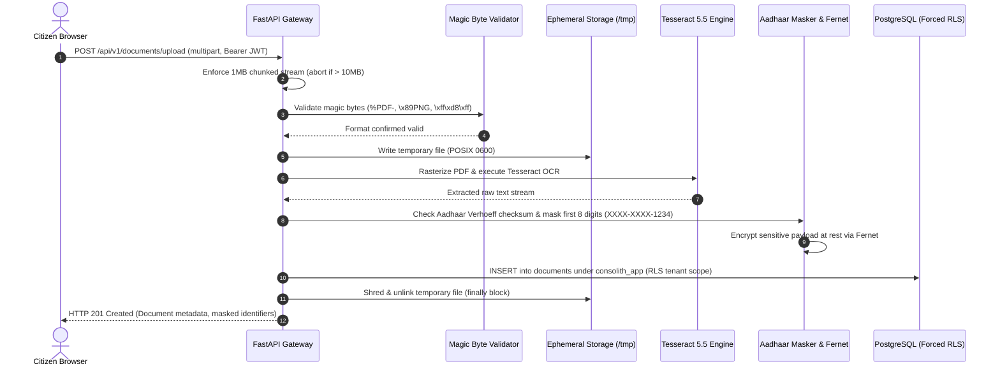
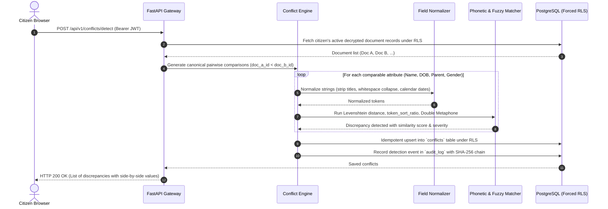
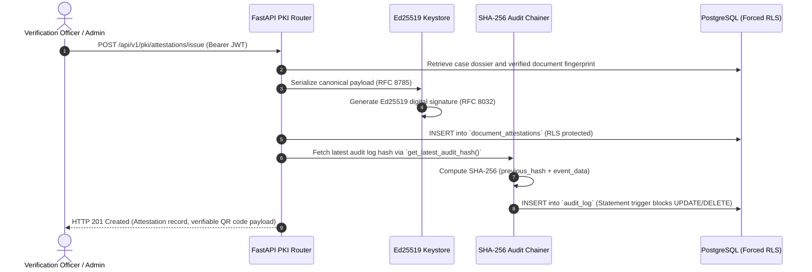
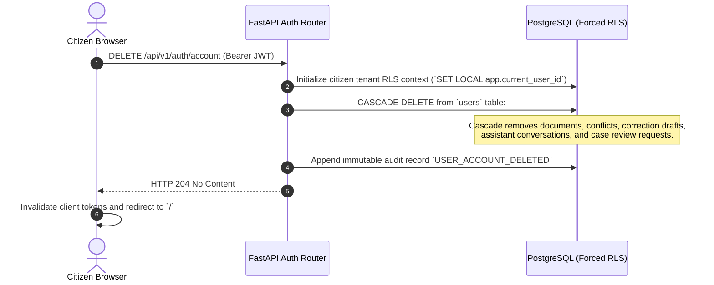

# CONVELINA — End-to-End Data Flow Architecture

**Classification:** Technical Architecture Specification  
**Status:** EVIDENCE-BASED IMPLEMENTATION TRACE  

---

## 1. Document Lifecycle & Upload Flow



### Ingestion Security Controls:
1. **Size Boundary**: Bounded 1MB chunked reads abort immediately with HTTP 413 if the payload exceeds 10MB.
2. **Header Integrity**: Magic byte inspection eliminates extension-spoofing vectors.
3. **Aadhaar Privacy**: First 8 digits masked immediately; raw file destroyed from ephemeral storage before HTTP response returns.

---

## 2. Deterministic Conflict Detection Flow



---

## 3. RAG Knowledge Assistant & Retrieval Flow

```mermaid
sequenceDiagram
    autonumber
    actor Citizen as Citizen Browser
    participant API as FastAPI Assistant Router
    participant Embed as Deterministic BGE Service
    participant Qdrant as Qdrant Vector DB
    participant LLM as Google Gemini (1.5-Flash)
    participant Val as Citation Validator
    participant DB as PostgreSQL (Forced RLS)

    Citizen->>API: POST /api/v1/assistant/chat {message, conversation_id, conflict_id}
    API->>DB: Fetch active conflict context if provided (under RLS)
    API->>Embed: Project query into 1024-dim normalized dense vector
    Embed-->>API: Query vector
    API->>Qdrant: Search `consolith_knowledge` (Top-K=5)
    Qdrant-->>API: Retrieved procedural chunks with cosine similarity
    API->>API: Filter chunks: discard all chunks with score < 0.55 floor
    alt No chunks exceed 0.55 floor
        API-->>Citizen: HTTP 200 OK (Insufficient evidence notice; decline to guess)
    else Verified evidence available
        API->>LLM: Format strict XML prompt with case context, sources, and history
        alt Gemini API unavailable / error
            API-->>Citizen: "Assistant service is not currently available. Please try again later."
        else Gemini returns structured JSON
            LLM-->>API: Structured response {answer, resolution_steps, forms, citations}
            API->>Val: Cross-check every citation against retrieved chunk text
            Val-->>API: Verified grounded answer
            API->>DB: Persist user & assistant messages in assistant_messages (RLS)
            API-->>Citizen: HTTP 200 OK (Grounded guidance, source badges, verified forms)
        end
    end
```

---

## 4. Cryptographic Attestation & Audit Trail Flow



---

## 5. Account Deletion & Data Purge Flow



