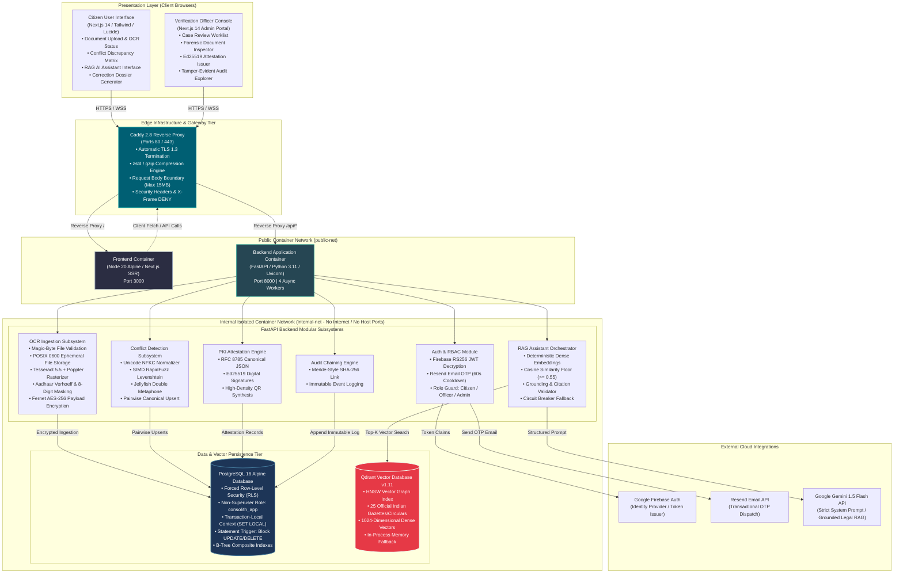
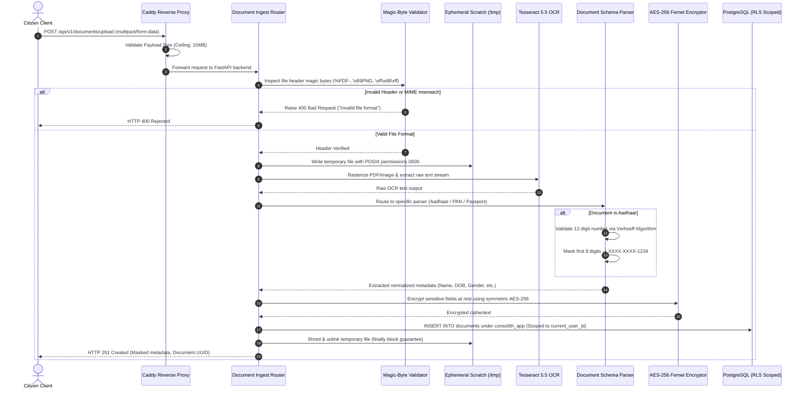
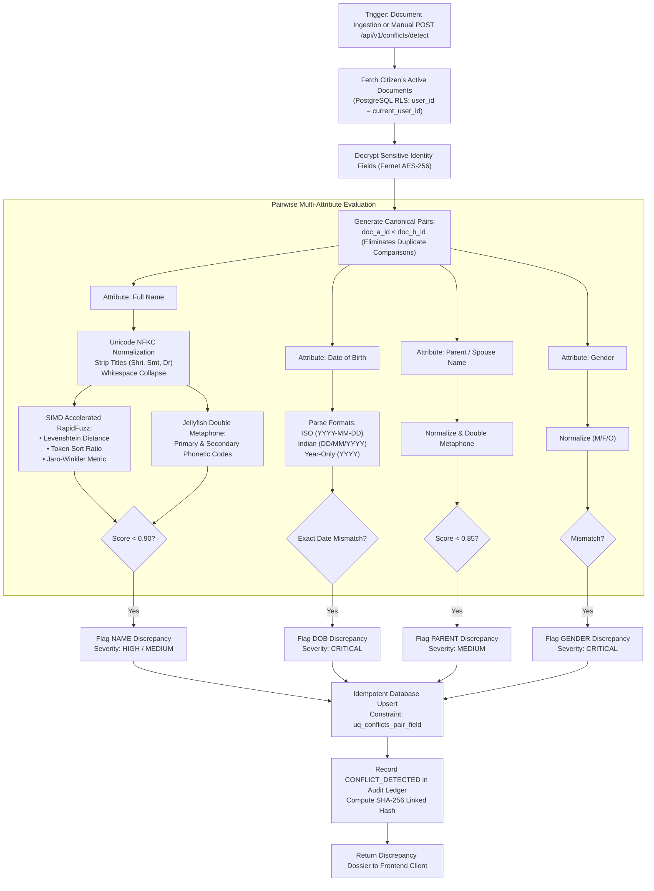
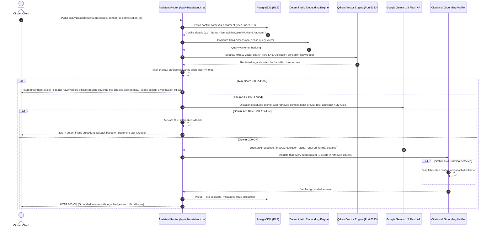
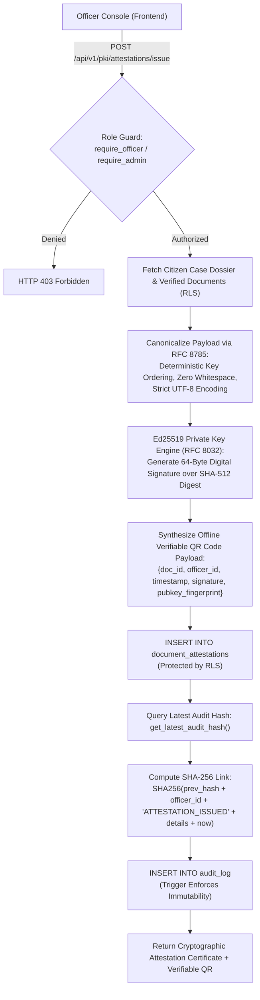
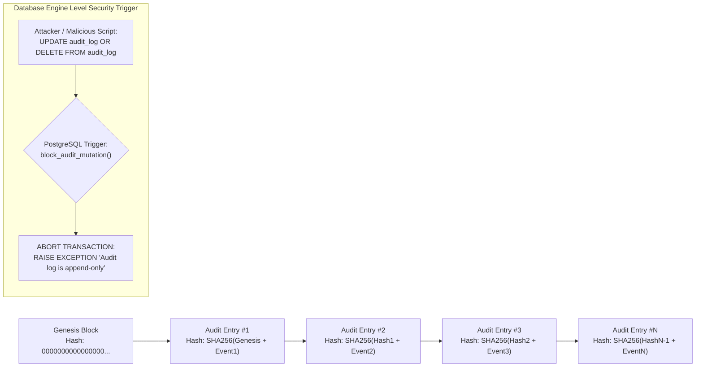
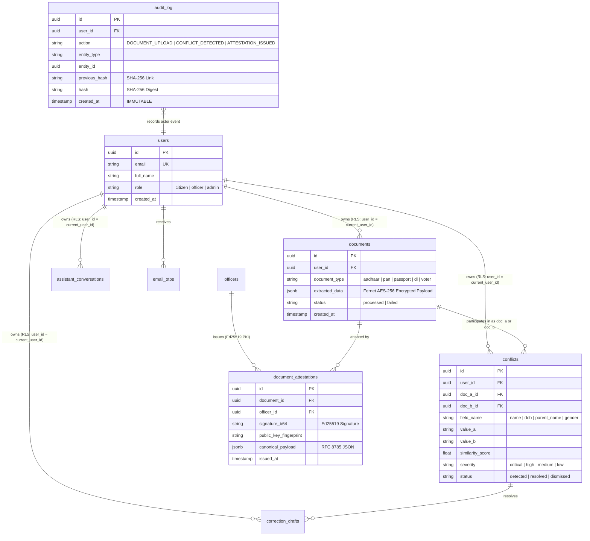

# CONVELINA — Master System Architecture & Engineering Blueprint

```
  ██████╗ ██████╗ ███╗   ██╗██╗   ██╗███████╗██╗     ██╗███╗   ██╗ █████╗ 
 ██╔════╝██╔═══██╗████╗  ██║██║   ██║██╔════╝██║     ██║████╗  ██║██╔══██╗
 ██║     ██║   ██║██╔██╗ ██║██║   ██║█████╗  ██║     ██║██╔██╗ ██║███████║
 ██║     ██║   ██║██║╚██╗██║╚██╗ ██╔╝██╔══╝  ██║     ██║██║╚██╗██║██╔══██║
 ╚██████╗╚██████╔╝██║ ╚████║ ╚████╔╝ ███████╗███████╗██║██║ ╚████║██║  ██║
  ╚═════╝ ╚═════╝ ╚═╝  ╚═══╝  ╚═══╝  ╚══════╝╚══════╝╚═╝╚═╝  ╚═══╝╚═╝  ╚═╝
 High-Assurance AI-Powered Identity Discrepancy Detection & PKI Verification Platform
```

**Document Version:** 2.0.0  
**Classification:** Enterprise System Architecture Specification  
**Status:** Production-Grade / Active Implementation Baseline  
**Maintainer:** CONVELINA Core Engineering & Security Architecture  

---

## 1. Executive System Overview & Mission

**CONVELINA** is a high-assurance, privacy-first identity discrepancy detection and resolution platform. It bridges the critical trust gap between mismatched citizen identity records across Indian government and institutional documents (Aadhaar, PAN, Passport, Driving License, Voter ID, and Educational Certificates).

### Core Architectural Invariants:
1. **Aadhaar Act Section 29 Compliance**: Zero permanent storage of raw Aadhaar images or unmasked numbers. Ephemeral POSIX-restricted file creation, instant Verhoeff checksum validation, immediate 8-digit masking (`XXXX-XXXX-1234`), and atomic shredding before HTTP response termination.
2. **Forced PostgreSQL Row-Level Security (RLS)**: Every tenant table is protected by PostgreSQL kernel-level RLS policies. Runtime connections execute strictly under an unprivileged, non-superuser role (`consolith_app`) using transaction-local session scoping (`SET LOCAL app.current_user_id`) to prevent connection pool data contamination.
3. **Cryptographically Chained Append-Only Audit Trail**: Every administrative, verification, and data mutation event is hashed with SHA-256 and chained to the previous entry. Database statement triggers strictly block `UPDATE` and `DELETE` operations on the audit ledger.
4. **Zero-Hallucination Grounded AI (RAG)**: AI legal guidance is grounded in an indexed Qdrant vector database containing 25 official government gazettes and circulars. A hard cosine similarity floor ($\ge 0.55$) prevents hallucinated procedures; answers below this threshold gracefully decline to answer.
5. **Ed25519 PKI Public Verification**: Approved correction dossiers receive an asymmetric Ed25519 cryptographic signature and verifiable QR code payload, enabling offline, tamper-evident authenticity verification by verifying officers.

---

## 2. Visual Tech Stack Matrix & Technology Inventory

```
+---------------------------------------------------------------------------------------------------------+
|                                        CONVELINA TECH STACK                                             |
+---------------------------------------------------------------------------------------------------------+
| FRONTEND            | Next.js 14 (App Router) | TypeScript 5 | Tailwind CSS | Framer Motion | Lucide     |
| EDGE PROXY          | Caddy 2.8 Server (Auto-TLS, zstd/gzip, 15MB Body Ceiling, Security Headers)        |
| BACKEND ENGINE      | Python 3.11 | FastAPI (Starlette + Pydantic v2 Rust Core) | Uvicorn (uvloop)       |
| COMPUTER VISION     | Tesseract 5.5 OCR | Poppler (pdftoppm) | OpenCV (cv2) | Pillow (PIL) | pdf2image  |
| STRING & PHONETICS  | RapidFuzz (C++ SIMD AVX2) | Jellyfish (Rust/C Double Metaphone) | Levenshtein      |
| RELATIONAL DATABASE | PostgreSQL 16 Alpine (Forced RLS, B-Tree Indexes, Connection Pooling)              |
| VECTOR DATABASE     | Qdrant v1.11 (HNSW Indexing, Cosine Metric, 1024-Dim Vectors, Memory Fallback)     |
| CRYPTOGRAPHY & PKI  | Ed25519 (RFC 8032) | Fernet AES-256 | SHA-256 Chaining | Verhoeff Checksum       |
| IDENTITY & AUTH     | Firebase Admin SDK (RS256 JWT) | Resend API Email OTP (6-Digit CSPRNG) | RBAC    |
| DEVOPS & TESTING    | Docker Multi-Stage | Compose Network Segmentation | Pytest | Playwright | OpenQodex|
+---------------------------------------------------------------------------------------------------------+
```

### Detailed Component Specifications

| Layer / Subsystem | Technology | Version | Architectural Role | Core Technical Advantage |
| :--- | :--- | :--- | :--- | :--- |
| **Presentation Tier** |    | 14.2.14 / TS 5.4 | Citizen Portal, Officer Console, Admin Audit Dashboard | Server-Side Rendering (SSR), zero client bundle leak, strict TypeScript typing, responsive Tailwind utility styling. |
| **Edge Gateway** |  | 2.8.4-alpine | Reverse proxy, TLS termination, request throttling, DoS filtering | Memory-safe Go implementation, automatic Let's Encrypt TLS, HTTP/2 & HTTP/3 support, 15MB body payload ceiling. |
| **API Application Tier** |    | Python 3.11 / FastAPI 0.110 | Asynchronous REST API, schema validation, dependency injection | Non-blocking async event loop (`uvloop`), Rust-powered data parsing via Pydantic v2, automatic OpenAPI contract generation. |
| **Computer Vision / OCR** |   | Tesseract 5.5 / OpenCV 4.9 | Image binarization, skew correction, text rasterization | C++ native engine execution, Poppler PDF rendering, adaptive thresholding for degraded stamp/seal documents. |
| **Phonetic & Fuzzy Engine** |   | RapidFuzz 3.8 / Jellyfish 1.0 | Indian name variation, phonetic matching, OCR typo compensation | C++ compiled SIMD vectorization for sub-microsecond string distance; Double Metaphone handles Indian multilingual phonetics. |
| **Relational Storage** |  | 16.2-alpine | Core business data, identity records, audit ledger, RLS boundary | Kernel-level Row-Level Security, ACID transactions, non-superuser role separation, composite index query speed. |
| **Vector Engine** |  | 1.11.0 | High-dimensional semantic search over government legal circulars | HNSW graph indexing, 1024-dimensional dense vectors, sub-5ms cosine retrieval, seamless in-process memory test mode. |
| **Cryptographic PKI** |   | PyCA Cryptography 42.0 | Asymmetric attestation signing, Fernet AES-256 payload encryption | 128-bit security level, immune to side-channel timing attacks, ultra-compact 64-byte signatures for QR code embedding. |
| **Authentication** |   | Firebase Admin 6.5 / Resend API | User authentication, identity verification, 6-digit OTP delivery | Hardware-backed RS256 token verification, CSPRNG OTP generation with 60-second cooldown and 10/hr IP rate limits. |
| **Orchestration & DevOps**|   | Docker 26.x / Compose v2 | Isolated multi-container deployment, network segregation | Complete separation of `internal-net` (no host ports) and `public-net`, non-root execution (`security_opt: [no-new-privileges]`). |

---

## 3. Master End-to-End System Architecture Blueprint

The following diagram illustrates the complete architectural blueprint across all client, network, compute, and persistence layers.



---

## 4. End-to-End System Pipelines & Data Flows

### Pipeline 1: Ephemeral Document Upload & Ingestion Pipeline

This pipeline enforces strict compliance with the **Aadhaar Act Section 29** by eliminating persistent storage of raw identity images and identity numbers.



#### Pipeline Techniques & Controls:
- **Magic-Byte Sniffing**: Prevents executable or malicious payload injection by inspecting the first 8 bytes of the binary stream rather than trusting the `Content-Type` header.
- **POSIX 0600 Ephemeral Sandbox**: Temporary files on disk are readable only by the non-root application process (`convelina`) and exist only for the duration of OCR execution.
- **Verhoeff Checksum**: Detects accidental transcription errors and fake Aadhaar numbers using a dihedral group $D_5$ permutation algorithm.
- **Atomic Unlinking**: File shredding occurs in a mandatory Python `finally` block, ensuring zero residual files even if OCR crashes or throws an exception.

---

### Pipeline 2: Cross-Document Conflict Detection & SIMD Matching Pipeline



#### Pipeline Techniques & Controls:
- **Canonical Pair Ordering**: Comparisons are locked to `doc_a_id < doc_b_id`, guaranteeing $O(N(N-1)/2)$ comparisons without duplicate or reverse-pair permutations.
- **Double Metaphone Integration**: Successfully resolves traditional Indian naming variations (e.g., "Chandra" vs "Chander", "Laxmi" vs "Lakshmi") that would trigger false positive conflicts in pure Levenshtein systems.
- **Year-Only Tolerance**: Accurately handles legacy Indian identity cards where only birth year is printed, avoiding false conflict flags when paired with full birth date documents.

---

### Pipeline 3: Zero-Hallucination RAG Assistant & Legal Circular Retrieval Pipeline



#### Pipeline Techniques & Controls:
- **Cosine Relevance Floor ($\ge 0.55$)**: Mathematically eliminates off-topic or hallucinated LLM responses by dropping non-authoritative chunks.
- **Citation Cross-Verification**: The backend verifies every citation token in the LLM response against the retrieved chunk IDs before serving the payload to the citizen.
- **Circuit Breaker Fallback**: If external LLM APIs fail or exhaust quota, the system seamlessly degrades to deterministic local procedure trees.

---

### Pipeline 4: Officer Verification & Ed25519 PKI Attestation Pipeline



#### Pipeline Techniques & Controls:
- **RFC 8785 Canonical JSON**: Eliminates signature invalidation caused by JSON formatting variations across different operating systems.
- **Ed25519 Asymmetric Cryptography**: Ultra-fast signature verification with 64-byte compact signatures suitable for inclusion inside standard 2D QR barcodes.
- **Dual-Verification Model**: Anyone can verify the attestation offline using CONVELINA's public key without requiring a database query.

---

### Pipeline 5: Append-Only Tamper-Evident SHA-256 Audit Trail Chaining



---

## 5. Network Topology, Connectivity & Security Boundaries

```
+---------------------------------------------------------------------------------------------------------+
|                                    OUTSIDE WORLD (INTERNET)                                             |
|                                                |                                                        |
|                                      HTTPS / Port 443 (TLS 1.3)                                         |
|                                                v                                                        |
| +-----------------------------------------------------------------------------------------------------+ |
| | CADDY 2.8 REVERSE PROXY CONTAINER (Edge)                                                            | |
| | - Auto TLS Termination (Let's Encrypt / ZeroSSL)                                                    | |
| | - Rate Limiting & DoS Protection                                                                    | |
| | - Strict Max Request Body: 15MB                                                                     | |
| | - Security Headers: X-Frame DENY, nosniff, CSP default-src 'self'                                  | |
| +-----------------------------------------------------------------------------------------------------+ |
|         |                                                           |                                   |
|         | Reverse Proxy (Port 3000)                                 | Reverse Proxy (Port 8000)         |
|         v                                                           v                                   |
| +------------------------------------+      +---------------------------------------------------------+ |
| | PUBLIC-NET: FRONTEND CONTAINER     |      | PUBLIC-NET & INTERNAL-NET: BACKEND CONTAINER            | |
| | - Next.js 14 App Router (Node 20)  |      | - FastAPI Python 3.11 (4 Uvicorn Workers)               | |
| | - SSR & Client Workspace UI        |      | - Pydantic v2 Rust Schema Core                          | |
| | - Non-Root User Execution          |      | - Non-Superuser DB Connection: consolith_app            | |
| +------------------------------------+      +---------------------------------------------------------+ |
|                                                                     |                                   |
|                                      +------------------------------+--------------------+              |
|                                      | TCP (Port 5432)                                   | TCP (Port 6333) |
|                                      v                                                   v              |
|                     +---------------------------------------+   +-------------------------------------+ |
|                     | INTERNAL-NET: POSTGRESQL 16 CONTAINER |   | INTERNAL-NET: QDRANT VECTOR DB      | |
|                     | - Internal Network ONLY (internal:true)|   | - Internal Network ONLY (internal)  | |
|                     | - ZERO Exposed Host Ports             |   | - ZERO Exposed Host Ports           | |
|                     | - Forced Row-Level Security (RLS)     |   | - 25 Government Circulars Indexed   | |
|                     | - Append-Only Audit Trigger           |   | - Cosine Metric HNSW Graph          | |
|                     +---------------------------------------+   +-------------------------------------+ |
+---------------------------------------------------------------------------------------------------------+
```

### Port & Integration Mapping Table

| Source | Destination | Protocol / Port | Network Boundary | Purpose | Security Controls |
| :--- | :--- | :--- | :--- | :--- | :--- |
| **Client Browser** | Caddy Proxy | HTTPS / 443 | Internet $\to$ Host | Public ingress for UI and APIs | TLS 1.3, HSTS, 15MB body ceiling, Security Headers |
| **Caddy Proxy** | Frontend Container | HTTP / 3000 | `public-net` | Serves Next.js SSR and client assets | Reverse proxy route: `/` |
| **Caddy Proxy** | Backend Container | HTTP / 8000 | `public-net` | Routes API requests and docs | Reverse proxy route: `/api/*`, `/health` |
| **Backend Container**| PostgreSQL DB | TCP / 5432 | `internal-net` | Relational storage & RLS evaluation | `internal: true`, no exposed ports, `consolith_app` role |
| **Backend Container**| Qdrant Vector DB | TCP / 6333 | `internal-net` | RAG knowledge vector retrieval | `internal: true`, no exposed ports, REST/gRPC API |
| **Backend Container**| Firebase Admin | HTTPS / 443 | Egress $\to$ Google APIs | RS256 token verification | Ephemeral HTTP client with 10s connection timeout |
| **Backend Container**| Google Gemini | HTTPS / 443 | Egress $\to$ Google APIs | RAG answer synthesis | Grounding floor $\ge 0.55$, structured JSON outputs |
| **Backend Container**| Resend Email API | HTTPS / 443 | Egress $\to$ Resend APIs | OTP email dispatch | Bearer token authorization, 60-second cooldown |

---

## 6. Database Entity-Relationship & Row-Level Security Architecture



---

## 7. Architectural Techniques & Design Patterns Summary

1. **Non-Superuser RLS Connection Pooling**:  
   Rather than connecting to PostgreSQL as `postgres`, FastAPI connects strictly as the unprivileged role `consolith_app`. Transaction-local variables (`SET LOCAL app.current_user_id = :uid`) guarantee that when the connection returns to the connection pool, user context is automatically dropped.
2. **Connection Pooling UUID Cast Safety**:  
   PostgreSQL throws runtime type errors if an empty string `""` is cast directly to `::uuid`. CONVELINA guards every RLS policy with:
   $$\text{NULLIF}(\text{current\_setting}('app.current\_user\_id', \text{true}), '')::\text{uuid}$$
3. **Zero-PII Storage Post-OCR**:  
   Under Aadhaar Act Section 29, raw document images are never persisted to object storage or database blobs. File bytes exist only in an ephemeral POSIX 0600 file buffer in RAM/`/tmp` and are wiped instantly post-OCR.
4. **SIMD-Accelerated Levenshtein Matching**:  
   Using C++ AVX2 vector instructions via `RapidFuzz`, the discrepancy engine computes tens of thousands of string variations in fractions of a millisecond.
5. **Merkle-Style Audit Integrity**:  
   Every audit entry forms a cryptographic hash chain:
   $$\text{Hash}_n = \text{SHA256}(\text{Hash}_{n-1} \parallel \text{User ID} \parallel \text{Action} \parallel \text{Payload} \parallel \text{Timestamp})$$
   Any manual row deletion or modification immediately breaks the cryptographic verification chain.
6. **Defense-in-Depth Container Hardening**:  
   All Docker containers run under non-root users (`uid 10001`), have `no-new-privileges: true` enabled, and are partitioned across isolated Docker networks (`internal-net` vs `public-net`).

---

*This document serves as the immutable architectural blueprint for CONVELINA.*

