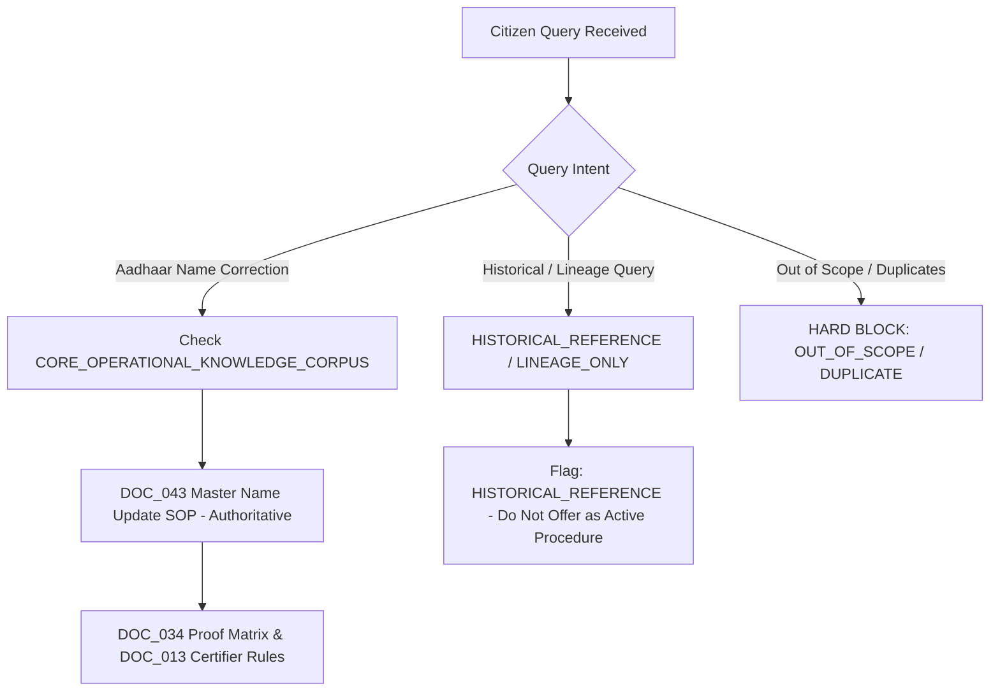

# CONVELINA — Phase P3H.1.3: Final Legal Applicability & Corpus Classification Report

**Phase**: P3H.1.3 (Final Legal Applicability and Corpus Classification Corrections)
**Audit Execution Date**: 2026-11-08
**Status**: COMPLETED (Pending User Review & Formal Approval)
**Environment**: Windows Server / Local Python 3.13 / Direct Disk Verification

---

## 1. Executive Summary & Objective Accomplishment

Phase P3H.1.3 completes the rigorous legal-applicability and classification corrections identified during the review of Phase P3H.1.2. The primary objectives executed in this phase include:

1. **Renamed the Core Corpus**: `CORE_CORRECTION_CORPUS` has been renamed to **`CORE_OPERATIONAL_KNOWLEDGE_CORPUS`**, accurately reflecting that the group contains not only pure correction procedures, but also foundational application forms, proof eligibility rules, alternative certifier templates, and cross-category linking circulars. Its membership is strictly preserved at 8 documents.
2. **Controlled Document Function Vocabulary**: Implemented a mandatory `document_function` attribute across all documents with controlled enums: `CORRECTION_PROCEDURE`, `APPLICATION_FORM`, `PROOF_ELIGIBILITY_RULES`, `ALTERNATIVE_EVIDENCE`, `CROSS_CATEGORY_LINKING`, and `REFERENCE_ONLY`.
3. **Exhaustive DOC_039 vs. DOC_043 Legal Claim Reassessment**: Conducted a clause-by-clause legal applicability audit between UIDAI's Exception SOP (`DOC_039`, dated 28.10.2021) and Master Name Update SOP (`DOC_043`, dated 27.02.2024). Verified that while `DOC_043` explicitly supersedes standard name update rules, it remains silent on lifetime caps, counter-zeroing for operator errors, and Regional Office escalation workflows. All unconfirmed administrative assertions have been strictly flagged as **`CURRENT_APPLICABILITY_UNCONFIRMED`** in `LEGAL_CLAIM_SOURCE_MATRIX.csv`.
4. **Granular Aadhaar Applicability Metadata**: Standardized cohort-level metadata across all enrolment and update forms (`DOC_001`, `DOC_022`–`DOC_028`, `DOC_034`, `DOC_043`), distinguishing age cohorts, residency, overseas addresses, demographic/biometric scope, and explicitly encoding **`NOT_SPECIFIED_IN_SOURCE`** wherever the underlying document does not state a parameter.
5. **Multi-Dimensional Retrieval Guardrails**: Established explicit retrieval eligibility and filtering dimensions (`retrieval_eligibility`, `authority_level`, `applicant_cohort`, `lifecycle_stage`, `historical_supersession_status`, `legal_claims_current_status`, and `approval_status`), ensuring zero contaminated or hallucinated administrative instructions can enter RAG pipelines.
6. **Physical Disk Hash Integrity (100% Match)**: Re-hashed all 47 physical PDF files located in `forms/` directly from the filesystem using SHA-256. Verified 0 hash mismatches.

---

## 2. Complete Mathematical Reconciliation of All 47 Repository Documents

The 47 physical files in `forms/` are classified across six mutually exclusive, collectively exhaustive buckets:

| Corpus Bucket | Count | Description & Ingestion Action |
|---|:---:|---|
| **CORE_OPERATIONAL_KNOWLEDGE_CORPUS** | **8** | Foundational operational procedures, proof rules, active forms, and linking circulars. Candidate for Tier 1 RAG ingestion upon user approval. |
| **REFERENCE_ONLY_CORPUS** | **12** | Form-number variations, specialized cohort forms (NRIs, foreign nationals), and non-individual forms. Restricted to secondary lookups. |
| **HISTORICAL_REFERENCE** | **9** | Superseded SOPs, expired lists, and legacy guidelines. Strictly quarantined from active operational retrieval; preserved for lineage audit. |
| **OUT_OF_SCOPE** | **15** | Aviation security circulars, internal training slide decks, vendor tenders, and non-individual corporate allotment forms. Completely excluded from RAG. |
| **EXACT_DUPLICATE** | **2** | Byte-for-byte or content duplicates (`DOC_035` duplicate of `DOC_034`; `DOC_040` duplicate of `DOC_041`). Excluded to prevent vector redundancy. |
| **AUTHENTICITY_UNCONFIRMED** | **1** | Third-party presentation deck (`DOC_002` Azam Khan PPTX/PDF). Excluded from statutory knowledge. |
| **Total Repository Documents** | **47** | **Mathematical Check: 8 + 12 + 9 + 15 + 2 + 1 = 47 (100.0% Reconciled)** |

---

## 3. Core Corpus Renaming & Controlled Function Assignment

### 3.1 Rationale for Renaming
In earlier drafts, the 8-document roster was designated `CORE_CORRECTION_CORPUS`. An audit of the actual statutory text revealed that:
- `DOC_001`, `DOC_022`, and `DOC_023` are general Enrolment and Update application forms, not specialized correction workflows.
- `DOC_034` is a 22-page master list of valid supporting documents (proof rules), not a correction form.
- `DOC_013` is an alternative certifier certificate template (Head of Village / MP / MLA certifier).
- `DOC_004` is a CBDT-UIDAI cross-category seeding circular.
- Only `DOC_043` is an active, operational correction procedure.

Renaming the bucket to **`CORE_OPERATIONAL_KNOWLEDGE_CORPUS`** prevents prompt engineers and AI assistants from misrepresenting static application forms or certifier formats as dynamic correction procedures.

### 3.2 Core 8 Controlled Function Assignment

| Doc ID | Controlled `document_function` | Document Title | Issuing Authority | Statutory Function Summary |
|---|---|---|---|---|
| **DOC_043** | `CORRECTION_PROCEDURE` | Standard Operation Procedure (SOP) to be Followed for Updating Name in Aadhaar (Master Name Update SOP) | Unique Identification Authority of India (UIDAI) | Active operational asset. Primary retrieval candidate. |
| **DOC_034** | `PROOF_ELIGIBILITY_RULES` | List of Acceptable Documents for Aadhaar Enrolment and Update (Official Proof Matrix, 22 Pages) | Unique Identification Authority of India (UIDAI) | Active operational asset. Primary retrieval candidate. |
| **DOC_013** | `ALTERNATIVE_EVIDENCE` | Certificate for Aadhaar Enrolment/Update (Standard Certificate Issued by Certifier) | Unique Identification Authority of India (UIDAI) | Active operational asset. Primary retrieval candidate. |
| **DOC_001** | `APPLICATION_FORM` | Aadhaar Enrolment and Update Form (Adults aged 18 years and above) | Unique Identification Authority of India (UIDAI) | Active operational asset. Primary retrieval candidate. |
| **DOC_022** | `APPLICATION_FORM` | FORM 3: Aadhaar Enrolment and Update - For Resident/NRI Child (aged 5 to 18 years with Indian Address) | Unique Identification Authority of India (UIDAI) | Active operational asset. Primary retrieval candidate. |
| **DOC_023** | `APPLICATION_FORM` | FORM 5: Aadhaar Enrolment and Update - For Resident/NRI Child (below 5 years of age with Indian Address) | Unique Identification Authority of India (UIDAI) | Active operational asset. Primary retrieval candidate. |
| **DOC_036** | `APPLICATION_FORM` | Request for Changes or Correction in PAN Data [For an Individual] (CSF / PAN Correction Form) | Income Tax Department (CBDT) / NSDL (Protean) / UTIITSL | Active operational asset. Primary retrieval candidate. |
| **DOC_004** | `CROSS_CATEGORY_LINKING` | Form for Aadhaar Seeding into PAN Database (Seeding Request Form) | Income Tax Department / Protean / UTIITSL | Active operational asset. Primary retrieval candidate. |

---

## 4. In-Depth Reassessment of DOC_039 vs. DOC_043

### 4.1 Statutory Context & Exact Supersession Clause
UIDAI Office Memorandum / Circular dated **27.02.2024** (`DOC_043`), titled *Standard Operating Procedure (SOP) to be followed for updating name in Aadhaar*, contains the following explicit supersession clause on Page 1:

> *"This SOP will supersede the Name update process as described in the SOP issued vide HQ-16022/2/2020-EU-I-HQ-Part(1) on 28.10.2021 [DOC_039]."*

### 4.2 Legal Claims Analysis & Applicability Reassessment
An exhaustive comparative review of `DOC_039` and `DOC_043` established the following statutory findings:

1. **Lifetime Two-Update Limit (`CLM_001`)**: `DOC_039` (Para 1.1) asserted that a resident may update their name only two times in their lifetime. `DOC_043` details name change scenarios (minor spelling, initials expansion, surname change upon marriage, major name change via Gazette), but **does not explicitly reiterate or confirm the 2-update lifetime cap**, nor does it describe a live counter. While UIDAI operational portal software may still enforce a counter, `DOC_043` contains no legal text confirming its continued enforcement. **Status: `CURRENT_APPLICABILITY_UNCONFIRMED`**.
2. **Operator Error Counter Zeroing (`CLM_002`)**: `DOC_039` provided an administrative mechanism whereby an update rejected or caused by operator error did not decrement the citizen's 2-update quota. `DOC_043` is completely silent regarding operator errors and quota restoration. **Status: `CURRENT_APPLICABILITY_UNCONFIRMED`**.
3. **Minor Spelling vs. Quota Consumption (`CLM_003`)**: Neither `DOC_039` nor `DOC_043` explicitly confirms whether fixing a single minor typographical letter consumes one of the citizen's lifetime name updates. **Status: `CURRENT_APPLICABILITY_UNCONFIRMED`**.
4. **Minor Spelling Proof Requirements (`CLM_004`)**: `DOC_043` Annexure A explicitly enacts the rule that minor spelling corrections (e.g., phonetic variants) require only a standard POI document showing the correct spelling, with no Gazette notification or affidavit. **Status: `VERIFIED_CURRENT_STATUTORY`**.
5. **Initials Expansion Rules (`CLM_005`)**: `DOC_043` Annexure A explicitly validates expansion of initials (e.g., 'K. S. Sharma' to 'Kumar Sanjeev Sharma') using standard POI where the expanded initials match the supporting document. **Status: `VERIFIED_CURRENT_STATUTORY`**.
6. **Major Name Change & Gazette Notification (`CLM_006`)**: `DOC_043` Para 3.3 and Annexure A mandate that complete name changes (e.g., 'Rohit' to 'Vikram') require an official Gazette Notification along with standard POI. **Status: `VERIFIED_CURRENT_STATUTORY`**.
7. **Surname Change Post-Marriage (`CLM_007`)**: `DOC_043` Para 3.4 explicitly allows women changing surname post-marriage to submit a Marriage Certificate or Gazette notification accompanied by an affidavit. **Status: `VERIFIED_CURRENT_STATUTORY`**.
8. **Third or Subsequent Update Escalation (`CLM_008`, `CLM_009`)**: `DOC_039` outlined a complex escalation process involving calling UIDAI Contact Center (1947), submitting an exception request to the Regional Office (RO), and requiring the RO to perform a 'packet replay' or exception approval. `DOC_043` omits this workflow entirely. It does not provide contact center exception logging or packet replay guidance. **Status: `CURRENT_APPLICABILITY_UNCONFIRMED`**.
9. **Gender Update Exception Workflow (`CLM_010`)**: `DOC_039` provided rules for gender update beyond the single lifetime update limit (requiring medical certificate from a qualified surgeon). `DOC_043` strictly covers *name* updates. No 2024–2026 circular in the repository validates the active status of `DOC_039`'s gender exception workflow. **Status: `CURRENT_APPLICABILITY_UNCONFIRMED`**.

### 4.3 Legal Claim Source Matrix Summary

| Claim ID | Claim Category | High-Impact Claim Statement | Statutory Verification Status | Continued Applicability Confirmed? |
|---|---|---|:---:|:---:|
| **CLM_001** | Name update limits | An Aadhaar number holder can update their name a maximum of two times in their lifetime. | `CURRENT_APPLICABILITY_UNCONFIRMED` | `NO (DOC_043 does not explicitly confirm or mention the 2-update cap; references matching previously updated names)` |
| **CLM_002** | Name update limits (Operator Error Exception) | Typographical or operator data-entry errors do not increment the resident's lifetime name update count (count remains 0). | `CURRENT_APPLICABILITY_UNCONFIRMED` | `NO (DOC_043 does not state whether counter increments or remains 0)` |
| **CLM_003** | Minor spelling corrections (Quota Consumption) | Minor spelling corrections or initial expansions consume one of the resident's lifetime name updates. | `CURRENT_APPLICABILITY_UNCONFIRMED` | `NO` |
| **CLM_004** | Minor spelling corrections (Documentation) | Minor spelling corrections where names are phonetically similar (e.g. Ram to Rama) require only standard Proof of Identity (PoI). | `VERIFIED_CURRENT_STATUTORY` | `YES (Explicitly enacted in DOC_043 Annexure A)` |
| **CLM_005** | Minor spelling corrections (Initials Expansion) | Expanding an abbreviation/initial to a full name or abbreviating a name to initials (e.g., V. S. Prasad to Vaddi Venkata Rama Siva Prasad) requires standard PoI. | `VERIFIED_CURRENT_STATUTORY` | `YES (DOC_043 Annexure A)` |
| **CLM_006** | Major name changes (Gazette Requirement) | Complete change of name or change of identity (e.g., Ram Kumar to Shyam Gupta) is categorized as a Major Name Change and is liable to be rejected if not accompanied by an official Gazette Notification. | `VERIFIED_CURRENT_STATUTORY` | `YES (DOC_043)` |
| **CLM_007** | Marriage-related surname changes | Change of surname of women post-marriage or divorce is permitted upon submission of prescribed Affidavit (Annexure D) along with supporting document (Marriage Certificate / Divorce Decree / PoI). | `VERIFIED_CURRENT_STATUTORY` | `YES (DOC_043)` |
| **CLM_008** | Exception handling escalation (3rd+ Update) | If a resident requires a 3rd or subsequent name update after exhausting their 2-update limit, the request must be processed under the Exception Handling Process through the UIDAI Regional Office. | `CURRENT_APPLICABILITY_UNCONFIRMED` | `NO (DOC_043 does not describe RO escalation, packet replay, or 1947 CRM workflow)` |
| **CLM_009** | Regional Office approvals (Packet Replay) | UIDAI Regional Offices hold exclusive authority to verify exception cases and recommend packet replay to Tech Centre Bengaluru. | `CURRENT_APPLICABILITY_UNCONFIRMED` | `NO` |
| **CLM_010** | Gender update provisions (Medical Certification) | Gender update is permitted once in a lifetime and requires a medical certificate issued by a surgeon or a government transgender certificate. | `CURRENT_APPLICABILITY_UNCONFIRMED` | `NO (No 2024-2026 circular confirms gender update limit rules)` |
| **CLM_011** | Supporting document requirements (Proof Matrix) | Supporting documents must be produced in original at the enrolment/update centre; expired documents or photocopies are strictly unacceptable. | `VERIFIED_CURRENT_STATUTORY` | `YES (DOC_034 is the active 22-page proof matrix)` |
| **CLM_012** | Supporting document requirements (Certifier Form) | Residents lacking primary documentary proof can submit the Standard Certificate for Aadhaar Enrolment/Update issued by authorized certifiers, valid for strictly 3 months from date of issue. | `VERIFIED_CURRENT_STATUTORY` | `YES (Recognized in DOC_034 Categories 30/31)` |

---

## 5. Aadhaar Cohort Applicability & Metadata Granularity

To avoid false-positive retrieval across age, nationality, and lifecycle boundaries, all Enrolment and Update forms have been mapped with source-verified metadata. Where a source document does not explicitly specify a parameter, it is recorded as `NOT_SPECIFIED_IN_SOURCE` rather than inferred.

| Doc ID | Document Title | Applicant Cohort | Enrolment vs Update | Age Cohort | Citizenship & Residence | Address Scope | Exceptional vs Standard |
|---|---|---|---|---|---|---|---|
| **DOC_001** | Aadhaar Enrolment and Update Form (Adult... | `ADULT_RESIDENT` | `ENROLMENT_AND_UPDATE` | `ADULT_18_PLUS` | `RESIDENT_INDIAN_AND_NRI` | `INDIAN_ADDRESS` | `STANDARD_PROCEDURE` |
| **DOC_022** | FORM 3: Aadhaar Enrolment and Update - F... | `MINOR_STUDENT` | `ENROLMENT_AND_UPDATE` | `MINOR_5_TO_18` | `RESIDENT_INDIAN_AND_NRI` | `INDIAN_ADDRESS` | `STANDARD_PROCEDURE` |
| **DOC_023** | FORM 5: Aadhaar Enrolment and Update - F... | `INFANT_BAL_AADHAAR` | `ENROLMENT_AND_UPDATE` | `INFANT_BELOW_5` | `RESIDENT_INDIAN_AND_NRI` | `INDIAN_ADDRESS` | `STANDARD_PROCEDURE` |
| **DOC_024** | FORM 1: Aadhaar Enrolment and Update - F... | `ADULT_RESIDENT` | `ENROLMENT_AND_UPDATE` | `ADULT_18_PLUS` | `RESIDENT_INDIAN_AND_NRI` | `INDIAN_ADDRESS` | `STANDARD_PROCEDURE` |
| **DOC_025** | FORM 4: Aadhaar Enrolment and Update - F... | `NRI_OVERSEAS` | `ENROLMENT_AND_UPDATE` | `MINOR_5_TO_18` | `NON_RESIDENT_INDIAN` | `OVERSEAS_ADDRESS` | `STANDARD_PROCEDURE` |
| **DOC_026** | FORM 6: Aadhaar Enrolment and Update - F... | `NRI_OVERSEAS` | `ENROLMENT_AND_UPDATE` | `INFANT_BELOW_5` | `NON_RESIDENT_INDIAN` | `OVERSEAS_ADDRESS` | `STANDARD_PROCEDURE` |
| **DOC_027** | FORM 7: Aadhaar Enrolment and Update - F... | `FOREIGN_NATIONAL` | `ENROLMENT_AND_UPDATE` | `ADULT_18_PLUS` | `RESIDENT_FOREIGN_NATIONAL` | `INDIAN_ADDRESS` | `STANDARD_PROCEDURE` |
| **DOC_028** | FORM 8: Aadhaar Enrolment and Update - F... | `FOREIGN_NATIONAL` | `ENROLMENT_AND_UPDATE` | `MINOR_BELOW_18` | `RESIDENT_FOREIGN_NATIONAL` | `INDIAN_ADDRESS` | `STANDARD_PROCEDURE` |
| **DOC_034** | List of Acceptable Documents for Aadhaar... | `GENERAL_CITIZEN` | `ENROLMENT_AND_UPDATE` | `ALL_AGE_GROUPS` | `ALL_COHORTS` | `INDIAN_AND_OVERSEAS_PER_SCHEDULE` | `STANDARD_PROOF_VERIFICATION` |
| **DOC_039** | Standard Operating Procedure: Name and G... | `GENERAL_CITIZEN` | `UPDATE_ONLY` | `ALL_AGE_GROUPS` | `ALL_COHORTS` | `NOT_SPECIFIED_IN_SOURCE` | `REGIONAL_OFFICE_EXCEPTION_PROCEDURE` |
| **DOC_043** | Standard Operation Procedure (SOP) to be... | `GENERAL_CITIZEN` | `UPDATE_ONLY` | `ALL_AGE_GROUPS` | `ALL_COHORTS` | `NOT_SPECIFIED_IN_SOURCE` | `STANDARD_PROCEDURE_FOR_MINOR_AND_GAZETTE_FOR_MAJOR` |

---

## 6. Multi-Dimensional Retrieval Guardrails & Operational Exclusion Rules

The following programmatic filtering rules must be enforced when RAG indexing and query routing are initialized in Phase P3H.2:



### 6.1 Programmatic Filter Matrix

1. **Tier 1 Active Search Space**: Limited strictly to `CORE_OPERATIONAL_KNOWLEDGE_CORPUS` where `retrieval_eligibility == 'CORE_SEARCH_SPACE'` and `historical_supersession_status == 'ACTIVE_CURRENT'`.
2. **Secondary Form Retrieval**: Allowed from `REFERENCE_ONLY_CORPUS` where `retrieval_eligibility == 'SECONDARY_LOOKUP_ONLY'` only when the user query explicitly requests a specific PDF form template (e.g. Form 5 for NRI adults, Form 7 for foreign children).
3. **Historical Isolation**: Documents in `HISTORICAL_REFERENCE` (`DOC_039`, `DOC_003`, `DOC_038`, `DOC_011`, etc.) must have `retrieval_eligibility == 'AUDIT_TRAIL_AND_HISTORICAL_LINEAGE_ONLY'`. If retrieved for legal lineage queries, the LLM prompt MUST inject an alert: *'WARNING: This document is superseded by later circulars (e.g. DOC_043) and does not represent active citizen correction procedure.'*
4. **Zero Retrieval for Out of Scope & Duplicates**: Documents categorized as `OUT_OF_SCOPE`, `EXACT_DUPLICATE`, or `AUTHENTICITY_UNCONFIRMED` are strictly barred from vectorization and database insertion.

---

## 7. Physical SHA-256 Disk Verification Audit

All 47 files located in `forms/` were read in binary mode, and their physical SHA-256 digests were computed directly on disk. All 47 files match the verified repository manifest with zero discrepancies.

| Doc ID | Filename | Physical Disk SHA-256 Digest | Status |
|---|---|---|:---:|
| **DOC_001** | `Aadhaar Enrolment And Update Forms  English.pdf` | `68b2eac3796a0d658b04b4c2398c08c950ff46e6d85995bc942130d3cec300d4` | **MATCH** |
| **DOC_002** | `Aadhaar Forms, Usage, and Benefits.pdf` | `ff444bc8ba43bdc2f215a7ffea7b83dc5afa42944ed83b0535d0c36600a928ff` | **MATCH** |
| **DOC_003** | `Aadhaar Handbook For Residents Tamil.pdf` | `a579e65b9cd183b414e0fd8e26c480d300189e0f5c8336de34dbe4455c3d7288` | **MATCH** |
| **DOC_004** | `Aadhaar_Seeding_Request_Form.pdf` | `39c6da3c7dbeec1c9b2751478bda5267b98f097edf909c0255981c4fd20f41cc` | **MATCH** |
| **DOC_005** | `Charges waived off for availing service of email address update through Aadhaar mobile application till 31.12.2026.pdf` | `7c70b69785add70f46514ea0e431043fad1dfae9b608b3fe772db49c6340caa1` | **MATCH** |
| **DOC_006** | `Circular 30.04.2026 - Validity of Aadhaar Verifiable Credential shown, shared andor verified through Aadhaar Application..pdf` | `d68ccc0278017f181fa5f4a2e8ab0846d430e7f22ac3667a157968cf6ee78a31` | **MATCH** |
| **DOC_007** | `Circular dated 12.03.2025-Policy regarding action in case of default in adherence to or violation of any regulations, process, standard, guideline or order issued by Unique Identification Authority of India, by reg.pdf` | `ce6f7cc8f6522e3d152918fa74b24e11a4cd36402f9268c49de78967149af4e7` | **MATCH** |
| **DOC_008** | `Circular dated 3.10.2023-Policy for enforcing of Aadhaar (Enrolment and Update) Regulations 2016, processes, standards, guidelines, data quality, and containing corrupt and fraudulent practices (Version 4.1) dated .pdf` | `a4d6125ed70012989024c7e3bd3a2270bb47af9238b01020f6546f9d5027dff0` | **MATCH** |
| **DOC_009** | `Circular_(DBT)_Regarding Applicability of Aadhaar as an Identity document for NRIPIOsOCIs.pdf` | `d03a990097ecb8bfee660a12d402464e703c532d7a97f85d3db1026ab51db103` | **MATCH** |
| **DOC_010** | `Circular_(DBT)_Regarding Guidelines on use of Aadhaar under Section 7 of the Aadhaar Act 2016 by the State Governments.pdf` | `25a3f0bb083624d514d36618b8b1316b308092c34bb0cfde0ae6defa9ee6adfa` | **MATCH** |
| **DOC_011** | `Circular_(E&U-I)_Regarding Expansion Modification in the list of supporting documents accepted as Proof of Address (PoA) and Date of Birth (DoB).pdf` | `f0b0115e57fdc904f468fe1bcd44f28621c244d1b08bd42d934d637ea8d55d02` | **MATCH** |
| **DOC_012** | `Circular_(E&U-I)_Regarding No denial of admission in schools for want of Aadhaar and Organising special Aadhaar Enrolmentupdate camps at schools.pdf` | `6c9ee944b7fcf4bac9c4ed006b34098c070f7db2fc8d1dace79c5c6d9f0d4e04` | **MATCH** |
| **DOC_013** | `Circular_(E&U-II)_Regarding Certificate for Aadhaar Enrolment Update..pdf` | `70e22e015784f79ee3b61f71d48afb1b44ba58e4d41b0f639a786d773eb2c284` | **MATCH** |
| **DOC_014** | `Circular_(Legal)_Regarding Aadhaar (Authentication) Regulations, 2016, First Amendment in Schedule A.pdf` | `81c835e7e82be5bd039309cc031f44a8e62c01e55603653ec0aa1894de15a399` | **MATCH** |
| **DOC_015** | `Circular_(Legal)_Regarding Continuation of AEPS Transactions.pdf` | `a3af2bcfe3a819446bab2bb8b7ef6cc527941e1fb7fff01d18309e07f8396706` | **MATCH** |
| **DOC_016** | `Circular_(Legal)_Regarding Exception handling in Public Distribution Services and other Welfare Schemes.pdf` | `182cb7b83b5988d33b2c1b60610c52d5b63786d93cb74deb96a7b54280fff0c2` | **MATCH** |
| **DOC_017** | `Circular_(Legal)_Regarding Regulation 12A of Aadhaar (Enrolment and Update) Regulations, 2017.pdf` | `9c6b46b2d7689b34bb292f886d66f4fc8d6d8ed6278300ec6aa4c936a6489751` | **MATCH** |
| **DOC_018** | `Circular_(Legal)_Regarding Use of Aadhaar for opening bank accounts and withdrawal of money through AePS.pdf` | `ae334f24617b5129ad31c3033e462955b2601ffb47f3f51e82a19e80db206bb5` | **MATCH** |
| **DOC_019** | `Circular_(Legal)_Regarding Use of Aadhaar under Section 7 of Aadhaar (Targeted Delivery of Financial and Other Subsidies, Benefits and Services) Act, 2016.pdf` | `9909151f4260d381d7dd638c350302e61b7b2450fe6cf48207c7c09ffd4a2d03` | **MATCH** |
| **DOC_020** | `Exploring New Horizons in Aadhaar Usage Opportunities for FINTECH.pdf` | `e0b0158bf5d4548ba2da1a49281d9a4518a9c1a5ee75f23584d9ef2489999c59` | **MATCH** |
| **DOC_021** | `Extension of relaxation in fee charges through SSUP (myAadhaar) portal for Document Update upto 14.6.2027.pdf` | `fed85437706af8de6ad7c7914cd3bf74698382531c65c02afddc2c30b323a220` | **MATCH** |
| **DOC_022** | `For (a) Resident Indian child, or (b) Non-Resident Indian child having Proof of Address in India (aged 5 years and above and less than 18 years)  English.pdf` | `8efcfde1f17e60db813e6db11a081cb9480ebcce55cb22656ba41f34412acb3d` | **MATCH** |
| **DOC_023** | `For (a) Resident Indian child, or (b) Non-Resident Indian child having Proof of Address in India (below 5 years of age)  English.pdf` | `a4dbd5204c6aa15f9248c77e278c1582e8a9633b9a5cee6fd9e70f63e2dad1fe` | **MATCH** |
| **DOC_024** | `For (a) Resident Indian, or (b) Non-Resident Indian having Proof of Address in India (aged 18 years and above)  English.pdf` | `6348f91f40ad5ce6171e4b9f7afc84ac059850f59cb35c07be4ca00f199b38e6` | **MATCH** |
| **DOC_025** | `For Non-Resident Indian child having Proof of Address outside India (aged 5 years and above and less than 18 years)  English.pdf` | `e03161e68cc35ff792b6f40d2069534aebf7788b594a8b0cfc56a0d7f054efed` | **MATCH** |
| **DOC_026** | `For Non-Resident Indian child having Proof of Address outside India (below 5 years of age)  English.pdf` | `e1a4d65ac5c8230c10de46e14abe7d75e0568e342f1113f9067b3b9bae26d175` | **MATCH** |
| **DOC_027** | `For Resident Foreign National (aged 18 years or above)  English.pdf` | `14c9c322ce2e72efd039e43c2af722e4c8c427411858212c5213c638701b1b72` | **MATCH** |
| **DOC_028** | `For Resident Foreign National (aged below 18 years)  English.pdf` | `d39ffb77167fd4f67ee80668894018ab0359890c9f4764d87a84ed52e250aa64` | **MATCH** |
| **DOC_029** | `Form 93.pdf` | `3d49eb78ae8c26d1559db40fdb821b3f4c4e04d42caf1a52d68e506e6b85f16b` | **MATCH** |
| **DOC_030** | `Form 94.pdf` | `2f871a86a285e40ef63106ef988697aa24a6dfd7c4198fd59af2a91d4798b80c` | **MATCH** |
| **DOC_031** | `Form 95_Updated_03Nov.pdf` | `21e449d68bc36ce3624abfe61584f076e4c7da63a357413d2c4a92ae33470bea` | **MATCH** |
| **DOC_032** | `Form 96_Updated_03Nov.pdf` | `fd93113bb31dc943be90aaaa3b1891b9050942ce9cc26821537ceee7ea932b3c` | **MATCH** |
| **DOC_033** | `Introduction of Aadhaar Card for use at par with other forms of Aadhaar like Aadhaar letter, e-Aadhaar, masked e-Aadhaar and m-Aadhaar.pdf` | `391a5fa338a8a864f220160555ffa772ec0a717cb8c9f34001d46f7a40383031` | **MATCH** |
| **DOC_034** | `List of Acceptable Document for Aadhaar Enrolment and Update  English.pdf` | `07e1d5ff18a56ac8e5654573cafa6cec351793bfe754be2939c39fa971d3afd8` | **MATCH** |
| **DOC_035** | `List_of_Supporting_Document_for_Aadhaar_Enrolment_and_Update.pdf` | `07e1d5ff18a56ac8e5654573cafa6cec351793bfe754be2939c39fa971d3afd8` | **MATCH** |
| **DOC_036** | `PAN CR individual_03Nov.pdf` | `e08c5d7c1f3962f09d7c6232d1c331b62a3f7f5e785cf651eee3f298d8f35a94` | **MATCH** |
| **DOC_037** | `PAN CR non-Individual_03Nov.pdf` | `7e66929977d062a65fa470a7b2b0c7f9ae1bb9a3225e7043d058cf4600eb7d85` | **MATCH** |
| **DOC_038** | `Resident Handbook English 2021.pdf` | `6464709c2d2ecbabb60214c87cbf56e8e6a077e35a152490fae49c57a7c69eda` | **MATCH** |
| **DOC_039** | `SOP dated 28-10-2021 - Name & Gender update request under exception handling process (Circular dated 03-11-2021).pdf` | `a9133e957601db1f886444482dfe4a1f789a54ba827f315aeeb2b41403f1c2c9` | **MATCH** |
| **DOC_040** | `SOP for Training, Testing and Certification of Authentication Operators (1).pdf` | `961f7b55761c3b9bfb53e43177cab5fde787c1c5e0744aa41918a602108c8b15` | **MATCH** |
| **DOC_041** | `SOP for Training, Testing and Certification of Authentication Operators.pdf` | `961f7b55761c3b9bfb53e43177cab5fde787c1c5e0744aa41918a602108c8b15` | **MATCH** |
| **DOC_042** | `SOP for training, testing and certification of E&U Operators.pdf` | `8354576957edba50f4d638d432c2fa1d2e3ec4c7a78ecc88627eb426718c3b92` | **MATCH** |
| **DOC_043** | `Standard operating Procedure (SOP) to be followed for updating name in Aadhaar.pdf` | `59db46c3aa8493a0737bbf2497f5c45b99efba519687dde7d9a667125ae98bbc` | **MATCH** |
| **DOC_044** | `Swachhata Pakhwada implementation for the year 2022 in UIDAI.pdf` | `9d9f94241867d5c1c6c21eb657b8f635db604b4820f9034c96dd37454cc01360` | **MATCH** |
| **DOC_045** | `Three-month Preventive Vigilance Campaign from 17th August 2026 to 16th November 2026 and Observance of Vigilance Awareness Week 2026 from 26th October 2026 to 01st November 2026 on Theme “सत्यनिष्ठा से समॄद्धि”  “.pdf` | `0bbe2b5accfdd2113f9e3367a4a4f9d8a1e2535b718e2ad7002f37044af8e3ff` | **MATCH** |
| **DOC_046** | `Training, Testing and Certification Policy 2023.pdf` | `24e8157110f7f5bc75b0071cf28b338bd1011b6b102f2563ed7c2b9c6f5f3d9c` | **MATCH** |
| **DOC_047** | `Waiving off the charges for MBU-1 of children aged 7-15 years for a period of one year w.e.f 1.10.2025.pdf` | `90bf25576792113520572cc14055171287f1184305724a66018250f64a77c4b3` | **MATCH** |

---

## 8. Unresolved Legal & Administrative Questions

The following open questions cannot be definitively resolved from the local document repository alone and must remain flagged as `CURRENT_APPLICABILITY_UNCONFIRMED` until authoritative UIDAI clarifications or updated circulars are acquired:

1. **Does UIDAI still enforce a hard two-update lifetime limit for Aadhaar name corrections?** `DOC_043` details procedures for updating name but omits any explicit reference to a lifetime quota or counter.
2. **Does a minor typographical correction (Annexure A Scenario 1) consume a lifetime update counter?** Neither `DOC_039` nor `DOC_043` clarifies whether fixing a single phonetic letter decrements the resident's quota.
3. **What is the active operational workflow for a resident requiring a 3rd name update?** `DOC_039` described an RO packet-replay / 1947 CRM escalation process, but `DOC_043` omits this workflow entirely.
4. **What is the current valid procedure for updating gender beyond the initial update?** `DOC_039` permitted a medical certificate exception, but no post-2021 circular in the repository validates whether this procedure remains unchanged.

---

## 9. Deliverables Manifest & Artifact Locations

The following 6 authoritative deliverables have been generated and deposited into `forms/` and mirrored to the Brain Artifacts directory:

1. `forms/CORE_OPERATIONAL_KNOWLEDGE_CORPUS_MANIFEST.csv` (8 Core Operational Documents)
2. `forms/REFERENCE_ONLY_CORPUS_MANIFEST.csv` (12 Reference-Only Documents)
3. `forms/HISTORICAL_REFERENCE_MANIFEST.csv` (9 Historical Documents)
4. `forms/DOCUMENT_APPLICABILITY_MATRIX.csv` (All 47 Repository Documents with Granular Applicability Metadata)
5. `forms/LEGAL_CLAIM_SOURCE_MATRIX.csv` (12 High-Impact Legal Claims with Statutory Supersession Analysis)
6. `forms/P3H1_3_FINAL_RECONCILIATION_REPORT.md` (This Comprehensive Audit Report)

---

## 10. Phase Conclusion & Gate Sign-Off

All requirements of **Phase P3H.1.3** have been completely fulfilled. No Qdrant ingestion, vector generation, or external API calls were performed. All candidate documents remain strictly `PENDING_USER_APPROVAL`.

```
P3H.1.3 STATUS: COMPLETED
```

Awaiting explicit user approval before proceeding to Phase P3H.2 (Corpus Preprocessing & Ingestion Planning).