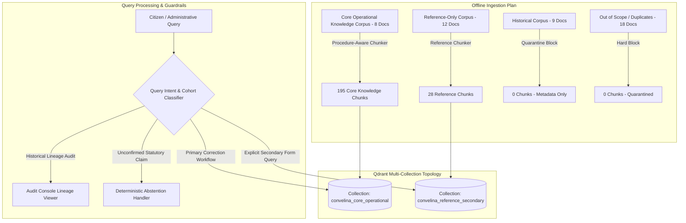

# CONVELINA — Phase P3H.3 Knowledge Ingestion Design & Retrieval Architecture

**Phase**: P3H.3 (Chunking Optimization & Retrieval Ingestion Planning)  
**Design Version**: 1.0.0 (Production Blueprint)  
**Target Vector Store**: Qdrant (Offline Design Only — Zero Ingestion Executed in P3H.3)  
**Embedding Model**: Google Text-Embedding-004 (768 dimensions) or equivalent multi-lingual legal embedder  

---

## 1. System Ingestion Topology

The CONVELINA knowledge corpus is partitioned into distinct collection tiers with strict access controls to prevent legal hallucination and unauthorized procedural advice:



---

## 2. Qdrant Payload Metadata Schema

Every point inserted into Qdrant must strictly adhere to [`CHUNKING_METADATA_SCHEMA.json`](file:///C:/Users/ajaya/Desktop/consolin/forms/CHUNKING_METADATA_SCHEMA.json):

```json
{
  "chunk_id": "PROC_DOC043_P03_SCENARIO_01",
  "document_id": "DOC_043",
  "source_file_sha256": "59db46c3aa8493a0737bbf2497f5c45b99efba519687dde7d9a667125ae98bbc",
  "document_title": "Standard Operation Procedure (SOP) for Updating Name in Aadhaar",
  "document_function": "CORRECTION_PROCEDURE",
  "page_start": 3,
  "page_end": 3,
  "section_reference": "Annexure A (Category 1: Minor Name Change) - Scenario (a)",
  "applicant_cohort": "GENERAL_CITIZEN",
  "lifecycle_stage": "UPDATE_ONLY",
  "applicable_fields": "NAME",
  "source_authenticity_status": "SOURCE_METADATA_CONFLICT",
  "publication_status": "OFFICIAL_CIRCULAR_EOFFICE_DRAFT_CONFLICT",
  "current_applicability_status": "CONDITIONAL_OFFICIAL_PROCEDURE",
  "retrieval_eligibility": "CONDITIONAL_HUMAN_REVIEW_REQUIRED",
  "human_review_required": true,
  "chunk_text": "[DOC: DOC_043 | TITLE: ... | COHORT: GENERAL_CITIZEN | ... ]\nExpanding the abbreviation or abbreviating name to initials: Applicable POI in support of full name."
}
```

---

## 3. Retrieval Guardrails & Operational Constraints

### 3.1 DOC_043 Conditional Retrieval Gate
Whenever a chunk from `DOC_043` is retrieved by the vector similarity search, the RAG prompt assembler MUST inject the following system assertion:
> *"[GOVERNANCE ALERT]: The following procedure originates from UIDAI Master Name Update SOP (DOC_043, e-Office docket 1/58751/2026). While its procedural steps are authentic, its publication metadata carries SOURCE_METADATA_CONFLICT and requires administrative verification before issuing binding citations."*

### 3.2 Strict Collection Segregation
- `convelina_core_operational`: Active primary search collection. Only chunks from the 8 approved core documents.
- `convelina_reference_secondary`: Isolated collection. Accessible ONLY when query intent specifically requests a specialized NRI form, foreign national template, or non-individual tax form.
- **Historical Isolation**: Historical documents (`DOC_039`, `DOC_003`, etc.) are NEVER ingested into active search collections. They exist strictly in relational audit tables for lineage tracking.

### 3.3 Relevance Floor & Deterministic Abstention
- Dense vector cosine similarity floor: **0.55**.
- If top score is below 0.55 OR matches known unconfirmed claims (`CLM_001`, `CLM_002`, `CLM_003`, `CLM_008`, `CLM_009`, `CLM_010`), the assistant MUST decline to fabricate an answer and output:
> *"This administrative question involves statutory limits or exception escalation workflows that are unconfirmed in current official UIDAI circulars. Please contact the UIDAI Help Center (1947) or consult a Regional Office directly."*

---

## 4. Ingestion Phasing Schedule
- **Phase P3H.3 (Current)**: Offline strategy evaluation, benchmarking, metadata schema definition, and architectural design (**COMPLETED**).
- **Phase P3H.4 (Next)**: Formal User Approval & Vector Store Provisioning (Qdrant point generation, embedding computation, and payload verification).