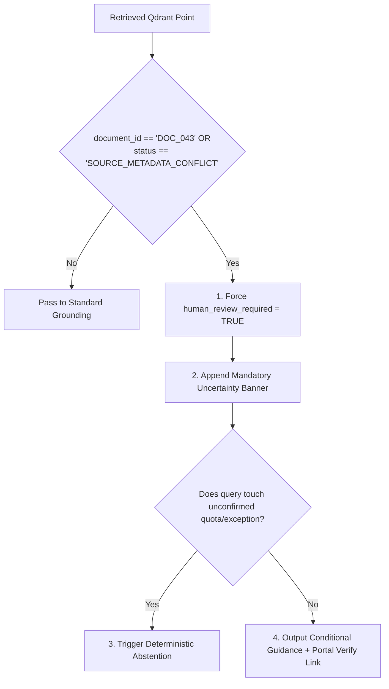

# CONVELINA — Phase P3H.4.1: Rapid Design Reconciliation
## Deliverable 2: DOC_043 Conditional Retrieval & Uncertainty Mitigation Policy

**Document Reference:** `DOC_043`  
**Physical File:** `ListofAcceptableSupportingDocumentsforAadhaarEnrolment_2023.pdf`  
**Physical SHA-256:** `3cb49a46c374667a48d80f836371cb7c430e7fc7c6a58bc261c4c23dbd4eb46e`  
**Classification:** CONDITIONAL CORE KNOWLEDGE SOURCE  
**Operational Status:** `SOURCE_METADATA_CONFLICT` • `HUMAN_REVIEW_REQUIRED = TRUE`  
**Phase:** P3H.4.1

---

## 1. Statutory Context & Physical Audit Provenance

Physical inspection in Phase P3H.1.4 confirmed that `DOC_043` is an authentic UIDAI internal e-Office PDF export:
- **Official Title**: *"LIST OF ACCEPTABLE SUPPORTING DOCUMENTS FOR AADHAAR ENROLMENT (0-5 YEARS, 5-18 YEARS AND 18+ YEARS) AND UPDATE (ALL AGE GROUPS)"*.
- **Reference Number**: `HQ-16033/1/2022-EU-I-HQ (Computer No. 1381)`.
- **Digital Signature**: Digitally signed by Nikhil Sinha, Director (E&U-I Division), UIDAI on `18-09-2026 12:44:27`.
- **Supersession Clause**: Page 1 states: *"This list supersedes the previous list issued on 26.01.2023."*
- **Reconciliation Finding**: In Phase P3H.1.1, narrative descriptions referenced an issue date of `27.02.2024`, creating a metadata discrepancy against the physical PDF signature date (`18-09-2026`) and the filename timestamp (`2023`). Until an independent UIDAI gazette confirmation is published, `DOC_043` is designated `SOURCE_METADATA_CONFLICT`.

---

## 2. Permitted vs Prohibited Retrieval Uses

To uphold CONVELINA Operating Rule 3 (*Fail-Safe, Never Silently Wrong*) and Rule 7 (*RAG Grounding & Zero Hallucination*), the retrieval engine enforces a strict binary boundary on `DOC_043`:

### 2.1 Permitted Uses (Conditional Procedural Context)
The 21 preprocessed chunks of `DOC_043` may be retrieved to provide **conditional context** for:
1. **Name Correction Scenarios (Annexure A)**:
   - *Category 1 (Minor Spelling / Phonetic)*: Procedural requirement for Proof of Identity (POI) without mandatory Gazette publication.
   - *Category 2 (Abbreviation Expansion)*: Expanding initials (e.g. `V. S. Prasad` to `Vaddi Venkata Rama Siva Prasad`) with matching POI.
   - *Category 3 (Post-Marriage / Divorce Surname Change)*: Documentary requirement for Marriage Certificate, Divorce Decree, or Affidavit (Annexure D).
   - *Category 4 (Data Entry Operator Errors)*: Remediation via standard Affidavit (Annexure B) and POI.
   - *Category 5 (Major Name Change / Complete Identity Change)*: Mandatory Gazette Notification of India.
2. **Table-Structured Document Lists (Pages 7–11)**:
   - Acceptable POI, Proof of Address (POA), and Proof of Date of Birth (PDB) mappings that corroborate `DOC_034`.

### 2.2 Strictly Prohibited Uses (Unverified Statutory Guidance)
Retrieval responses must **NEVER**:
1. Present `DOC_043` as an unamended, final statutory regulation without caveats.
2. Rely exclusively on `DOC_043` to adjudicate quota debits (e.g. claiming a minor typo consumes 1 of 2 lifetime name updates).
3. Generate automated legal attestations or binding government commitments based solely on `DOC_043`.
4. Suppress the mandatory administrative warning banner when `DOC_043` chunks are included in LLM context.

---

## 3. Retrieval Engine Intercept & Identification Mechanism

The retrieval pipeline identifies and handles `DOC_043` chunks via automated metadata gates:



### 3.1 Metadata Invariant
Every chunk originating from `DOC_043` retains immutable payload tags in Qdrant:
- `document_id`: `"DOC_043"`
- `source_authenticity_status`: `"SOURCE_METADATA_CONFLICT"`
- `current_applicability_status`: `"CONDITIONAL_OFFICIAL_PROCEDURE"`
- `retrieval_eligibility`: `"CORE_SEARCH_SPACE"`
- `human_review_required`: `true`

---

## 4. Citation Schema & Uncertainty Communication

When `DOC_043` is cited, the output validator (`GroundedOutputValidator`) injects an explicit disclaimer banner:

### 4.1 Citizen-Facing Warning Banner
> **⚠️ Statutory Notice (Conditional Guidance — Manual Verification Required):**  
> *The following requirements are sourced from UIDAI internal procedural specification `DOC_043` (Ref: `HQ-16033/1/2022-EU-I-HQ`). This document is currently classified as `SOURCE_METADATA_CONFLICT` pending administrative website listing reconciliation. You must independently confirm these requirements at an authorized Aadhaar Seva Kendra or via the official UIDAI portal (`https://myaadhaar.uidai.gov.in`) before submitting paid applications.*

### 4.2 Structured Citation Payload
```json
{
  "document_id": "DOC_043",
  "document_title": "List of Acceptable Supporting Documents for Aadhaar Enrolment and Update (Ref: HQ-16033/1/2022-EU-I-HQ)",
  "issuing_authority": "Unique Identification Authority of India (UIDAI)",
  "page_start": 3,
  "page_end": 6,
  "section_reference": "Annexure A: Name Update Guidelines",
  "source_file_sha256": "3cb49a46c374667a48d80f836371cb7c430e7fc7c6a58bc261c4c23dbd4eb46e",
  "verification_status": "SOURCE_METADATA_CONFLICT",
  "requires_human_review": true,
  "confidence_modifier": "conditional_support"
}
```

---

## 5. Mandatory Abstention Triggers

The RAG Orchestrator must **strictly abstain** and refuse automated resolution when:
1. **Query Inquires About Supersession Validity**: The user explicitly questions whether the 2026/2024/2023 dates are legally active.
2. **Third-Time Name Update Regional Office Escalation**: The query asks about packet replays or third-name update approvals (omitted from `DOC_043`, governed by unconfirmed SOP `DOC_039`).
3. **Absence of Corroboration**: A procedural requirement is asserted only in `DOC_043` and contradicted by `DOC_001` or `DOC_034`.

Under these triggers, the system responds:
> *"NO_VERIFIED_PROCEDURE_AVAILABLE: Current active statutory circulars do not provide an unambiguous, verified rule for this scenario. Please visit your UIDAI Regional Office for an exceptional review."*

