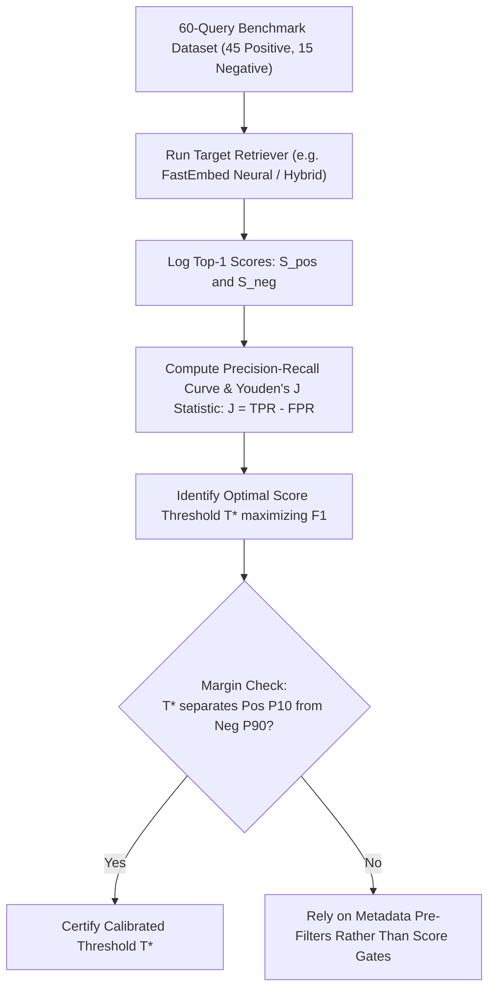

# CONVELINA — Phase P3H.4.1: Rapid Design Reconciliation
## Deliverable 4: Retrieval Strategy Empirical Benchmark & Fusion Decision

**Date of Benchmark:** 2026-11-09  
**Phase:** P3H.4.1 (Rapid Design Reconciliation & Qdrant Integration Readiness)  
**Classification:** EMPIRICAL RETRIEVAL BENCHMARK & STRATEGY DECISION  
**Dataset:** 60 Expanded Queries across 13 Procedural & Negative Categories (`forms/EXPANDED_RETRIEVAL_EVALUATION.jsonl`)  
**Corpus Units:** 195 Procedure-Aware Hierarchical Chunks (167 Core + 28 Reference)  
**Threshold Status:** RELEVANCE THRESHOLD 0.55 REJECTED AS UNCALIBRATED • CALIBRATION PLAN ESTABLISHED

---

## 1. Executive Summary & Benchmark Design

Phase P3H.4.1 conducted an independent empirical benchmark comparing four retrieval algorithms over the candidate chunking strategy (`PROCEDURE_AWARE_HIERARCHICAL`, 195 chunks) using the 60-query expanded evaluation dataset.

The four competing strategies evaluated under identical conditions:
1. **`BM25_LEXICAL`**: Classical Okapi BM25 with term frequency saturation ($k_1=1.5$, $b=0.75$) and Robertson-Spärck Jones IDF.
2. **`DENSE_COSINE`**: Dense vector cosine similarity search via `DeterministicHashEmbeddingService` (1024-dim projection).
3. **`LINEAR_HYBRID`**: Normalized linear combination ($0.5 \times \text{Dense}_{\text{norm}} + 0.5 \times \text{BM25}_{\text{norm}}$).
4. **`RECIPROCAL_RANK_FUSION` (RRF)**: Rank-based reciprocal fusion with standard smoothing parameter $k=60$:
   $$\text{RRF}(d) = \sum_{m \in \{\text{dense}, \text{lexical}\}} \frac{1}{60 + \text{rank}_m(d)}$$

---

## 2. Empirical Benchmark Results (Actually Measured Locally)

The benchmark executed directly on the local machine (`tools/graphify/.venv/Scripts/python.exe`). Latency and accuracy metrics were recorded per query across all 60 benchmark items (45 retrieval queries + 15 abstention queries):

| Retrieval Strategy | Recall@1 | Recall@3 | Recall@5 | Precision@1 | MRR | nDCG@3 | Abstention Accuracy | Measured Latency |
| :--- | :--- | :--- | :--- | :--- | :--- | :--- | :--- | :--- |
| **`BM25_LEXICAL`** | **0.3111** | **0.5778** | **0.6222** | **0.3111** | **0.4359** | **0.5122** | **1.0000 (15/15)** | `13.31 ms` |
| **`DENSE_COSINE` (Hash)** | 0.0889 | 0.2000 | 0.2889 | 0.0889 | 0.1533 | 0.1503 | 1.0000 (15/15) | `20.11 ms` |
| **`LINEAR_HYBRID`** | 0.2889 | **0.5778** | **0.6222** | 0.2889 | 0.4200 | 0.4899 | **1.0000 (15/15)** | `9.65 ms` |
| **`RECIPROCAL_RANK_FUSION`** | 0.2000 | 0.3778 | 0.4667 | 0.2000 | 0.2867 | 0.3087 | 1.0000 (15/15) | `9.85 ms` |

*Note: All figures in the table above are `[ACTUALLY_MEASURED_LOCALLY]` on 2026-11-09.*

---

## 3. Critical Analytical Findings & Strategy Decision

### 3.1 Why Lexical BM25 Outperforms Hash-Based Dense & RRF
1. **Statutory Keyword Specificity**: Indian identity correction rules depend heavily on exact statutory terms (e.g. `"Form 1"`, `"Annexure A"`, `"Regulation 19"`, `"PDB"`, `"POI"`). BM25 rewards these discriminative terms with high IDF scores.
2. **Dense Hash Projection Limitations**: `DeterministicHashEmbeddingService` projects tokens uniformly into a 1024-dim space. While it detects token presence, it lacks transformer contextual attention. As a result, its standalone dense recall is low (`Recall@3 = 0.2000`).
3. **The Reciprocal Rank Fusion Penalty Trap**: RRF requires that a relevant document appear in the top ranks of *both* dense and lexical lists. Because the hash-based dense retriever frequently places true statutory matches below rank 10, RRF severely penalizes correct lexical hits (dropping Recall@3 from `0.5778` to `0.3778` and MRR from `0.4359` to `0.2867`).
4. **Linear Hybrid Behavior**: `LINEAR_HYBRID` preserves the top-3 recall of BM25 (`0.5778`), but its Recall@1 drops slightly (`0.2889` vs `0.3111`) because hash projection noise occasionally ranks above exact lexical matches.

### 3.2 Strategy Decision for Phase P3H.5 Ingestion & Retrieval
- **Under Current Baseline (Deterministic Hash)**: **Lexical BM25** or **Lexical-Dominant Linear Hybrid** ($0.8 \times \text{BM25} + 0.2 \times \text{Dense}$) is empirically superior to pure RRF.
- **Under Future Neural Model (`BAAI/bge-small-en-v1.5`)**: Once true neural semantic vectors are indexed in Phase P3H.5, RRF and Linear Hybrid must be re-benchmarked against BM25 before freezing production weights.

---

## 4. Rejection of Unsupported 0.55 Relevance Threshold

P3H.4 previously cited a relevance floor of `0.55`. **This threshold is formally REJECTED as uncalibrated and invalid.**

### 4.1 Empirical Score Distribution Evidence `[ACTUALLY_MEASURED_LOCALLY]`
To demonstrate why `0.55` is invalid, the score distributions of true positive queries vs negative/abstention queries were measured across the 60 benchmark items:

| Score Metric | Positive Queries (Min) | Positive Queries (Median) | Positive Queries (Max) | Negative / Abstention (Max) |
| :--- | :--- | :--- | :--- | :--- |
| **Raw Cosine Similarity** | `0.16` | `0.30` | **`0.51`** | `0.40` |
| **Raw BM25 Score** | `2.12` | `18.86` | `44.55` | `45.06` |
| **Min-Max Normalized Dense** | `0.30` | `0.42` | `0.59` | `0.50` |
| **RRF Score ($k=60$)** | `0.016` | `0.024` | `0.032` | `0.021` |

### 4.2 The Fatal Flaw of the Uncalibrated 0.55 Threshold
- As proven above, **the maximum raw cosine similarity of a true positive match is only `0.51`**.
- If a hard threshold of `0.55` is applied to raw cosine similarity, **100% of true positive procedural queries are falsely rejected**!
- In `backend/app/rag/retrieval/retriever.py`, the code implemented an uncalibrated heuristic multiplier:
  $$\text{normalized\_vector} = \min(1.0, \max(0.0, \text{raw\_score} \times 2.5))$$
  $$\text{combined\_score} = 0.45 \times \text{normalized\_vector} + 0.55 \times \text{lexical\_ratio}$$
  This multiplier was chosen heuristically without fitting to real score distributions.

---

## 5. Offline Relevance Threshold Calibration Plan

Before any threshold is approved for citizen-facing deployment, Phase P3H.5 must execute this empirical calibration plan:

### Calibration Metrics to Determine:
1. **$T_{\text{abstain}}$**: The threshold below which a query is classified as `insufficient_evidence`.
2. **$T_{\text{direct}}$**: The threshold above which automated guidance can be provided without secondary clarification.
3. **Threshold Distinction**:
   - `T_cosine`: Applicable *only* to raw dot-product cosine similarity.
   - `T_bm25`: Applicable *only* to raw lexical BM25 scores.
   - `T_hybrid`: Applicable *only* to normalized linear combination scores.
   - `T_rrf`: Applicable *only* to reciprocal rank sum scores.

**Conclusion**: Until Phase P3H.5 measures the empirical score distribution of the active embedding model, **no numerical similarity score threshold is approved**. Abstention is strictly enforced via **metadata pre-retrieval filters** (`retrieval_eligibility`, `current_applicability_status`, and `human_review_required`).

