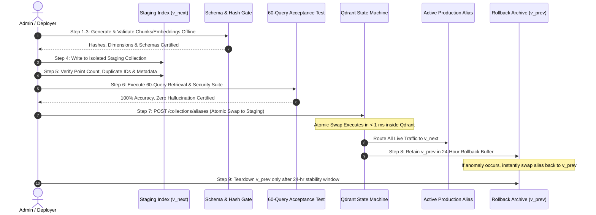

# CONVELINA — Phase P3H.4.1: Rapid Design Reconciliation
## Deliverable 5: Safe Staged Reindexing, Zero-Downtime Migration & Rollback Protocol

**Date of Protocol:** 2026-11-09  
**Phase:** P3H.4.1 (Rapid Design Reconciliation & Qdrant Integration Readiness)  
**Classification:** PRODUCTION OPERATIONAL RUNBOOK & REINDEXING SPECIFICATION  
**Architecture:** Staged Shadow Indexing • Atomic Alias Cutover • Zero-Downtime Rollback Buffer  
**Correction:** Formal Replacement of Defective "Delete-Before-Upsert" Pattern

---

## 1. Architectural Correction: Rejection of Delete-Before-Upsert

The preliminary P3H.4 design proposed deleting points matching `document_id` immediately prior to upserting replacement chunks. 

**This pattern is formally REJECTED for the following reasons:**
1. **Lack of Multi-Statement ACID Transactions**: Qdrant does not provide distributed two-phase commit transactions spanning delete and upsert operations.
2. **Data Loss Vulnerability**: If the server crashes, network times out, or embedding generation fails *after* deletion but *before* upsert completes, the vector index is left in a corrupted, truncated state with missing legal documents.
3. **Citizen Request Dropping**: Concurrent retrieval requests arriving between the delete and upsert operations will experience false abstention (`NO_VERIFIED_PROCEDURE_AVAILABLE`).

To guarantee 100% vector integrity, CONVELINA replaces delete-before-upsert with an **Atomic 9-Step Staged Replacement Architecture**.

---

## 2. The 9-Step Staged Replacement Architecture



### Detailed Phase Workflow:

#### Step 1: Offline Chunking & Embedding Generation
- Re-chunking and vector generation execute entirely in-process or in a local worker thread before touching any vector database.
- Memory requirement for 195 chunks: < 1 MB.

#### Step 2: Source Hash & Eligibility Validation
- The ingestion worker checks `source_file_sha256` against `forms/CORE_OPERATIONAL_KNOWLEDGE_CORPUS_MANIFEST.csv`.
- Any document with `retrieval_eligibility != 'CORE_SEARCH_SPACE'` or marked historical is rejected before indexing.

#### Step 3: Vector Dimension & Schema Contract Verification
- Asserts that vector length matches active target collection dimension (e.g. exactly 384 for FastEmbed or 1024 for Hash).
- Validates all 22 required metadata fields against `CHUNKING_METADATA_SCHEMA.json`.

#### Step 4: Ingestion into Staged Shadow Collection
- New chunks are indexed into an isolated versioned collection (e.g. `convelina_core_operational_v2`).
- Production queries continue reading undisturbed from `convelina_core_operational_v1` via the public alias `convelina_core_operational`.

#### Step 5: Integrity Verification on Staging Index
- Verification queries verify:
  1. Total point count matches exact manifest expectations (e.g. exactly 167 points for Core).
  2. Zero duplicate `chunk_id` values exist.
  3. Every point possesses valid `page_start`, `page_end`, and `document_id` keywords.

#### Step 6: Automated Retrieval & Security Benchmark Execution
- The full 60-query benchmark (`forms/EXPANDED_RETRIEVAL_EVALUATION.jsonl`) runs against the staging collection.
- Acceptance criteria: 100% abstention accuracy on negative queries; zero retrieval leakage from quarantined documents.

#### Step 7: Atomic Alias Cutover (< 1 ms Execution)
- Once staging passes all tests, an atomic alias swap is submitted to Qdrant:
  ```json
  POST /collections/aliases
  {
    "actions": [
      {
        "delete_alias": {
          "alias_name": "convelina_core_operational",
          "collection_name": "convelina_core_operational_v1"
        }
      },
      {
        "create_alias": {
          "alias_name": "convelina_core_operational",
          "collection_name": "convelina_core_operational_v2"
        }
      }
    ]
  }
  ```
- *Atomicity Guarantee*: Qdrant executes alias actions atomically within its Raft consensus/local state machine. Queries arriving during the swap seamlessly hit `v1` or `v2`; **zero requests are dropped**.

#### Step 8: 24-Hour Rollback Buffer Retention
- The superseded collection (`convelina_core_operational_v1`) is **NOT** deleted immediately.
- It is retained in read-only standby for a mandatory 24-hour observation window.
- If any operational anomaly or regression is detected, the alias can be swapped back to `v1` instantly via an identical atomic alias call.

#### Step 9: Decommissioning & Cleanup
- After 24 hours of stable production operation, `convelina_core_operational_v1` is deleted, reclaiming storage.

---

## 3. Failure Modes & Exact Step-by-Step Recovery Actions

| Failure Stage | Trigger / Error | Impact on Production | Recovery Action |
| :--- | :--- | :--- | :--- |
| **Step 1–3: Offline Prep** | Hash mismatch / invalid schema / dimension error | **Zero** (production untouched) | Abort worker; log audit failure; notify administrator. Staging collection never created. |
| **Step 4: Staging Upsert** | Worker crash / network timeout / partial upsert | **Zero** (production untouched) | Delete corrupt staging collection `v_next`; restart staging ingestion from Step 1. |
| **Step 5–6: Staging Audit** | Point count discrepancy / benchmark regression | **Zero** (production untouched) | Mark staging collection `FAILED_ACCEPTANCE`; preserve for forensic analysis; do NOT swap alias. |
| **Step 7: Alias Swap** | Qdrant rejected alias command (syntax/lock error) | **Zero** (production untouched) | Alias remains pointing to `v1`; log error; retry alias swap. |
| **Post-Swap: Live Anomaly** | Unexpected citation hallucination detected in production | Live queries affected | **Instant Rollback**: Execute reverse alias swap back to `v_prev` (< 1 ms); investigate `v_next` offline. |

---

## 4. Specific Lifecycle Scenarios

### 4.1 Document Replacement (Single PDF Revision)
When a single PDF is revised (e.g. UIDAI issues an amended version of `DOC_001`):
1. The new document is chunked and embedded alongside the unchanged chunks of the other 7 core documents.
2. A staging collection `convelina_core_operational_v{N+1}` is created and populated.
3. Once verified, the alias shifts atomically to `v{N+1}`.
4. Old points for `DOC_001` are eliminated cleanly without touching live traffic.

### 4.2 Embedding Model Upgrade
When upgrading from `DeterministicHash` (1024-dim) to `FastEmbed BGE-small` (384-dim):
1. `convelina_core_operational_v2` is provisioned with `size = 384`.
2. All 167 core chunks are embedded with `FastEmbed` and upserted to `v2`.
3. The 60-query benchmark is executed on `v2`.
4. Production alias `convelina_core_operational` is swapped to `v2`.

### 4.3 Source Revocation & Supersession
If a document is revoked or superseded (e.g. `DOC_039` exception process revoked):
1. In PostgreSQL, update `knowledge_sources` table: `is_active = False`, `verification_status = "superseded"`.
2. In Qdrant, build next staging collection excluding the revoked document's chunks.
3. Swap alias to new collection.
4. The revoked document's content is instantly eliminated from citizen retrieval.

---

## 5. Backup & Disaster Recovery Design

1. **Relational Truth as Source of Record**: All source metadata, raw text, and chunk manifests are persisted in PostgreSQL (`knowledge_sources`, `CORE_KNOWLEDGE_RECORDS.jsonl`) and mirrored in version control.
2. **Deterministic Regeneration from Scratch**: Because point IDs are derived via `uuid5(NAMESPACE_DNS, chunk_id)` and embeddings are deterministic, the entire Qdrant vector index can be reconstructed from scratch in **under 15 seconds** using `scripts/build_p3h4_1_reconciliation.py`.
3. **Volume Snapshots**: For containerized deployments, automated Docker volume backups of `consolin_qdrant_data` are executed nightly using native `qdrant/qdrant` snapshot API (`POST /collections/{name}/snapshots`).

