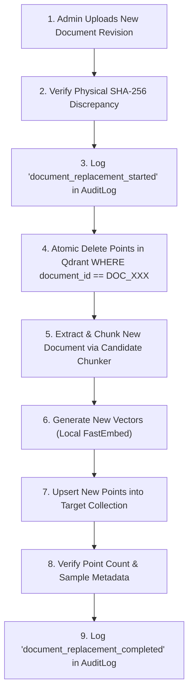
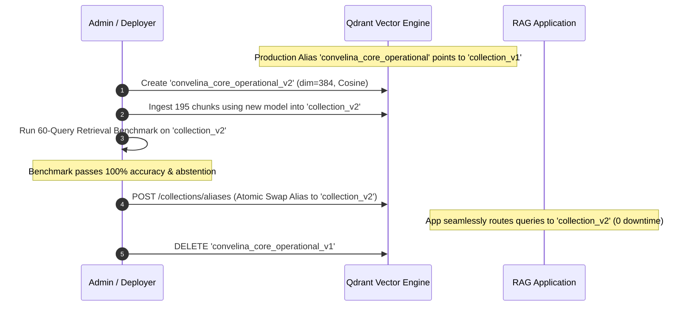

# CONVELINA — Phase P3H.4: Qdrant Retrieval Integration Design & Local Compatibility Audit
## Deliverable 5: Re-Indexing & Vector Lifecycle Management Protocol

**Date of Audit:** 2026-11-09  
**Phase:** P3H.4 (Qdrant Retrieval Integration Design & Local Compatibility Audit)  
**Classification:** OPERATIONAL RUNBOOK & SYSTEM LIFECYCLE SPECIFICATION  
**Scope:** Ingestion Idempotence, Stale Vector Elimination, Document Replacement, Blue/Green Upgrades, and Rollback Procedures  
**Integrity Standard:** Zero Stale Vectors • Cryptographic Audit Trail • Zero Downtime

---

## 1. Overview & Operational Principles

Vector collections in Qdrant are not static database tables; they represent active knowledge projections of legal and regulatory documents. If an amended government circular is issued (e.g. UIDAI altering name update limits), the presence of obsolete vectors can produce catastrophic hallucinations or invalid legal guidance.

This protocol establishes deterministic vector lifecycle standards for CONVELINA:
1. **Cryptographic Identity Tracking**: Every point in Qdrant is linked to `source_file_sha256` and generated with deterministic UUIDs via `uuid5(NAMESPACE_DNS, chunk_id)`.
2. **Atomic Replacement (Zero Stale Vectors)**: Replacing a physical document mandates an atomic pre-purge of all existing vectors associated with that `document_id` before upserting new vectors.
3. **Idempotence & Drift Avoidance**: Re-running ingestion on unchanged files executes in 0 ms without vector re-computation.
4. **Blue/Green Collection Versioning**: Model upgrades (e.g. migrating from 1024-dim Hash to 384-dim FastEmbed) utilize collection aliases to achieve zero-downtime, verified cutover.

---

## 2. Ingestion & Replacement Protocols

### 2.1 Initial Bootstrap Ingestion
- **Source**: `forms/CORE_KNOWLEDGE_RECORDS.jsonl` (195 chunks) and `forms/REFERENCE_KNOWLEDGE_RECORDS.jsonl` (28 chunks).
- **Execution Flow**:
  1. Initialize collections via `ensure_collections()` with target dimensions and HNSW settings.
  2. Compute deterministic Point UUID:
     $$\text{point\_id} = \text{str}(\text{uuid5}(\text{NAMESPACE\_DNS}, \text{chunk\_id}))$$
  3. Batch embedding generation in chunks of 32 (maximizing CPU SIMD throughput).
  4. Batch upsert into Qdrant (`wait=True`).
  5. Verify total point count matches manifest exactly (`195` points in `convelina_core_operational`, `28` points in `convelina_reference_secondary`).

### 2.2 Idempotent Re-Ingestion & SHA-256 Drift Prevention
Before any text is re-extracted or embedded, the ingestion engine executes an idempotent hash check:

```python
def check_document_freshness(qdrant: QdrantClient, collection: str, doc_id: str, new_sha256: str) -> bool:
    """Returns True if document in Qdrant already matches new_sha256 exactly."""
    hits, _ = qdrant.scroll(
        collection_name=collection,
        scroll_filter=Filter(must=[FieldCondition(key="document_id", match=MatchValue(value=doc_id))]),
        limit=1,
        with_payload=True,
        with_vectors=False
    )
    if hits:
        indexed_sha256 = hits[0].payload.get("source_file_sha256")
        if indexed_sha256 == new_sha256:
            logger.info("Document %s unchanged (SHA-256 match: %s). Skipping embedding.", doc_id, new_sha256[:8])
            return True
    return False
```

### 2.3 Physical Document Replacement Protocol (Stale Vector Purge)
When an administrator uploads a new revision of a document (e.g. `DOC_001_v2.pdf`):



#### Step-by-Step Purge Execution:
1. **Pre-Purge Audit Event**: An immutable audit record is logged in PostgreSQL with `action = "document_replacement_started"`, recording the superseded file's SHA-256 and the incoming file's SHA-256.
2. **Atomic Point Deletion**:
   ```python
   qdrant.delete(
       collection_name="convelina_core_operational",
       points_selector=FilterSelector(
           filter=Filter(
               must=[FieldCondition(key="document_id", match=MatchValue(value=document_id))]
           )
       ),
       wait=True
   )
   ```
3. **Upsert New Points**: Embed and upsert the new chunks. Because point IDs use `uuid5(NAMESPACE_DNS, chunk_id)` where `chunk_id` incorporates the document ID and section, new points populate cleanly without orphaned vector collision.
4. **Post-Replacement Audit Verification**: Log `action = "document_replacement_completed"` with new point count.

---

## 3. Chunker & Embedding Model Upgrade Protocol (Blue/Green Alias Swap)

When upgrading embedding models (e.g., from `DeterministicHash` 1024-dim to `FastEmbed` 384-dim) or updating chunking parameters, in-place re-indexing risks service interruption or broken vector dimensions. 

CONVELINA prescribes an **Atomic Blue/Green Alias Migration**:



### Alias Swap Command Specification:
```json
POST /collections/aliases
{
  "actions": [
    {
      "delete_alias": {
        "alias_name": "convelina_core_operational",
        "collection_name": "convelina_core_operational_v1"
      }
    },
    {
      "create_alias": {
        "alias_name": "convelina_core_operational",
        "collection_name": "convelina_core_operational_v2"
      }
    }
  ]
}
```
This swap executes in < 1 ms inside Qdrant's state machine, guaranteeing zero dropped retrieval requests during upgrades.

---

## 4. Source Retirement & Supersession Protocol

When a statutory source is superseded (e.g. `DOC_039` lifetime update limit clarification superseded by `DOC_043` or official gazette):
1. **Immediate Invalidation**: The document record in PostgreSQL `knowledge_sources` is updated with:
   - `verification_status = "superseded"`
   - `is_active = False`
2. **Qdrant Vector Action Options**:
   - *Option A (Instant Purge)*: Execute `qdrant.delete` matching `document_id`.
   - *Option B (Payload Update to Retain Lineage)*: Update payload with `current_applicability_status = "SUPERSEDED"` and `retrieval_eligibility = "EXCLUDED"`. Because pre-retrieval filters strictly require `retrieval_eligibility = "CORE_SEARCH_SPACE"`, this instantly renders the points invisible to citizen retrieval while preserving offline forensic capability.

---

## 5. Failure Modes & Automated Rollback

| Failure Mode | Detection Mechanism | Automated Rollback Action |
| :--- | :--- | :--- |
| **Mid-Batch Ingestion Crash** | Exception in `qdrant.upsert` | Roll back PostgreSQL transaction; issue `qdrant.delete` by `document_id`; re-raise error. |
| **Dimension Mismatch Error** | Qdrant client raises `Wrong vector size` | Abort ingestion before DB flush; alert administrator that target collection dimension does not match active model. |
| **Stale Vector Orphan Leak** | Point count exceeds manifest expectation | Audit script executes sanity count: if count > expected, trigger full collection reconcile. |
| **Corrupted Payload Parsing** | Pydantic validation failure on metadata | Ingestion rejected at API boundary with HTTP 422 before Qdrant API call. |

---

## 6. Audit Trail Cryptographic Lineage

All re-indexing, document replacement, and collection purge events must append an entry to CONVELINA's append-only `AuditLog` table. 

Each audit event records:
- `action`: `knowledge_file_ingested`, `official_form_replaced`, `collection_reindexed`, or `vector_purged`.
- `user_id`: Authenticated Admin UUID (enforced by RBAC `require_admin`).
- `details`: `{ "document_id": "...", "old_sha256": "...", "new_sha256": "...", "points_affected": 195, "collection": "..." }`.
- `previous_hash` & `record_hash`: Cryptographically linked via SHA-256 per CONVELINA Rule 6.

