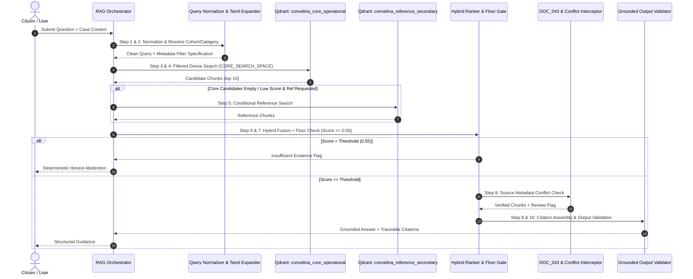

# CONVELINA — Phase P3H.4: Qdrant Retrieval Integration Design & Local Compatibility Audit
## Deliverable 4: Retrieval Integration Contract & Lifecycle Specification

**Date of Audit:** 2026-11-09  
**Phase:** P3H.4 (Qdrant Retrieval Integration Design & Local Compatibility Audit)  
**Classification:** SYSTEM SPECIFICATION & INTERFACE CONTRACT  
**Scope:** 10-Step Retrieval Sequence, Pre-Retrieval Filter Push-Down, Hybrid Scoring, DOC_043 Intercept, and Citation Schema  
**Grounding Standard:** Zero Hallucination • Mandatory Floor Enforcement • Cryptographic Traceability

---

## 1. Architectural Overview

The Retrieval Integration Contract governs all interactions between citizen queries, conversation context, Qdrant vector collections, and response generation in CONVELINA. 

To prevent hallucinations, source leakage, or outdated advice, retrieval does not execute as an unconstrained similarity search. Instead, it proceeds through an immutable **10-Step Deterministic Retrieval Pipeline**:



---

## 2. The 10-Step Retrieval Pipeline Specification

### Step 1: Query Normalization & Statutory Term Expansion
- **Action**: Lowercases text, strips extraneous punctuation, and filters non-informative conversational stop words (`"how"`, `"do"`, `"i"`, `"my"`, `"what"`).
- **Tamil / Multilingual Mapping**: Detects Unicode range `\u0B80-\u0BFF` and maps Tamil legal terminology (e.g. "பெயர்" $\to$ "name", "ஆதார்" $\to$ "aadhaar", "திருத்தம்" $\to$ "correction", "பான்" $\to$ "pan", "பிறந்த தேதி" $\to$ "dob") into bilingual search tokens.

### Step 2: Cohort & Identity Category Resolution
- **Action**: Inspects authenticated case context (`ResolutionContext`) and user question to determine:
  - Target Identity Category: `aadhaar`, `pan`, `passport`, `class_10`, `class_12`, `epf`.
  - Applicant Cohort: `ADULT_RESIDENTS_18_PLUS`, `MINORS_UNDER_18`, `NRI_RESIDENTS`, `ALL_RESIDENTS`.
  - Lifecycle Stage: `UPDATE_CORRECTION`, `NEW_ENROLMENT`, `DOCUMENT_UPDATE`.

### Step 3: Pre-Retrieval Qdrant Filter Construction (Push-Down)
- **Action**: Builds strict Qdrant filter conditions pushed down to the Qdrant query engine:
  ```python
  Filter(
      must=[
          FieldCondition(key="document_category", match=MatchValue(value=resolved_category)),
          FieldCondition(key="retrieval_eligibility", match=MatchValue(value="CORE_SEARCH_SPACE")),
          FieldCondition(key="human_review_required", match=MatchValue(value=False)),
      ],
      should=[
          FieldCondition(key="applicant_cohort", match=MatchValue(value=resolved_cohort)),
          FieldCondition(key="applicant_cohort", match=MatchValue(value="ALL_RESIDENTS")),
      ]
  )
  ```
- **Invariant**: This push-down filter guarantees that zero historical, reference-only, or out-of-scope chunks ever enter the top-k candidate pool.

### Step 4: Core Operational Vector Search
- **Target Collection**: `convelina_core_operational`.
- **Query Vector**: Generated via local `FastEmbed` (384-dim) or `DeterministicHash` (1024-dim).
- **Limits**: `limit = top_k * 2` (e.g., fetch 10 raw candidates for hybrid re-ranking).
- **Qdrant Internal Score Threshold**: `score_threshold = 0.05` (prevents evaluating negative or orthogonal noise vectors).

### Step 5: Conditional Reference-Only Fallback
- **Trigger Condition**: Activated *only* if:
  1. Core operational retrieval returns zero candidates passing score floor `0.55`, OR
  2. The user query explicitly contains historical lineage keywords (`"old rule"`, `"superseded"`, `"previous notification"`, `"background"`).
- **Target Collection**: `convelina_reference_secondary`.
- **Constraint**: Chunks retrieved from this secondary collection are marked with a mandatory banner:
  > *"Notice: The following information is from reference/guidance circulars and does not constitute primary operational procedure."*

### Step 6: Hybrid Lexical-Dense Fusion
- **Score Computation**:
  $$\text{combined\_score} = 0.45 \times \text{normalized\_vector\_score} + 0.55 \times \text{lexical\_ratio}$$
  where:
  $$\text{normalized\_vector\_score} = \min(1.0, \max(0.0, \text{raw\_cosine\_score} \times 2.5))$$
  $$\text{lexical\_ratio} = \min\left(1.0, \frac{\text{matched\_statutory\_tokens}}{\max(\text{len}(\text{query\_tokens}), 1)}\right)$$
- **Deduplication**: Chunks sharing identical `(document_id, section_reference)` are collapsed, preserving the highest-scoring chunk.

### Step 7: Relevance Floor & Deterministic Abstention Gate
- **Enforcement**: If the top-scoring candidate has $\text{combined\_score} < 0.55$:
  - The pipeline immediately halts response generation.
  - Returns `confidence = "insufficient_evidence"`.
  - Sets `answer = "NO_VERIFIED_PROCEDURE_AVAILABLE: The official knowledge corpus does not contain verified statutory guidance for this query."`
  - Yields zero citations (preventing citation hallucination).

### Step 8: DOC_043 & Quarantined Claim Intercept
- **Condition**: If any chunk originates from `DOC_043` or carries `source_authenticity_status = "SOURCE_METADATA_CONFLICT"`:
  - The orchestrator injects an administrative warning banner:
    > *"⚠️ Administrative Notice: This procedure references UIDAI document DOC_043 which is currently undergoing source metadata reconciliation. Manual verification with the UIDAI portal is required."*
  - Sets `requires_human_review = True`.

### Step 9: Cryptographically Grounded Citation Assembly
- Every retrieved evidence item assembled into the context prompt must map to an immutable schema:
  - `document_id`: Canonical document identifier (e.g. `DOC_001`).
  - `document_title`: Full official publication title.
  - `issuing_authority`: Full government department name.
  - `page_reference`: `page_start` to `page_end`.
  - `section_reference`: Exact section, heading, or table ID.
  - `source_file_sha256`: Byte-level SHA-256 hash of physical PDF.

### Step 10: Output Synthesis & Grounding Verification
- **Output Validator (`GroundedOutputValidator`)**:
  - Compares all citations in the LLM/template output against the actual retrieved chunks.
  - Automatically strips any hallucinated citations not present in the retrieved chunk list.
  - Validates that resolution steps align with the official forms catalog.

---

## 3. Data Interface Schemas (Pydantic / JSON)

### 3.1 Retrieval Query Context Schema

```json
{
  "$schema": "http://json-schema.org/draft-07/schema#",
  "title": "RetrievalQueryContext",
  "type": "object",
  "required": ["query", "document_category"],
  "properties": {
    "query": { "type": "string", "minLength": 3 },
    "document_category": { 
      "type": "string", 
      "enum": ["aadhaar", "pan", "passport", "class_10", "class_12", "epf"] 
    },
    "applicant_cohort": { 
      "type": "string", 
      "default": "ALL_RESIDENTS",
      "enum": ["ALL_RESIDENTS", "ADULT_RESIDENTS_18_PLUS", "MINORS_UNDER_18", "NRI_RESIDENTS"] 
    },
    "lifecycle_stage": { 
      "type": "string", 
      "default": "UPDATE_CORRECTION" 
    },
    "top_k": { "type": "integer", "default": 5, "minimum": 1, "maximum": 10 },
    "allow_reference_fallback": { "type": "boolean", "default": false }
  }
}
```

### 3.2 Grounded Citation Schema

```json
{
  "$schema": "http://json-schema.org/draft-07/schema#",
  "title": "GroundedSourceCitation",
  "type": "object",
  "required": [
    "document_id",
    "document_title",
    "issuing_authority",
    "page_start",
    "page_end",
    "section_reference",
    "source_file_sha256",
    "score"
  ],
  "properties": {
    "document_id": { "type": "string", "pattern": "^DOC_[0-9]{3}$" },
    "document_title": { "type": "string" },
    "issuing_authority": { "type": "string" },
    "page_start": { "type": "integer", "minimum": 1 },
    "page_end": { "type": "integer", "minimum": 1 },
    "section_reference": { "type": "string" },
    "source_file_sha256": { "type": "string", "minLength": 64, "maxLength": 64 },
    "score": { "type": "number", "minimum": 0.0, "maximum": 1.0 },
    "requires_human_review": { "type": "boolean", "default": false }
  }
}
```

