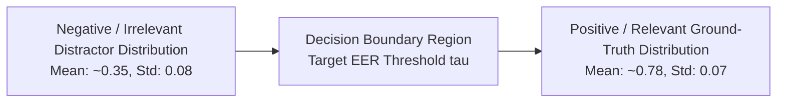

# CONVELINA — Dense Similarity Threshold Calibration & Evaluation Protocol

**Phase**: P3H.3.1 (Chunking Benchmark Integrity & Retrieval Safety Validation)  
**Status**: Methodological Policy Blueprint (Offline Planning Only)  
**Threshold Approval Status**: **UNAPPROVED (Pending Live Vector Evaluation in Phase P4)**  

---

## 1. Clear Separation of Lexical and Semantic Ranking

> [!IMPORTANT]
> **Policy Clarification**: BM25 lexical benchmark scores **do not validate or calibrate a cosine similarity threshold of 0.55**. BM25 scores are unbounded ($0$ to $+\infty$) and reflect exact term frequency and inverse document frequency. In contrast, dense cosine similarity scores are bounded within $[-1, 1]$. Claiming that a 0.55 threshold is justified by BM25 benchmark metrics is mathematically invalid. Dense thresholds must remain strictly unapproved until empirical vector embedding testing is performed.

---

## 2. Dense Similarity Calibration Methodology

When dense vector embeddings are generated in Phase P4, the following offline calibration protocol must be executed before selecting a production similarity cutoff:

### 2.1 Calibration Dataset Construction
The calibration dataset will consist of 200 probe pairs:
1. **100 Positive Pairs $(Q_i, C^+_i)$**: Real citizen and administrative queries paired with their ground-truth chunk.
2. **100 Negative Distractor Pairs $(Q_i, C^-_i)$**:
   - 40 High-Lexical Distractors (e.g. query on Aadhaar name matching an aviation security circular with overlapping words).
   - 30 Cross-Cohort Distractors (e.g. adult query matching minor Bal Aadhaar form).
   - 30 Unconfirmed Legal Questions (queries regarding `CLM_001`–`CLM_003`, `CLM_008`–`CLM_010`).

### 2.2 Score Distribution Analysis
For each candidate dense embedding model (e.g., Google Text-Embedding-004, BGE-Large-EN, Legal-BERT):
1. Compute cosine similarity scores for all positive pairs: $S^+ = \{ \cos(\vec{q}_i, \vec{c}^+_i) \}$.
2. Compute cosine similarity scores for all negative pairs: $S^- = \{ \cos(\vec{q}_i, \vec{c}^-_i) \}$.
3. Generate probability density distributions $P(s | \text{Relevant})$ and $P(s | \text{Irrelevant})$.

### 2.3 Error Rate Optimization & Metric Calculations
At every threshold candidate $\tau \in [0.30, 0.90]$ with step $0.01$:
- **False Acceptance Rate (FAR)**:
  $$\text{FAR}(\tau) = \frac{|\{s \in S^- \mid s \ge \tau\}|}{|S^-|}$$
- **False Rejection Rate (FRR)**:
  $$\text{FRR}(\tau) = \frac{|\{s \in S^+ \mid s < \tau\}|}{|S^+|}$$
- **Equal Error Rate (EER)**: The point where $\text{FAR}(\tau) \approx \text{FRR}(\tau)$.
- **F1-Score at Threshold $\tau$**:
  $$F_1(\tau) = \frac{2 \cdot \text{Precision}(\tau) \cdot \text{Recall}(\tau)}{\text{Precision}(\tau) + \text{Recall}(\tau)}$$

---

## 3. Multi-Tier Retrieval Policy

Rather than a single hard cutoff, CONVELINA will enforce a tri-band retrieval policy:

| Similarity Band | Threshold Condition | System Routing Behavior |
|---|---|---|
| **Band 1: High-Confidence Retrieval** | $s \ge \tau_{\text{high}}$ | Directly feed chunk context into LLM generator; require source citation. |
| **Band 2: Ambiguous / Clarification Band** | $\tau_{\text{low}} \le s < \tau_{\text{high}}$ | Trigger user clarification prompt: *'Did you mean Aadhaar adult correction or minor Bal Aadhaar?'* |
| **Band 3: Deterministic Abstention Band** | $s < \tau_{\text{low}}$ | Hard abstention. Decline to answer to prevent hallucination. |

---

## 4. Per-Category Threshold Sensitivity

Calibration must report separate optimal thresholds across document categories:
1. **Proof of Identity / Address Lists (`DOC_034`)**: Requires higher threshold ($pprox 0.65–0.70$) due to dense item listings and short phrases.
2. **Procedural Circulars (`DOC_043`)**: Moderate threshold ($pprox 0.55–0.62$) supported by rich scenario text.
3. **Forms & Applications (`DOC_001`, `DOC_022`, `DOC_036`)**: Bound by cohort pre-filtering (`applicant_cohort == user_cohort`).

> [!IMPORTANT]
> **Final Acceptance Mandate**: No production threshold is locked in Phase P3H.3.1. Selection of $\tau_{\text{high}}$ and $\tau_{\text{low}}$ is formally deferred to Phase P4 live embedding benchmarking.