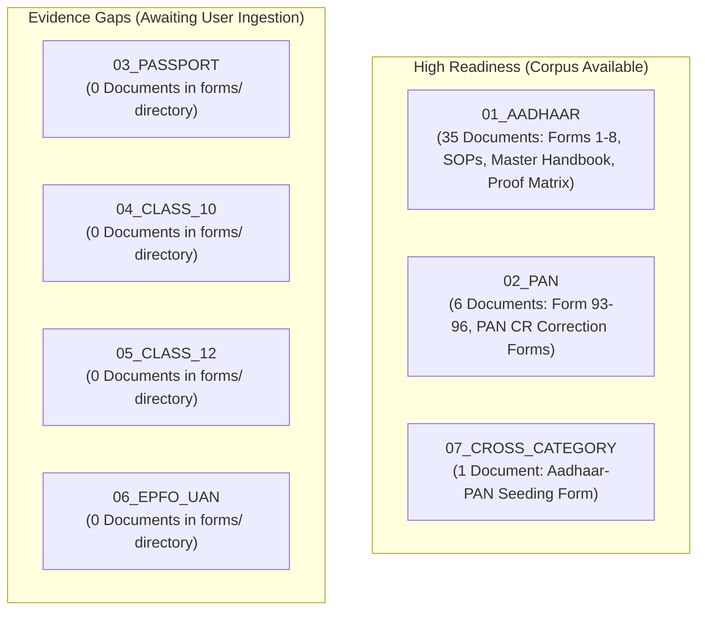

# CONVELINA — Source Corpus Readiness & Evidence Gap Report (Phase P3H.0)

**Date of Audit:** November 8, 2026  
**Auditor:** Antigravity Autonomous Pair Programmer  
**Objective:** Independent assessment of corpus readiness across CONVELINA's six statutory categories before Phase P3H.1 RAG ingestion.

---

## 1. Readiness Assessment by Statutory Category

### Category 1: Aadhaar Card (`01_AADHAAR`)
- **Status:** **FULLY READY FOR PHASE P3H.1 INGESTION**
- **Available Assets:** 35 documents.
  - Complete form suite: Form 1 (Adults), Form 2 (Child 5-18), Form 3 (Child <5), Form 4 (NRI Child 5-18), Form 5 (NRI Child <5), Form 7 (Foreign Adult), Form 8 (Foreign Minor), and Gazetted Officer Certificate.
  - Authoritative procedures: Master Name Update SOP (`DOC_043`), Name & Gender Exception Handling SOP for limit exhaustion (`DOC_039`), Master 22-page Acceptable Proof Matrix (`DOC_034`), and Resident Handbooks (English & Tamil).
  - Regulatory orders: Fee waivers, Section 7 guidelines, school admission protections.

### Category 2: PAN Card (`02_PAN`)
- **Status:** **HIGH READINESS (CORE FORMS PRESENT)**
- **Available Assets:** 6 documents.
  - Statutory Correction Form: `PAN CR individual_03Nov.pdf` (The central document for PAN clerical changes).
  - Allotment Forms: Form 93 (Individual Citizen), Form 94 (Company), Form 95 (Foreign Citizen), Form 96 (Foreign Entity).
  - Correction Form: PAN CR Non-Individual.
- **Gap:** Missing NSDL / Protean e-filing manual circular detailing supporting document rules for surname change post-marriage.

### Category 3: Cross-Category Reconciliation (`07_CROSS_CATEGORY`)
- **Status:** **OPERATIONAL**
- **Available Assets:** `Aadhaar_Seeding_Request_Form.pdf` for PAN-Aadhaar linkage.

---

## 2. Identified Evidence Gaps (Categories 3, 4, 5, 6)

The initial repository audit revealed that the user's `forms/` directory contains **zero official files** for four of CONVELINA's Tier 1 categories:

| Missing Category | Current Status in `forms/` | Expected Official Documents Required in Next Phase |
| :--- | :---: | :--- |
| **03_PASSPORT** | **0 Documents** | Passport Seva Application Form, Annexure E (Deed Poll / Sworn Affidavit for Name Change), Annexure D (Minor declaration), MEA Name Change Advisory Circular 2024. |
| **04_CLASS_10** | **0 Documents** | CBSE Examination Bye-Laws Rule 69 (Correction in Name / Date of Birth), State Board Correction Proforma, School Principal Attestation Format. |
| **05_CLASS_12** | **0 Documents** | CBSE Senior School Certificate clerical correction guidelines, Gazette notification proforma for major educational certificate change. |
| **06_EPFO_UAN** | **0 Documents** | Authentic EPFO Joint Declaration Form (Standard 3-column proforma), EPFO SOP on Member Profile Rejection & Correction Circular 2024. |

*(Note: Files named `Form 93`, `Form 94`, `Form 95`, and `Form 96` were initially suspected of being EPFO forms, but textual inspection proved they are Income Tax Department PAN forms under Rule 158.)*

---

## 3. Recommendations & Next Steps

1. **Do Not Ingest into Qdrant Yet:** Adhere to the strict boundary that Phase P3H.0 is discovery and organization only.
2. **Phase P3H.1 Scope:** When the user provides the missing official documents for Passport, Class 10, Class 12, and EPFO, conduct identical discovery, SHA-256 verification, and placement into `03_PASSPORT/`, `04_CLASS_10/`, `05_CLASS_12/`, and `06_EPFO_UAN/`.
3. **Quarantine Retention:** Retain `09_IRRELEVANT_QUARANTINE` (3 files) and `10_DUPLICATES_REVIEW` (2 files) securely without deleting.
